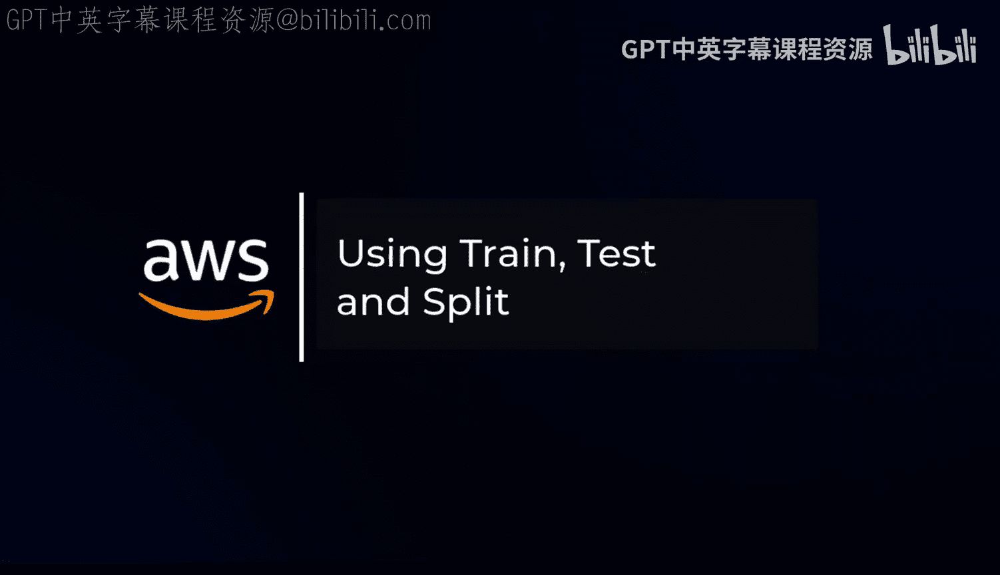
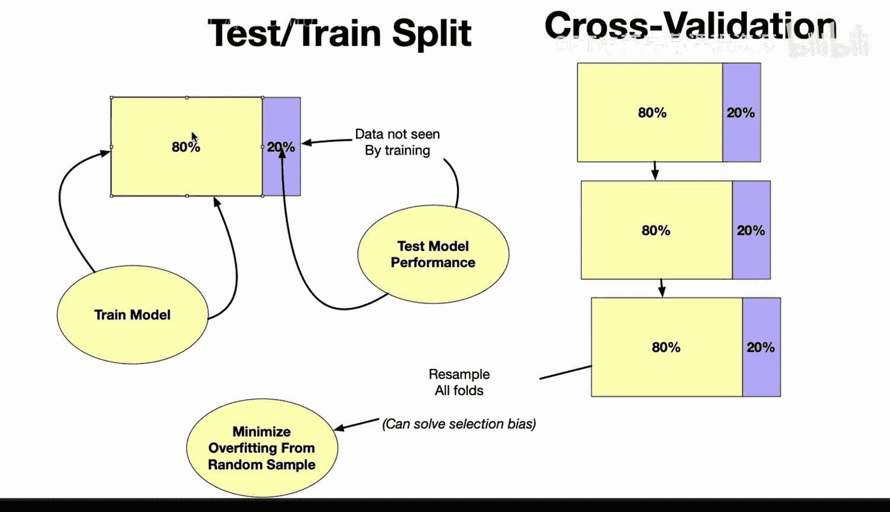
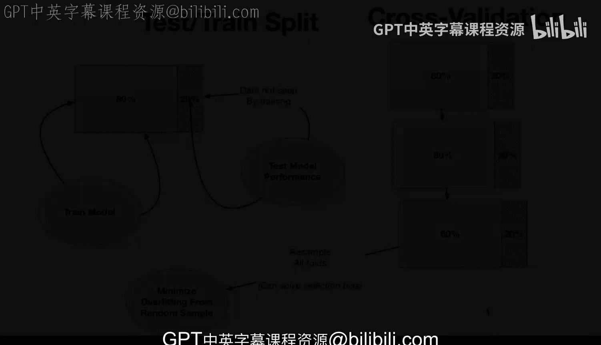

# 杜克大学｜机器学习运维｜DevOps⧸DataOps、Azure、MLFlow和抱脸｜MLOps ｜ Machine Learning Operations p106 29_03_05_使用训练-测试-分割方法.zh_en -BV1yE421c7uA_p106-

A core competency for doing machine learning is to understand the testtrain split and an easy way to think about this is that you're going to divide the data into an 8020 rule。

 so 80% of the data will be used to train the model and that will be randomly selected and you'll use this data to come up with your best accuracy by tweaking hyperparameters and selecting the correct model。

And then you'll hold out this 20% so that it's not being used to train the model。

 then you'll test your model performance。 So what will happen here is you'll get a more realistic understanding of how your model will perform in the real world。

Once you get into this scenario， though， you still could have some overfitting problems because this randomly selected data could be subject to selection bias。

 right， what if you randomly selected data that's too similar to itself， which could happen。

 So one of the ways that you could solve this problem is by using cross validation and you could take many different folds of the data and split those into 80。

20 splits， for example， and then resample all those folds together and use that as the solution。

 So this doesn't guarantee that you will fix a problem with overfitting。

Or even that there is a problem with overfitting， but if there is an issue with selection bias。

 this could be one of the solutions that you use to solve it。

 so it is worth trying out cross validation if you notice that you're getting an overfitting problem and again the core intuition here is that you could have had an improper。

A selection of your data， and that could be causing overfitting and cross validation could help solve it。

