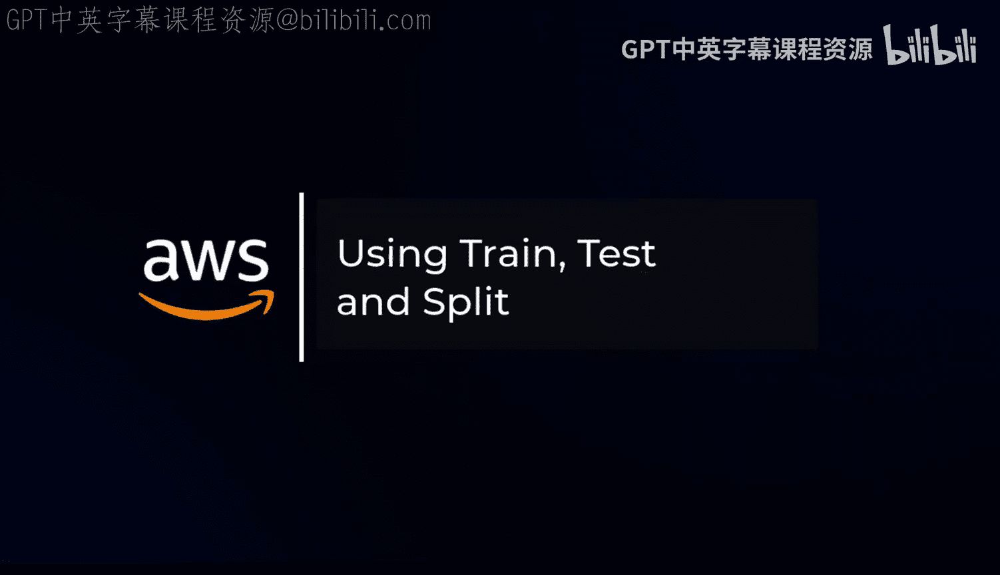
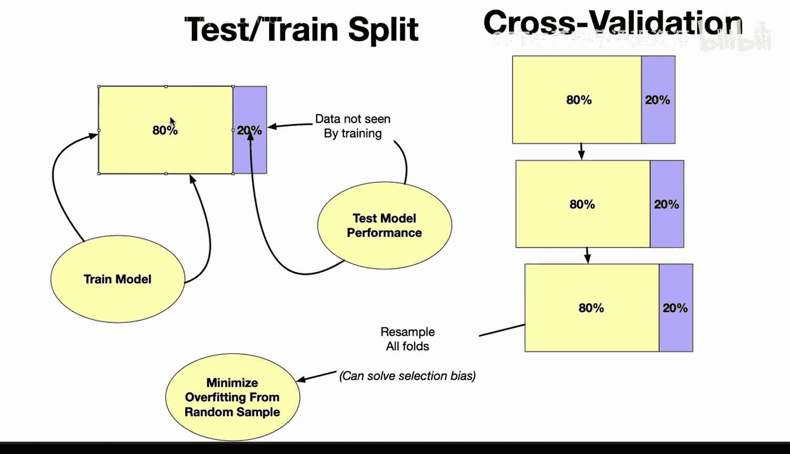
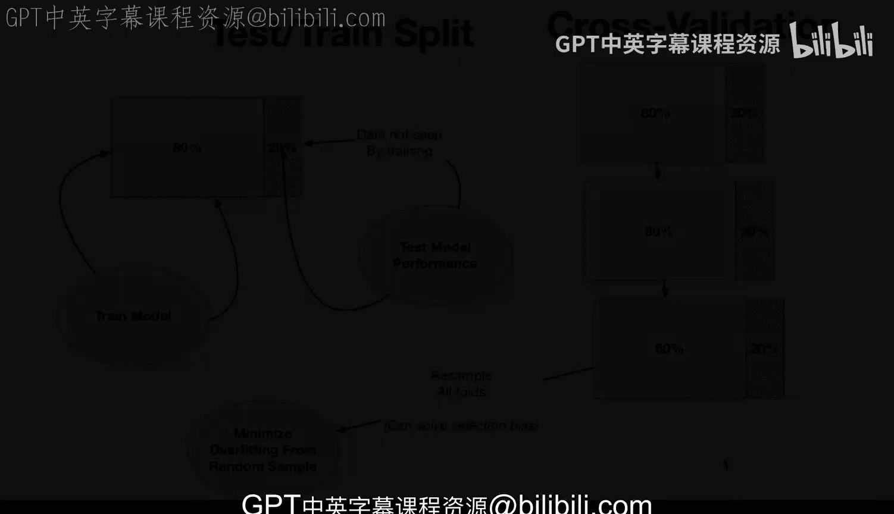

# 机器学习运维：106：使用训练-测试-分割方法 📊



在本节课中，我们将要学习机器学习中的一个核心概念：训练-测试-分割方法。我们将探讨如何将数据集划分为训练集和测试集，以及这种方法如何帮助我们评估模型的真实性能。同时，我们也会了解其潜在的局限性，并介绍交叉验证作为一种可能的解决方案。

---

## 核心概念：训练-测试-分割

机器学习的一项核心能力是理解训练-测试-分割。一个简单的理解方式是，你将按照80/20规则来划分数据。

**公式表示：**
`总数据集 = 训练集 (80%) + 测试集 (20%)`

这意味着80%的数据将被随机选择出来，用于训练模型。你将通过调整超参数和选择正确的模型，利用这部分数据来获得最佳准确率。

然后，你会保留这20%的数据，使其不参与模型训练过程。

---

## 评估模型性能

上一节我们介绍了如何划分数据，本节中我们来看看如何使用测试集。接下来，你将用这20%的测试集来评估模型的性能。

这样做的好处是，你能更真实地了解模型在现实世界中的表现。

---

## 潜在的过拟合问题

然而，即使采用了这种方法，你仍然可能面临过拟合的问题。因为随机选择的数据可能存在选择偏差。

例如，如果你随机选择的数据彼此之间过于相似，这种情况就可能发生。

---

## 解决方案：交叉验证

为了解决这个问题，你可以使用交叉验证。以下是交叉验证的基本思路：

你可以将数据分成许多不同的“折”，例如，将每一折都按80/20的比例进行划分。

然后，重新采样所有这些折，并将它们组合起来作为解决方案。

**代码示例（概念性描述）：**
```python
# 伪代码：K折交叉验证
将数据分为K个相等的部分（折）
对于 i 在 范围(K) 内：
    将第 i 折作为测试集
    将剩余的 K-1 折作为训练集
    在训练集上训练模型
    在测试集上评估模型
最终性能 = 所有K次评估结果的平均值
```

这并不能保证一定能解决过拟合问题，甚至不能保证一定存在过拟合问题。但如果确实存在选择偏差的问题，交叉验证可以作为一种解决方案。

因此，如果你发现模型存在过拟合问题，尝试交叉验证是值得的。其核心直觉在于，你的数据划分可能不当，这可能导致过拟合，而交叉验证有助于解决这个问题。



---

## 总结



本节课中我们一起学习了训练-测试-分割方法。我们了解到，将数据按比例（如80/20）划分为训练集和测试集，是评估模型泛化能力的基础步骤。同时，我们也认识到随机分割可能引入选择偏差和过拟合风险，而交叉验证是应对这些潜在问题的有效技术之一。掌握这些概念对于构建稳健的机器学习模型至关重要。