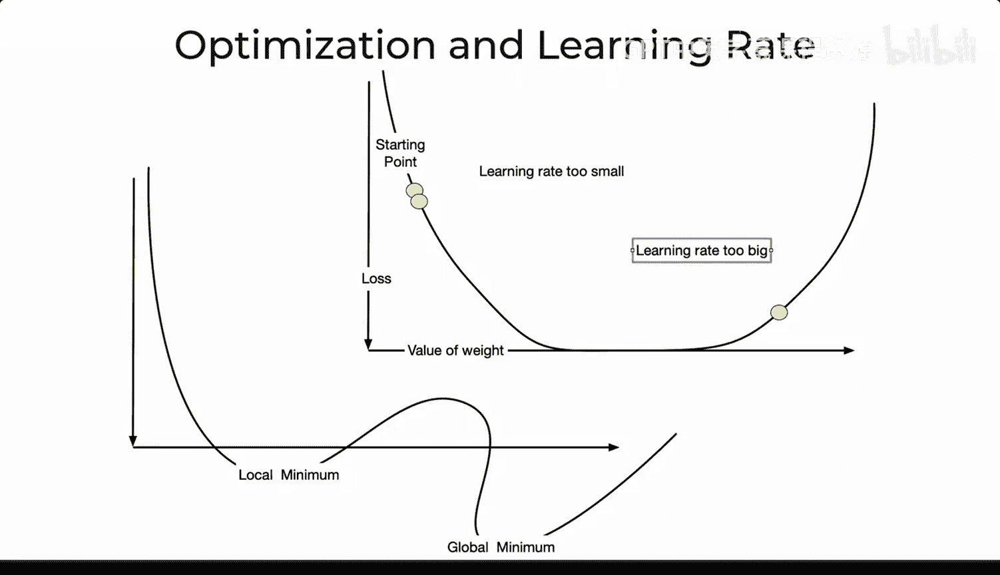

# 杜克大学｜机器学习运维｜DevOps⧸DataOps、Azure、MLFlow和抱脸｜MLOps ｜ Machine Learning Operations p107 30_03_06_解决优化问题.zh_en -BV1yE421c7uA_p107-

One of the foundational problems in deep learning is this concept of。Optimizing。

 and let's take a look at a few different scenarios here that explain this principle。

When you're trying to solve for a problem， there are local minia and global minia。

 And if you get stuck in a local minia。You're not going to get the the ultimate best solution。

 So in this scenario here， if you're slowly descending down。

And you get stuck inside of this local minima。Then you won't eventually get to this global minima down here and get the best possible solution。

 which reduces the error rate of the classification problem you're trying to solve， for example。

 one of the intuitions behind this is to think about walking down a mountain in the dark。

 you could get stuck in a lake somewhere halfway down the mountain that's the local minima。

 but if you get to the very bottom， then that would be the global mini。

Another way to think about this problem is to think about the problem of gradient descent。

Which is that you're building a loss function that you want to get better and better accuracy。

 you want to reduce the loss。And eventually， you need to get into the learning race or how much do you learn？

As you're moving down to find the global minimum， if you set a learning rate that's too small。

 then it'll take forever to get to the solution， to get to the global minimum。

 if you take a learning rate that's too big right here。

 you bounce over past and shoot past the global minimum。

 So one of the things to consider when you when you're solving deep learning problems is this learning rate and you can actually find out what your learning rate is by trial and error and a really good tool for that is to use the Tensor flow playground and it gives you a great starting point to play around with learning rates and also experimenting with loss functions。

