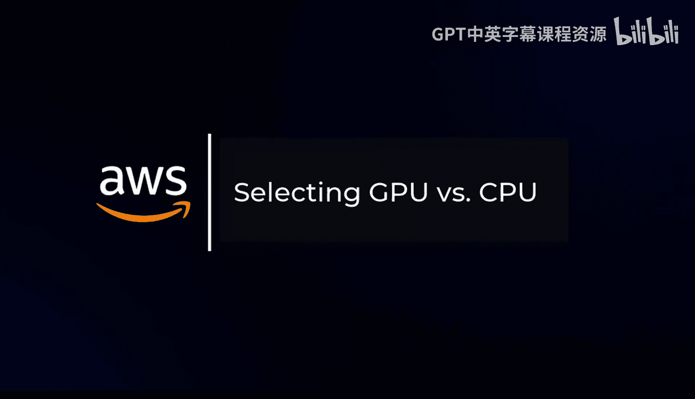
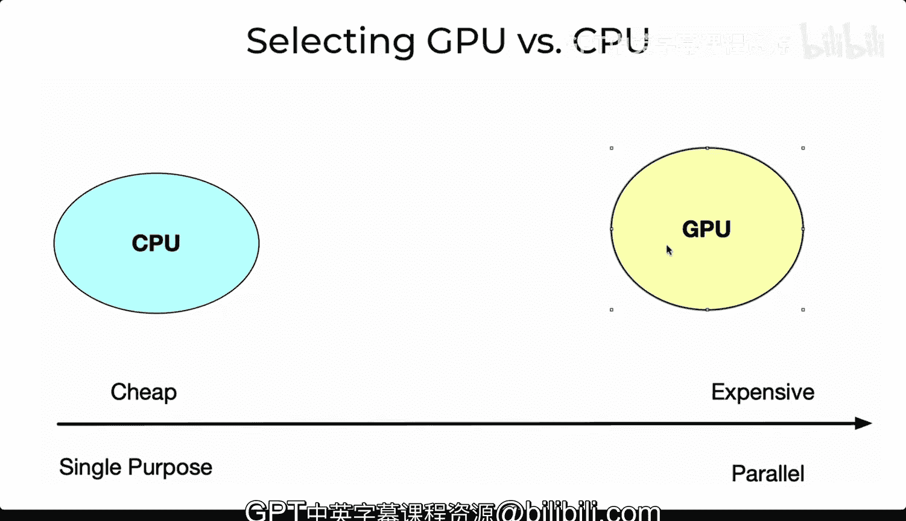

# 杜克大学｜机器学习运维｜DevOps⧸DataOps、Azure、MLFlow和抱脸｜MLOps ｜ Machine Learning Operations p108 31_03_07_选择GPU与CPU.zh_en -BV1yE421c7uA_p108-

Here， let's talk about how to select a GPU versus GPU for the training job that you're running or for the inference job。

 First， let's take a look at a CPU here。 It is a cheap and single purposebu chip And so what this means is that it's great for doing things like opening up spreadsheets but it's less great for doing parallel processing because it's not designed to be parallel on the other hand a GPU has high density So it's designed to be parallel but it has a higher cost and the higher cost allows you to do things in parallel。

 So there's a tradeoff here between a CPU and a GPU and it really depends on what kind of problem you're trying to solve how fast you want to solve it and really this is one of the things to consider is if you can use a CPU maybe time isn't something that you care about。

 it can be done， let's say in batch and it's not urgent a CPU could be a good choice if you need it to be a very perform。

 You're doing huge parallel operation than a GPU could be a good choice because it。

Speed up the amount of time it takes to train something or the inference time。

