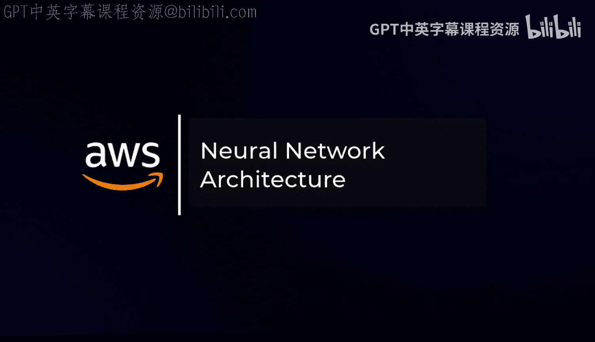
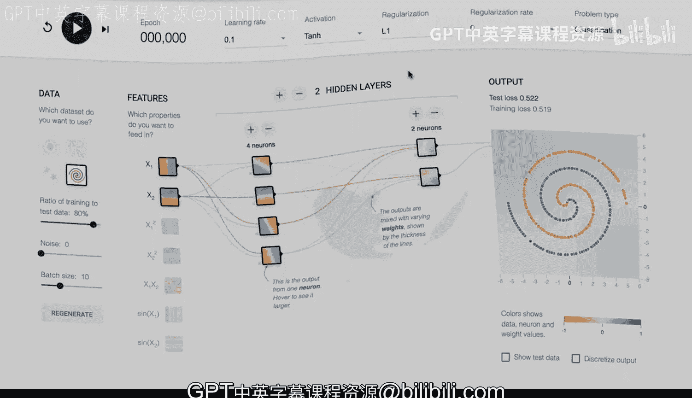

# 杜克大学｜机器学习运维｜DevOps⧸DataOps、Azure、MLFlow和抱脸｜MLOps ｜ Machine Learning Operations p109 32_03_08_神经网络架构.zh_en -BV1yE421c7uA_p109-

Great way to learn more about the intuition behind neural networks is to play with the playground。

tensorflow。org tool。 And here we see that we've got a data set selected that has two distinct classes and we have a couple features here。

 and we have some neurons here in one layer， and we have another hidden layer with another couple of neurons here。

 and we can see the test loss。And the training loss。 So if I wanted to start training this model。

 you can see here this is the learning rate， and eventually it starts to figure out the difference between these two classes。

 but I do have a little bit of overfitting here because of this test loss。

 So one of the things that I could do。I I could try to apply some other hyperparameter tuning so I could change the learning rate to potentially find the solution a little bit quicker and I also could tweak the regularization to prevent overfitting but first let's try the learning rate here and see if that changes things and we can see here it did appear to converge a little bit quicker by changing the learning rate and look there's actually a little bit less test loss as well so it's able to get to a better solution a little bit quicker now what happens if I go through and I add a little bit of regularization which would help it generalize and we go here we can see that in fact it doesn't appear to do that much to the problem but the core idea here is that by you playing around with the hyperparameters here and toggling between different data sets and running this it's a great way to figure out the intuition around some of the things that you're doing。

as well as swap out how much test data you're using， try different data sets。

 really get an intuition around the way that a neural network works。

