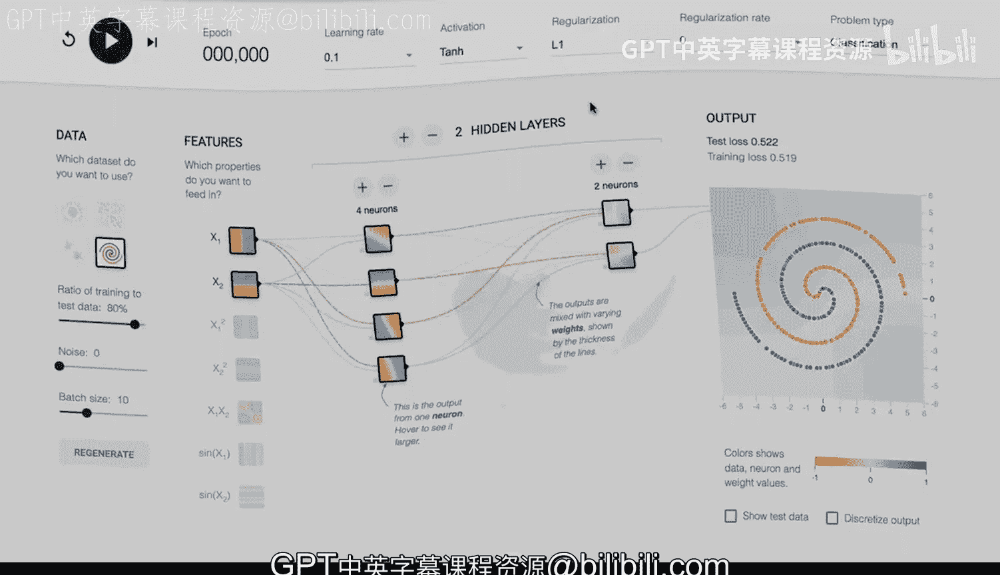

# 机器学习运维：109：神经网络架构探索 🧠

在本节课中，我们将通过一个交互式工具来直观地理解神经网络的工作原理。我们将学习如何调整超参数，并观察这些调整如何影响模型的训练过程和性能。

---

探索神经网络背后原理的一个绝佳方法是使用 TensorFlow 的交互式工具。下图展示了该工具的界面。

界面上，我们选择了一个包含两个明显类别的数据集。这里有几个特征可供使用。神经网络包含一个隐藏层，其中有几个神经元，以及另一个隐藏层，也包含几个神经元。我们可以实时看到测试损失和训练损失的变化。

## 模型训练与观察

现在，如果我们开始训练这个模型，可以看到这里有一个控制学习率的参数。随着训练进行，模型逐渐开始区分这两个类别。

然而，这里出现了一点过拟合的迹象，因为测试损失较高。

## 超参数调优

为了解决过拟合问题，我们可以尝试调整其他超参数。例如，我们可以改变学习率，以可能更快地找到解决方案。我们也可以调整正则化参数来防止过拟合。

首先，让我们尝试调整学习率，看看效果如何。

通过改变学习率，模型收敛的速度似乎快了一些。同时，测试损失也略有降低。这意味着模型能够更快地找到一个更好的解决方案。

## 应用正则化

接下来，如果我们添加一点正则化来帮助模型更好地泛化，会怎么样呢？

我们调整正则化参数后，发现它对当前问题的改善效果似乎不明显。但这里的核心思想是，通过手动调整这些超参数，并在不同数据集之间切换、运行实验，是理解你正在做的事情背后原理的绝佳方式。

## 进一步探索

你还可以尝试调整测试数据的使用比例，或者尝试不同的数据集。这能帮助你真正建立起对神经网络工作方式的直觉。

---

本节课中，我们一起学习了如何利用交互式工具直观探索神经网络的架构。我们实践了通过调整**学习率**和**正则化**等超参数来观察模型训练与泛化效果的变化。这种方法能有效帮助初学者建立对神经网络工作原理的直观理解。