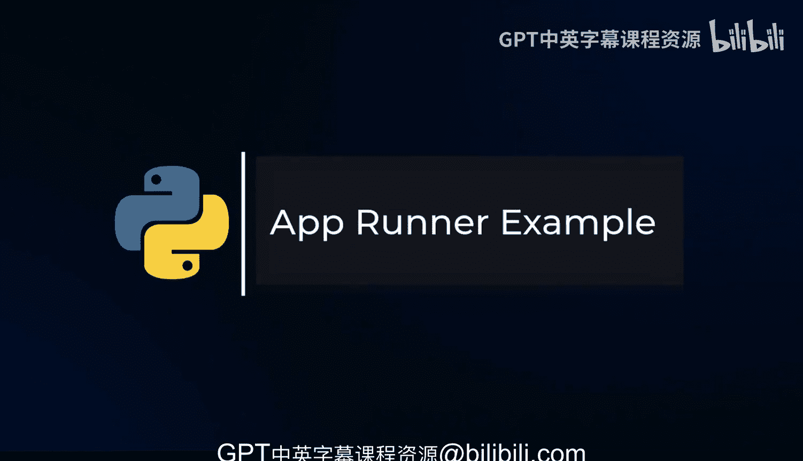
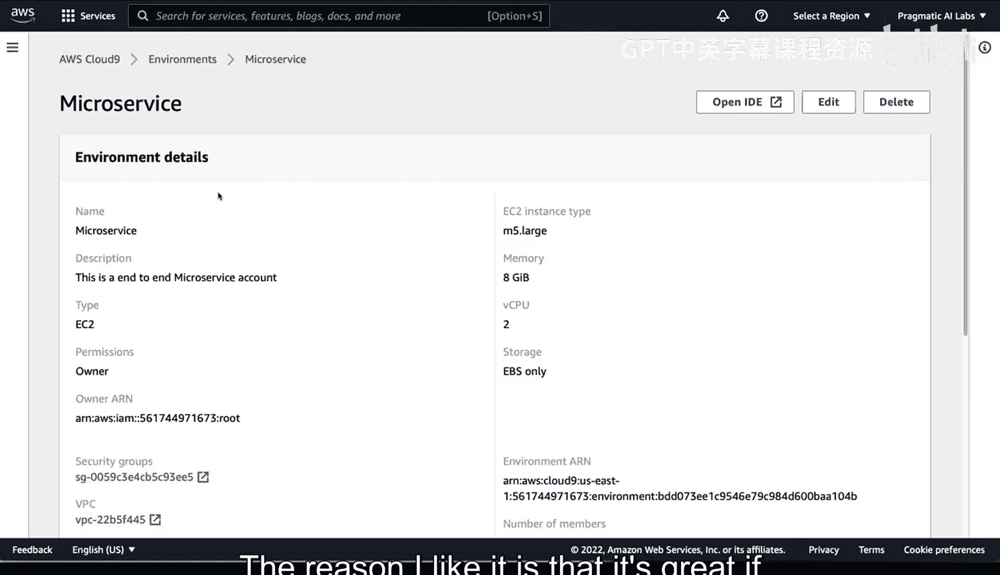
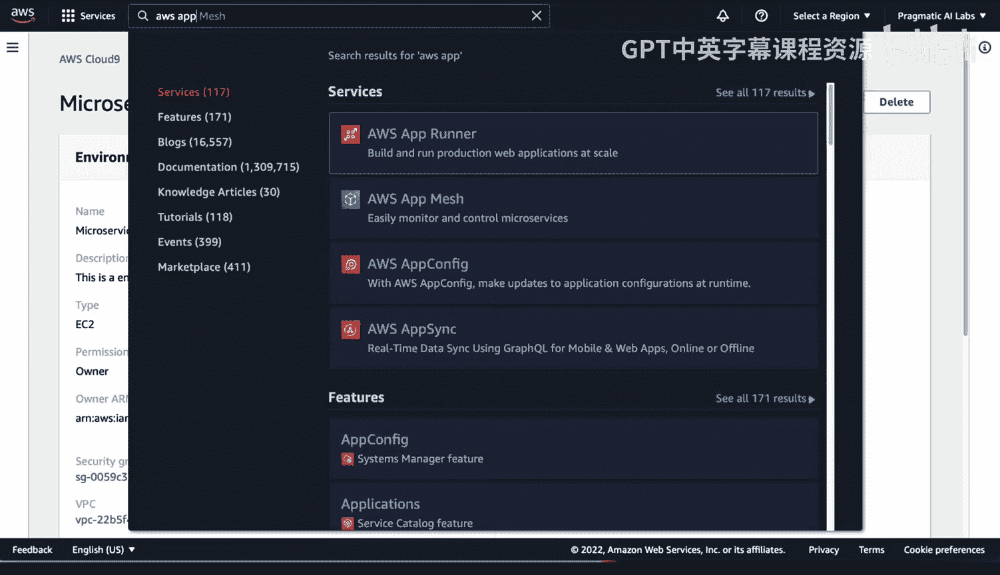
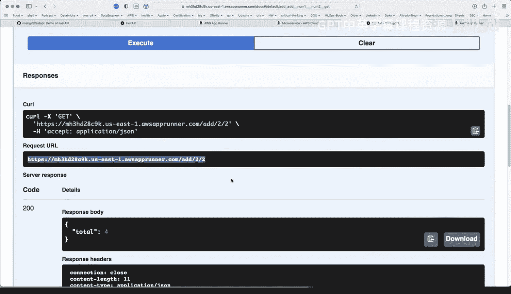
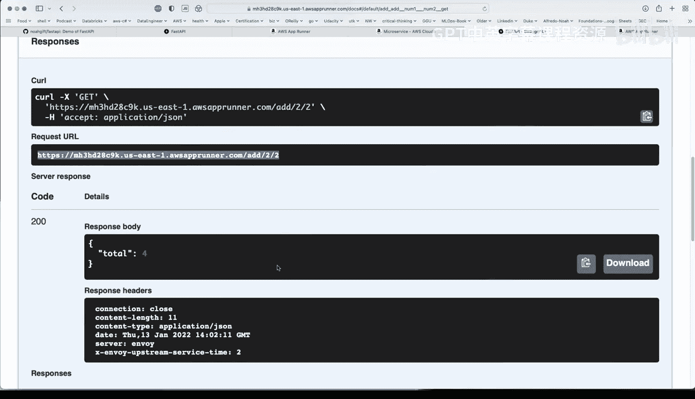
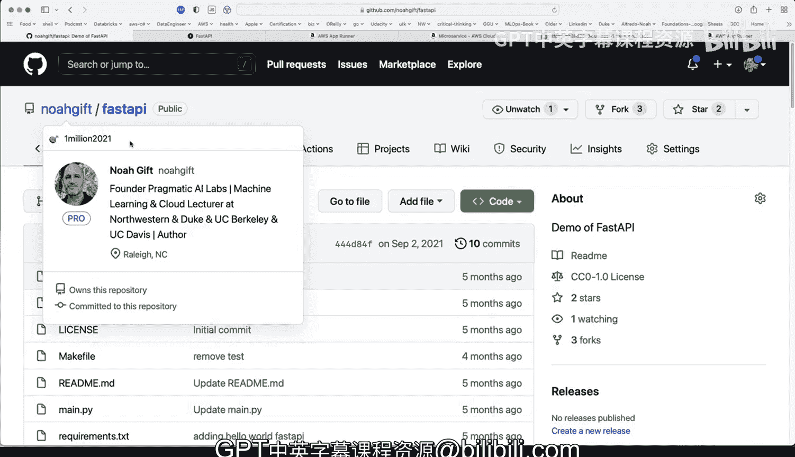

# 杜克大学｜机器学习运维｜DevOps⧸DataOps、Azure、MLFlow和抱脸｜MLOps ｜ Machine Learning Operations p11 18_01_05_App-Runner示例.zh_en -BV1yE421c7uA_p11-

Okay， I have a repo here， NOAAgi fast API and it's using the fast API framework and if I take a look at this real quick we look at a fast API you can see it's a very popular framework that has a lot of good things into it。

 including the ability to do typing as well as integrated swagger and it's very simple and you can see some of the key features so let's go ahead and use this fast API framework notice that I have some documentation here on how to use a containerized version as well。

 but I'm going to start off with a really simple environment I use AWS cloud9 The reason I like it is that it's great if I'm going to deploy a microservice to the AWS cloud platform and we're actually going to use AWS apprunner which is an emerging nice microservice framework deployment hosting from AWS。

And what's nice about apprunners， you can see I have a bunch of apps here running。

 So let's go ahead and get started and let's take a look at this environment here。

 I've got 80bus cloud 9 setup。 I have a Python virtual environment。

 You can see it's reference right here and I like to have a scaffolding of my project let me go and look at this make file I like to have an install a test a format and a Li。

 I think this is a great idea。 and I also use the Github actions here to go through here and make sure that I test my code automatically So this is called continuous integration。

 I highly recommend you do it as well again you can take a look at this in NoAgift fast API repo So the next thing I'm gonna do is I'm going run this microservice here let's go ahead and take a look at it first I say from fast API import fast API I have a hello world route here。

 I say hello Duke this is from a course I'm teaching at Duke and cloud computing and then I have a ad here。

We have two numbers that are added together and we return back the total and then this thing hosts it on external interface on port 8080 so to run it very straightforward。

 I just say Python main。Once I see the into the directory， which is the microservice directory。

 type in Python main。There we go。 It's running。 What's nice now is I can just open up a new terminal over here and I can just curl whatever appears in the output。

 This is a great thing to know about in a terminal based environment。

 we go through here and we say this great， it's working。

 And then if I want to test the endpoint I can add。

 let's say two and2 right and we can see this works So now that I've got this thing running。

 how can we hook this up into the AWS apprunner environment。 Fortunatelyly。

 it's very straightforward。😊，What I'm going to do is I'm going to say create a service and you can do this。

 which I have the documentation for in the repo， I'm going to select source code repository。

I'm going to go ahead and pick this repository， which again isOAA gift FastS API。

 so we'll give it a second to load and once this thing is able to find those repositories。

 I can select it and then use that as the source for my deployment。Here we go， so we've got。

A lot of reos， but I'm going to scroll down here to fast API。Which is。Rights。Here， fast API， perfect。

 scroll down。 There's a couple options。 There's automatic， which is a great idea。

 This would be called continuous delivery。 So I'm continuously pushing my code into production or some。

 you know， prototype environment that I've got set up。😊。

For now I'm going to do manual just to make it very straightforward。

 we'll go ahead and say manual runtime we'll pick Python 3 very straightforward。

 I just say Python installstall R requirements because I've already got that set up What's nice about this is that it'll be able to just use that requirements package next all I need to do is type in Python main this is the same thing I did in my cloud9 environment go ahead and say next call this some kind of service we'll just call this micro service。

2。We'll say two like this， and then I can scroll down here and say next and click createate and deploy so very straightforward process。

And now it's going to go through and it's going to deploy it。Since I've already done this earlier。

 it takes about five minutes to get this running， I'm going go back to the other microservice that I have running and notice if I just click on the default domain it's a fully encrypted URL here。

 which is pretty nice and what's nice about this as well is I can actually go through and I can type in for example Docs and what's nice about fast API is it has swagger documentation built into it so I can go through here and play around with my API if I click on try it out we can go through here and we can put in two plus2 and we can execute and notice it gives us the curl command the Que URL。

 the code details， all this really awesome stuff so if I was building a data engineering or machine learning API it would be good to go Likewise I can also test out the full route itself in this case I would and add you know two and2。

Okay， so that's all for today， very straightforward， go ahead and check outOAA giftftt Fast API。

