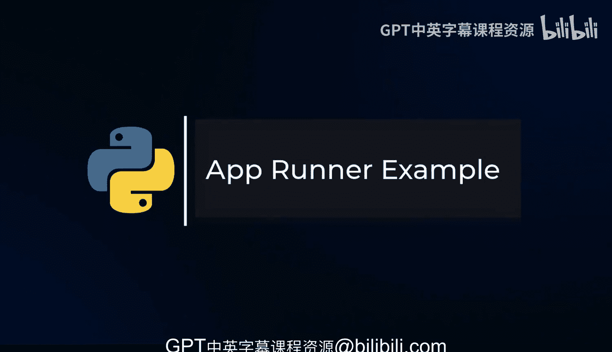
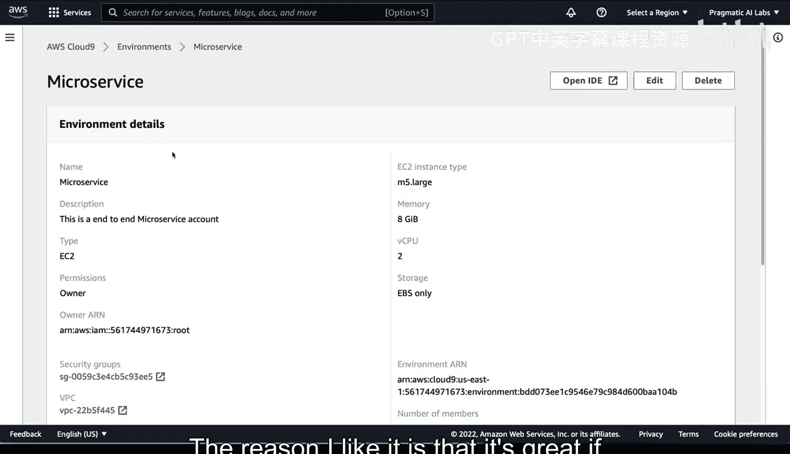
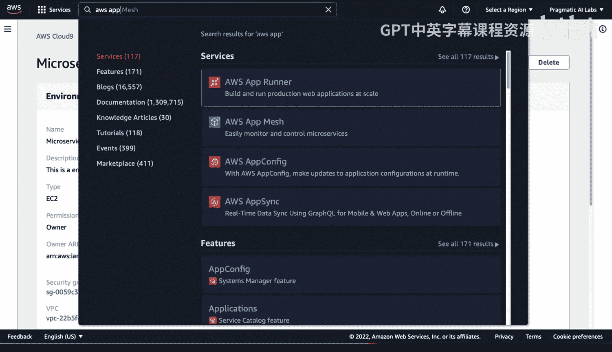
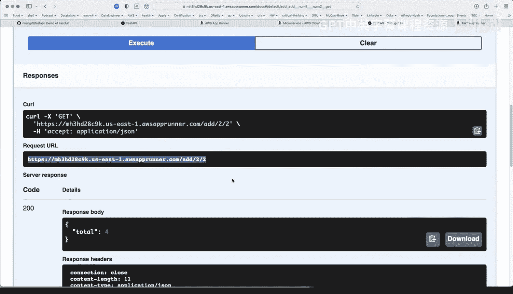
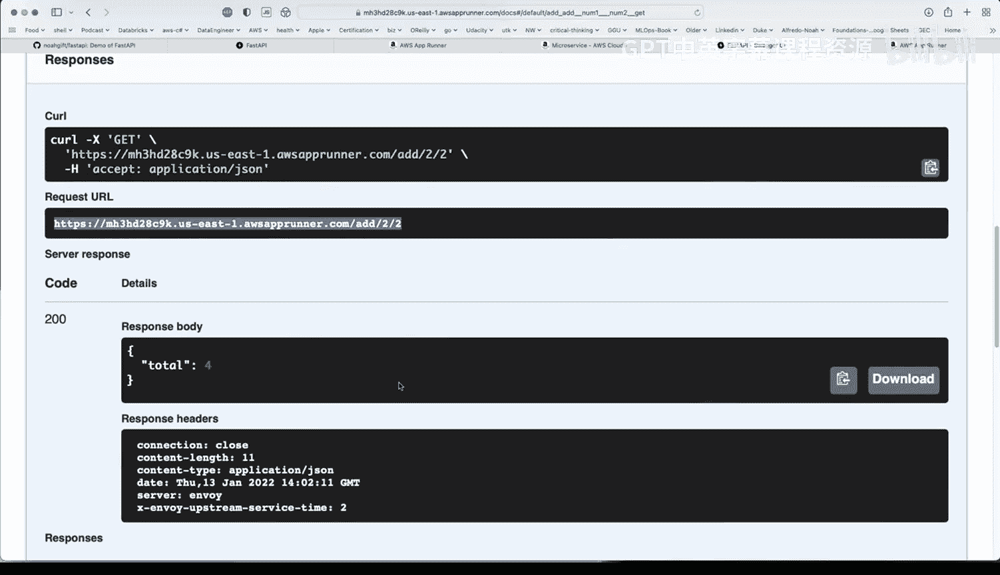
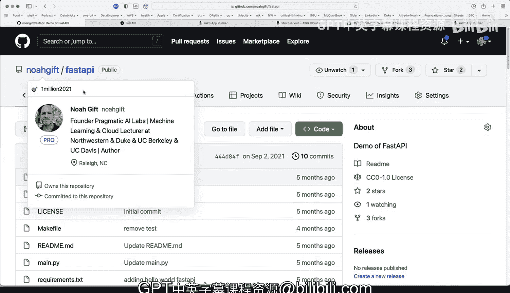

# 机器学习运维：11：使用FastAPI与AWS App Runner部署微服务示例

在本节课中，我们将学习如何将一个使用FastAPI框架构建的简单微服务，部署到AWS的App Runner托管服务上。整个过程将涵盖从本地开发、测试到云端部署的完整流程。

---

上一节我们介绍了微服务部署的基本概念，本节中我们来看看一个具体的实践示例。我使用了一个名为`NOAAgi-fastAPI`的代码仓库，它基于FastAPI框架。FastAPI是一个流行的Python Web框架，它支持类型注解、内置了Swagger API文档，并且非常简单易用。

以下是FastAPI的一些关键特性：
*   支持Python类型提示。
*   自动生成交互式API文档（Swagger UI）。
*   高性能。
*   易于学习和使用。

我将从一个简单的开发环境开始。我选择使用AWS Cloud9，因为它非常适合在AWS云平台上部署微服务。我们最终将使用AWS App Runner，这是AWS提供的一个用于部署和托管微服务的新兴框架。

App Runner的一个优点是管理方便。你可以看到我这里已经运行着多个应用程序。现在，让我们开始操作，先看看这个开发环境。

我的Cloud9环境已经设置好。我创建了一个Python虚拟环境，你可以在这里看到它的引用。我喜欢为我的项目建立一个标准的脚手架结构。让我看看这个`Makefile`，我定义了`install`、`test`、`format`和`lint`等命令。我认为这是一个很好的实践。

此外，我还使用了GitHub Actions来自动化测试我的代码，这被称为持续集成。我强烈建议你也这样做。你可以在`NOAAgi-fastAPI`仓库中查看具体配置。

接下来，我要运行这个微服务。我们先看看代码。首先，从`fastapi`导入`FastAPI`。我定义了一个`/hello`路由，它会返回“Hello Duke”。这是我正在杜克大学讲授的云计算课程的内容。然后，我定义了一个`/add`端点，它接收两个数字，将它们相加并返回总和。最后，应用在端口8080上启动，监听外部接口。

运行它非常简单。进入微服务目录，输入`python main.py`。看，它运行起来了。现在，我可以在一个新终端中，使用`curl`命令测试刚刚在输出中看到的地址。在基于终端的环境里，这是一个很有用的技巧。

我们测试`/hello`端点，成功了。然后测试`/add`端点，输入2和2，也成功了。

现在，我已经让服务在本地运行起来了，如何将它部署到AWS App Runner环境中呢？幸运的是，这个过程非常直接。

我将创建一个新的服务。按照仓库文档的说明，我选择“源代码仓库”作为来源。然后，我选择`NOAAgi-fastAPI`这个仓库。稍等片刻让它加载。

找到我的`fastapi`仓库并选中它，将其作为部署的源代码。这里有几个选项，其中“自动部署”是一个好主意，这被称为持续交付，可以自动将代码推送到生产或原型环境。但为了演示清晰，我暂时选择“手动部署”。

运行时选择Python 3。构建命令很简单：`pip install -r requirements.txt`，因为我已经准备好了依赖文件。启动命令是`python main.py`，这和我在Cloud9环境中做的完全一样。

点击“下一步”，为服务命名，例如“microservice-2”。然后继续点击“下一步”并选择“创建和部署”。整个过程非常直观。

现在，部署开始了。由于我之前已经操作过，知道这大约需要5分钟才能完成。我先回到另一个已经运行中的微服务实例。如果我点击它的默认域名，会得到一个完全加密的URL，这很不错。

同样很棒的是，我可以在URL后加上`/docs`路径。FastAPI内置了Swagger文档，我可以在这里直接测试API。点击“Try it out”，输入两个数字（比如2和2），然后执行。它会给出对应的curl命令、请求URL和响应详情等非常有用的信息。这对于构建数据工程或机器学习API非常方便。同样，我也可以直接测试`/hello`路由。

本节课中我们一起学习了如何使用FastAPI快速构建一个微服务，并通过AWS App Runner将其部署到云端。我们涵盖了从本地开发测试、项目结构配置到云端服务创建和访问的完整步骤。这是一个将机器学习模型或数据处理功能快速发布为API服务的有效方法。