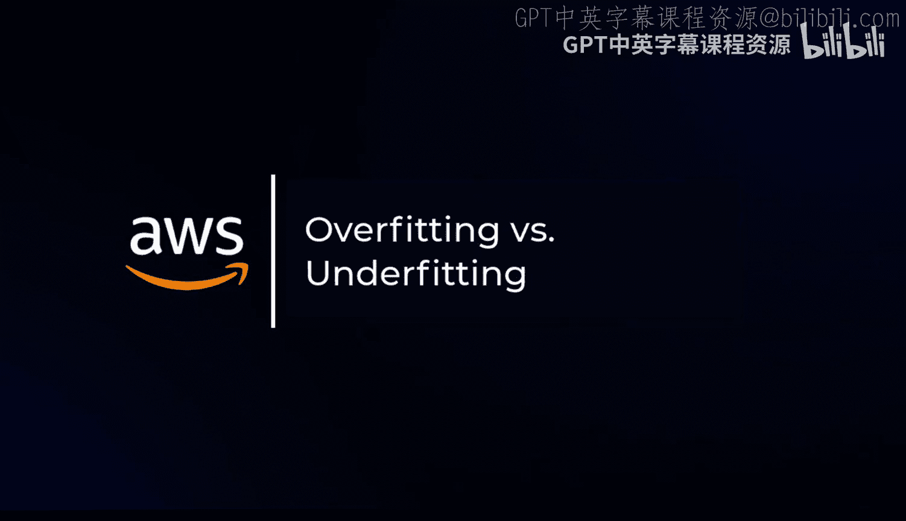
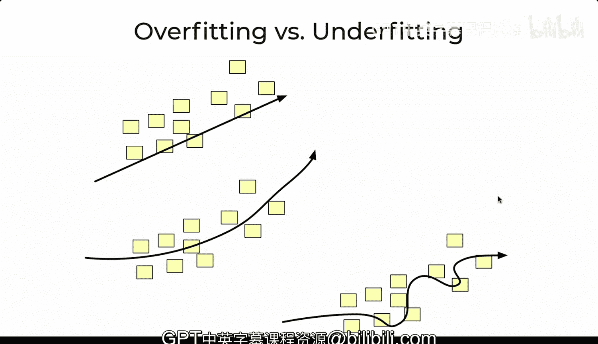

# 杜克大学｜机器学习运维｜DevOps⧸DataOps、Azure、MLFlow和抱脸｜MLOps ｜ Machine Learning Operations p110 33_03_03_过拟合与欠拟合.zh_en -BV1yE421c7uA_p110-

Let's take a look at the concept of overfitting versus underfitting。In one way。

 you can think about a underfitting problem as。The line is not directly following the points of a scatter plot。

 So if this is a scatter plot here and we have a bunch of data。

 notice there's a slightly super linear pattern here where there's some data that's appear and appear。

 and if you're putting your regression line through this part of the data set。

 you're missing out on predicting potentially some of these other values as they rise up。Likewise。

 if you wanted to create a more balanced model here。

 notice that you would have a slight curve to the data and you can see that the line is appearing directly through the middle of the data so you can call this a balanced prediction。

There's a overfitting problem though as well that can occur and that's when you try to too closely match the data and so the prediction could be unrealistic because it's not generalizable to other dataset sets so it may work for the particular test data that you're working on but if you're kind of following too closely and creating this unusual pattern here when you get new data sets。

 that unusual pattern could cause a overfitting problem。

 so that's really the intuition here is are you not predicting values well enough because you're trying to be too safe is there a balance approach where you're taking a little bit of risk and making the curve here or you're getting too risky of a prediction where you're trying to fit the data too closely and as a result when it gets new datasets。

 it won't be able to generalize and create a prediction that makes sense on a wider variety of data。

