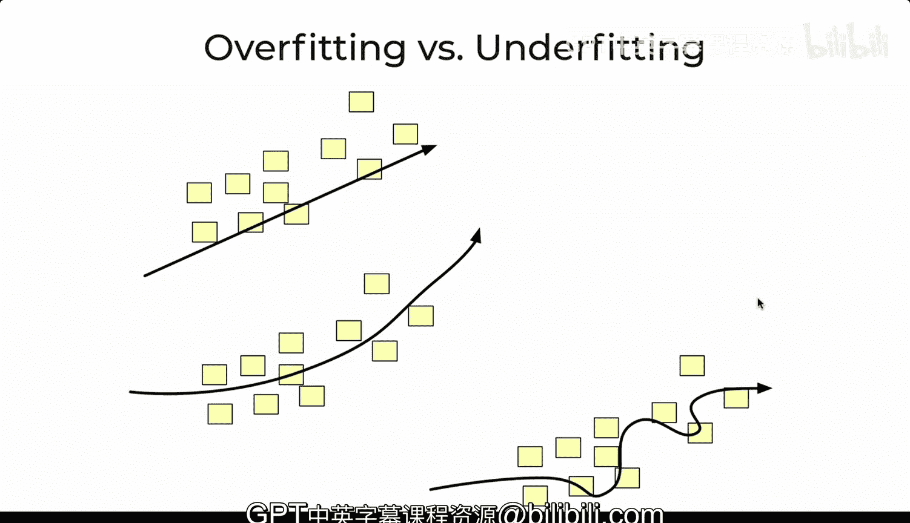

# 机器学习运维：110：过拟合与欠拟合 🔍

在本节课中，我们将要学习机器学习模型训练中的两个核心概念：**过拟合**与**欠拟合**。理解这两个概念对于构建一个泛化能力强、预测准确的模型至关重要。

---

## 概念介绍

上一节我们介绍了模型评估的基本思想，本节中我们来看看模型在训练数据上可能出现的两种典型问题。

首先，我们可以将**欠拟合**问题理解为：模型（例如一条回归线）未能很好地捕捉数据点（散点图）的整体趋势。

观察上图所示的散点图，数据呈现出轻微的线性上升趋势。如果在此数据集上绘制一条回归线，但这条线未能贴合大部分数据点的分布，就可能遗漏对其他上升趋势数据的预测。换句话说，模型过于简单，未能学习到数据中的基本模式。

---

## 平衡模型

为了创建一个更平衡的模型，我们需要让预测线更贴合数据的中心趋势。

在上图中，一个更理想的模型会呈现出一条轻微弯曲的线，这条线直接穿过数据的中间区域。这种模型可以被称为**平衡的预测**。它既不过于简单（欠拟合），也不过于复杂（过拟合），在捕捉趋势和保持泛化能力之间取得了平衡。

---

## 过拟合问题

然而，同样存在**过拟合**问题。当模型试图过于紧密地匹配训练数据时，就会发生过拟合。

在这种情况下，模型可能会产生不切实际的预测，因为它无法泛化到其他数据集。它可能在你当前使用的特定测试数据上表现良好，但由于它过于紧密地跟随数据点，甚至学习到了数据中的噪声和随机波动，从而形成了一个不寻常的、复杂的模式。当你获得新的数据集时，这个不寻常的模式将导致预测失败，这就是过拟合问题。

---

## 核心直觉总结

以下是理解这两个概念的核心直觉：

*   **欠拟合**：模型过于“安全”或简单，未能充分学习数据中的模式，导致预测能力不足。
*   **平衡模型**：模型在“风险”与“安全”之间取得平衡，适度贴合数据趋势，具有良好的泛化能力。
*   **过拟合**：模型过于“冒险”或复杂，试图完美拟合训练数据（包括噪声），导致在新数据上无法做出合理的预测。

---

本节课中我们一起学习了**过拟合**与**欠拟合**的概念。欠拟合意味着模型太简单，未能捕捉数据规律；而过拟合意味着模型太复杂，过度学习了训练数据的细节（包括噪声），从而丧失了泛化到新数据的能力。构建一个成功的机器学习模型，关键在于找到两者之间的平衡点。