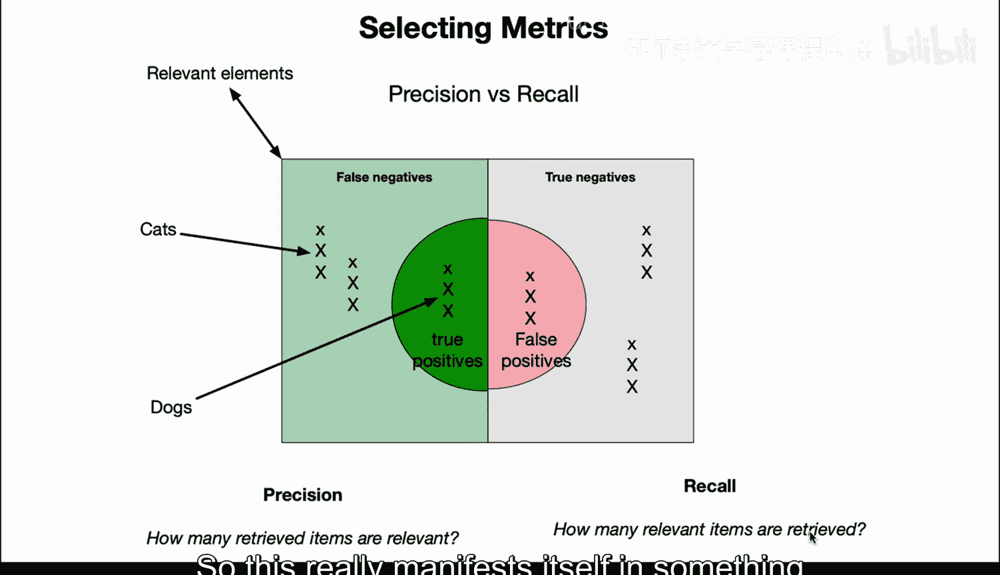
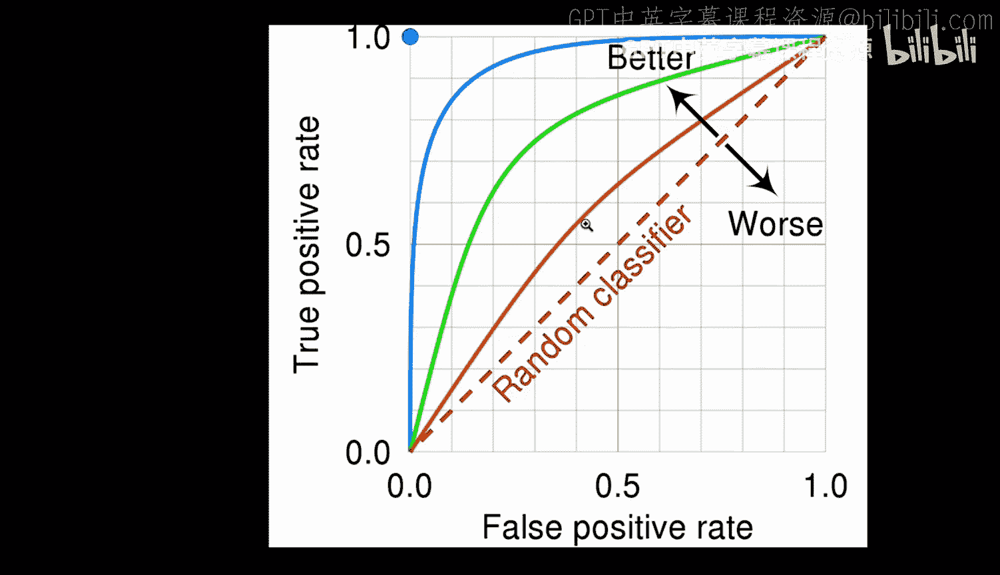
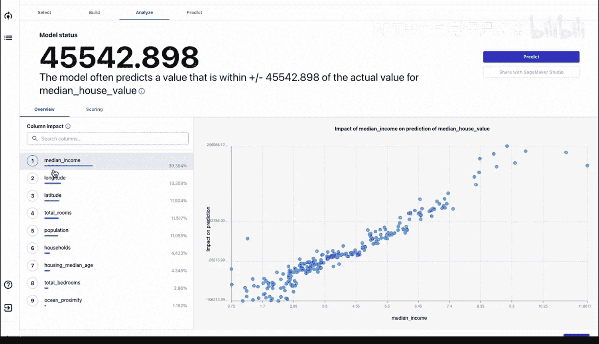

# 杜克大学｜机器学习运维｜DevOps⧸DataOps、Azure、MLFlow和抱脸｜MLOps ｜ Machine Learning Operations p111 34_03_04_选择评估指标.zh_en -BV1yE421c7uA_p111-

One of the classic problems with machine learning is you have to figure out what good is。

 And how do you do this？ Well， one of the ways you can do this is by selecting a metric to figure out for your problem what it is it you're trying to solve。

 Now let's take a very simple scenario here where you're trying to predict between cats and dogs。

 So if you have， let's say， 10 items here and there are some cats and there's some dogs in there。

 you want to be able to determine how many times you were able to correctly identify a dog。

 And this would be a true positive and how many times you were correctly able to identify that it was not a dog。

 it was a cat。 and this would be the false negative。 So you can see this is a relevant element。

 So it's this category。 Now， in the alternate scenario here。 if you're able to。

 in this scenario say that these were dogs， but there were really cats。

 this would be a false positive。😊，In the case of a true negative。

 this would also be a similar scenario。 So how do we determine this， Well， in terms of metrics。

 we have precision， how many retrieved items were relevant。 So in this category here。

 how many of them was I successfully able to retrieve。And then in terms of recall。

 how many relevant items are actually retrieved， so basically if you were not able to correctly identify all of the items in your in your data。

 then you're going to have a limited recall， so maybe it isn't as useful to use this particular model because there's a whole category of data that you weren't able to actually successfully do a recall on。

So this really manifests itself in something called the area under the curve。

 if we go over to Wikipedia here。

And we take a look at a， you know， essentially a perfect classifier system。

 one of the things that we can see from a perfect classifier。

Is that on a true positive rate and a false positive rate。

 we're able to get this perfect curve here where we were able to always identify a true positive and always identify a false positive。

 but in the real world， this is often not the case and so。If we have a random classifier here。

 you can see this would be you know not great performance right。

 this is just randomly selecting between one category or another as you increase here。

 the ability to select between true positive and false positive rate you can see we get better or in this if we go in this direction。

 we get worse， and so that's really one of the key intuitions with classification is the area under the curve or ROC curve and we want to select what is the correct balance that will give us the best ability to say these are cats。

 these are dogs。And eliminate false positives and also select for true positives。

Now， if we go to sage maker， another area that we can use metrics for is by looking at numerical predictions。

 So in the case of this particular model inside of sage maker canvas you can see that on the left here。

 we have actual values of medium house。 and then we have predicted value。

 So we have this metric here that is able to show us。In terms of root mean squared error。

 that this model often predicts that the value is between this particular range which is within 45。

000 of the actual value set really depends on what kind of housing market you're in whether that would be a good enough model for you and if we go to advanced metrics。

 we can dig into a little bit more of the different problems and get a visual relationship between the different metrics。

 and so this is often a good idea as well as to not just look at the core metric。

 but to dig into other assistive metrics。 and in this case。

 if we look at R squared which is called the goodness of fit。

We can see that in this particular scenario。We can see what percentage of the difference in median house price can be explained by the input column。

 So essentially of the picture that we have， how much of it is explained by the features that we selected。

 In this case， we see that it's close to 80%。 So we can explain roughly 80% of what was going on by the the features that we've selected。

 So it means it's possible to improve it a little bit more if we got additional features inside of the data。

 And let's go back here。And look at the build selection here。 You can see the different columns here。

 right， so we can see that in fact， we have rooms， bedrooms， population ocean proximity。

 median income， longitude， latitude right so these are these columns here explain 80%。

 And if we go to analyze here。One of the things that we can do as well is we can even see the impact of each of these features on the model。

 so there are lots of ways to dig into the metrics and not just look at the core metrics。

 but the supporting metrics to determine whether you have been able to do the cost benefit analysis of the prediction successfully。

 there is no perfect metrics you often need to look at multiple metrics to successfully predict via machine learning。

