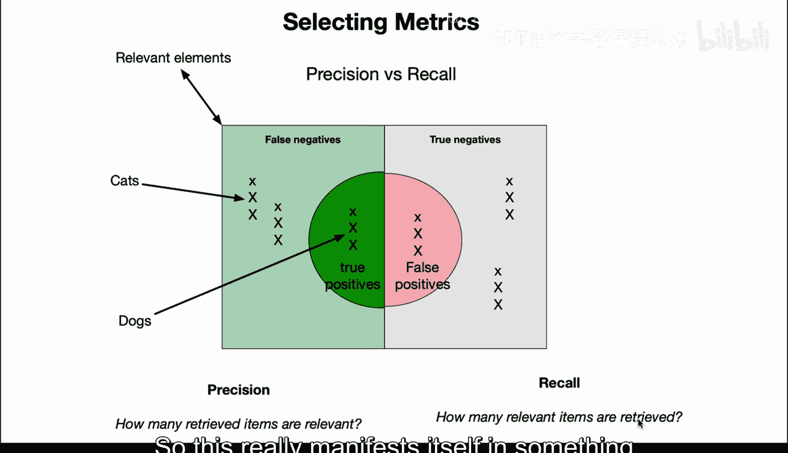
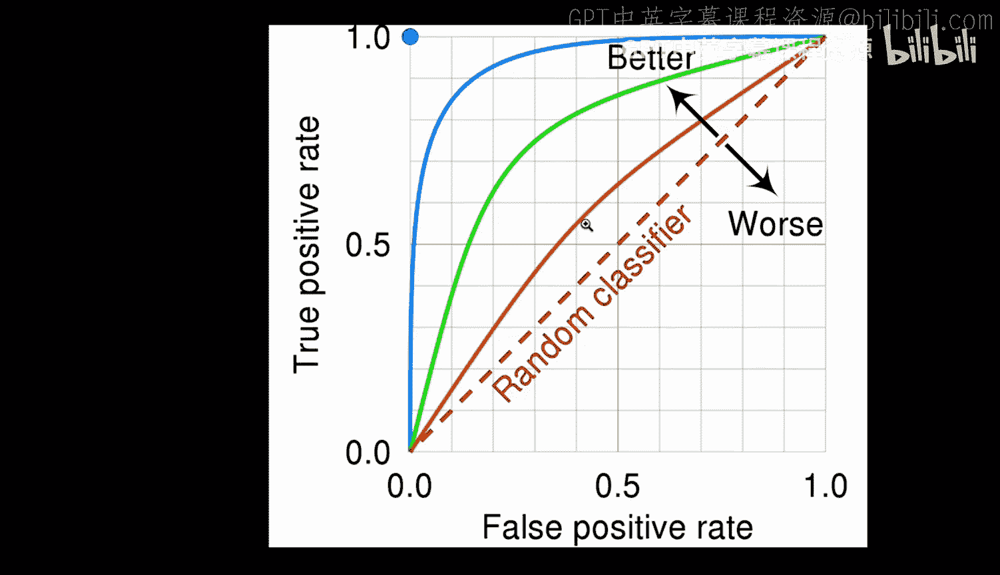
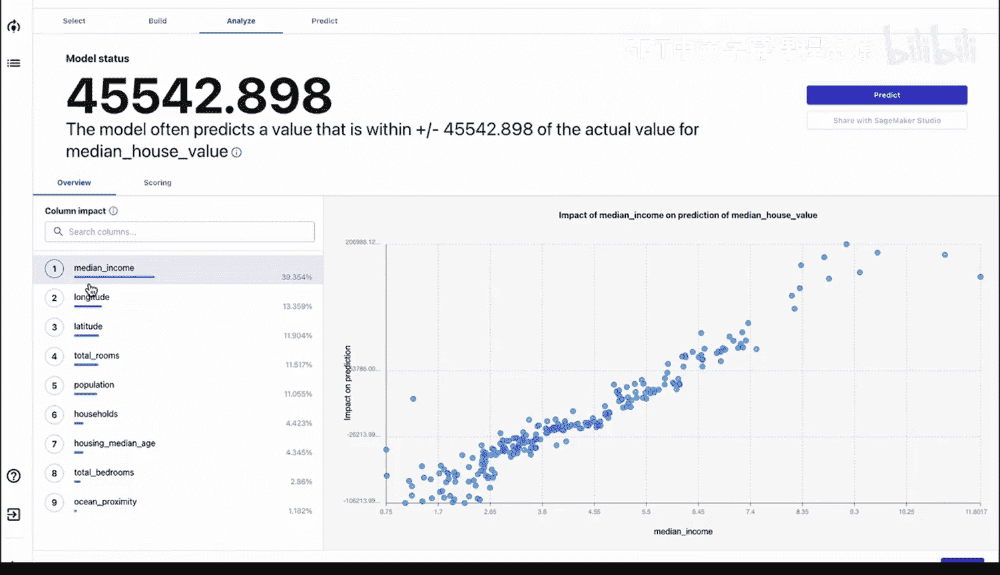

# 机器学习运维：第111课：选择评估指标 📊

在本节课中，我们将学习如何为机器学习模型选择合适的评估指标。评估指标是衡量模型性能好坏的关键工具，它帮助我们理解模型在解决特定问题上的表现。我们将从分类问题入手，然后探讨回归问题，并了解如何通过多个指标来全面评估模型。

## 分类问题中的评估指标 🐱🐶

上一节我们介绍了评估指标的重要性，本节中我们来看看在分类任务中如何定义“好”的模型。一个经典的问题是：你必须弄清楚什么是“好”。如何做到这一点？一种方法是为你的问题选择一个指标，以确定你试图解决的是什么。

让我们以一个简单的场景为例：你试图区分猫和狗。假设这里有10个样本，其中有一些猫和一些狗。你需要能够确定你正确识别出狗的次数（这被称为**真正例**），以及你正确识别出它不是狗（即它是猫）的次数（这被称为**真反例**）。同时，也存在错误的情况：如果你将猫识别为狗，这就是**假正例**；如果你将狗识别为猫，这就是**假反例**。这些概念构成了评估分类模型的基础。

为了量化这些概念，我们引入两个核心指标：**精确率**和**召回率**。

以下是这两个指标的定义：
*   **精确率**：在所有被模型预测为“正类”（例如“狗”）的样本中，有多少是真正的正类。其公式为：
    `精确率 = 真正例 / (真正例 + 假正例)`
*   **召回率**：在所有实际为正类的样本中，有多少被模型成功预测了出来。其公式为：
    `召回率 = 真正例 / (真正例 + 假反例)`

精确率关注的是预测结果的准确性，而召回率关注的是模型发现正类样本的能力。一个模型可能精确率很高但召回率很低（即只对非常有把握的样本进行预测），反之亦然。

### 综合评估：ROC曲线与AUC

在现实中，我们很少能获得完美的分类器。模型的表现通常需要在精确率和召回率之间，或者在**真正例率**（即召回率）和**假正例率**之间进行权衡。这种权衡关系可以通过**受试者工作特征曲线**（ROC曲线）来可视化。

ROC曲线以假正例率为横轴，真正例率为纵轴。一个完美的分类器的ROC曲线会紧贴左上角。而一个随机猜测的分类器的ROC曲线则是一条从原点出发的对角线。**曲线下面积**（AUC）是衡量模型整体性能的一个综合指标，AUC值越接近1，模型性能越好。

选择评估指标的核心直觉在于，我们需要找到能够为我们的问题（例如区分猫和狗）提供最佳预测能力的平衡点，既要尽可能消除假正例，也要尽可能选出真正例。

## 回归问题中的评估指标 🏠

上一节我们探讨了分类任务的指标，现在我们将目光转向回归问题。在回归任务中，我们预测的是连续数值，例如房屋价格。

在SageMaker Canvas等工具中，我们可以查看模型对数值的预测情况。例如，在左侧是房屋的实际价格，右侧是模型的预测值。一个常用的核心指标是**均方根误差**（RMSE），它衡量了预测值与实际值之间的平均差异。例如，一个模型的RMSE为45,000美元，意味着其预测值平均偏离实际值45,000美元。这个值是否可接受，完全取决于具体的应用场景（例如，在怎样的房产市场中）。

### 深入分析：辅助指标

除了核心指标，深入分析其他辅助指标也是一个好主意。例如，我们可以查看**R平方**（R²），它被称为“拟合优度”。

R²表示目标变量（如房价）的变化中有多大比例可以由输入特征解释。其值介于0和1之间。例如，如果R²为0.8，意味着我们选择的特征可以解释房价差异的80%。这也暗示，如果我们能获得更多相关特征数据，模型性能还有提升空间。

回到模型构建选择界面，我们可以看到使用了哪些特征列，例如房间数、卧室数、人口、地理位置、收入中位数等。正是这些特征解释了80%的房价变化。

在分析界面，我们甚至可以查看每个特征对模型预测的具体影响程度。因此，评估模型性能有很多方法，不应只看核心指标，还要结合支持性指标，以成功完成预测的成本效益分析。

## 总结 📝

本节课中我们一起学习了如何为机器学习模型选择评估指标。我们了解到：
1.  对于分类问题，核心概念包括真正例、假正例、真反例、假反例，并由此衍生出精确率、召回率以及综合性的ROC曲线与AUC指标。
2.  对于回归问题，我们介绍了均方根误差（RMSE）和拟合优度（R²）等指标。
3.  最重要的是，不存在完美的单一指标。为了成功进行机器学习预测，你通常需要查看多个指标，并结合具体业务场景进行综合判断。通过核心指标与辅助指标的结合分析，才能全面评估模型性能并指导后续优化。