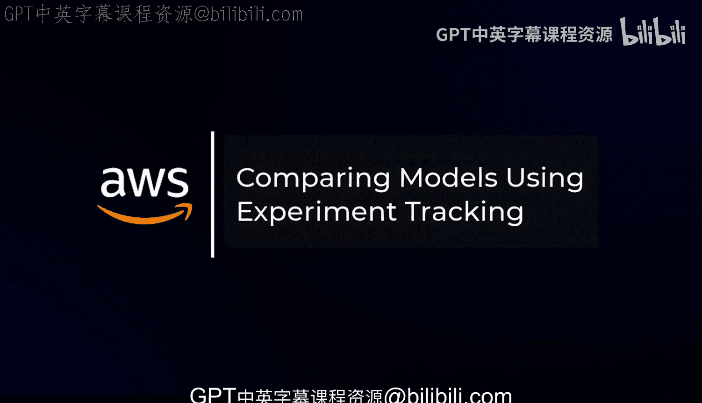
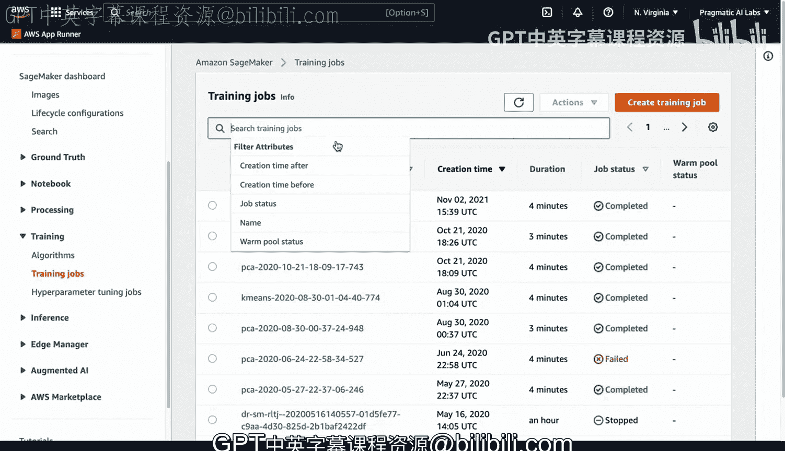

# 杜克大学｜机器学习运维｜DevOps⧸DataOps、Azure、MLFlow和抱脸｜MLOps ｜ Machine Learning Operations p112 35_03_05_使用实验跟踪比较模型.zh_en -BV1yE421c7uA_p112-

Here we have the sagemaker dashboard， and I'm taking a look at training jobs here。

 and under these training jobs， I can look at all the different jobs I've completed。

 And this is one of the key ideas behind experiment tracking is that I can go ahead and filter by certain status。

 For example， what were all the jobs that were actually completed。For example。

 and this would allow me to easily come in the next morning and see that the jobs were completed or for example。

 which ones have have failed also I could look at the name of the job maybe I look for you principal component analysis inside and I could filter by all the principal component analysis jobs and then I could also dive into the details and look at some of the other metrics here for example。

 how long it took to run something what was a training image that was run what was the instance type was a CPU versus GPU so this is the core idea behind having an experiment tracking a trainings window here is it allows you to query and look at a huge history of jobs if you have 100 percent10 person team this allows you to really dig into the details and find all of the attributes that you're trying to filter for so that you can manage a large training of。

m。