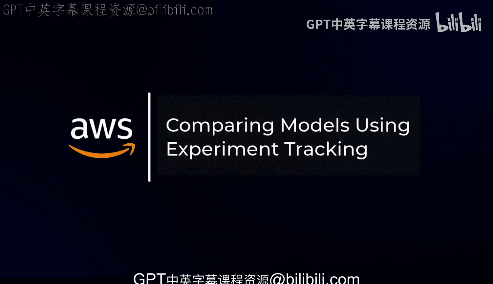
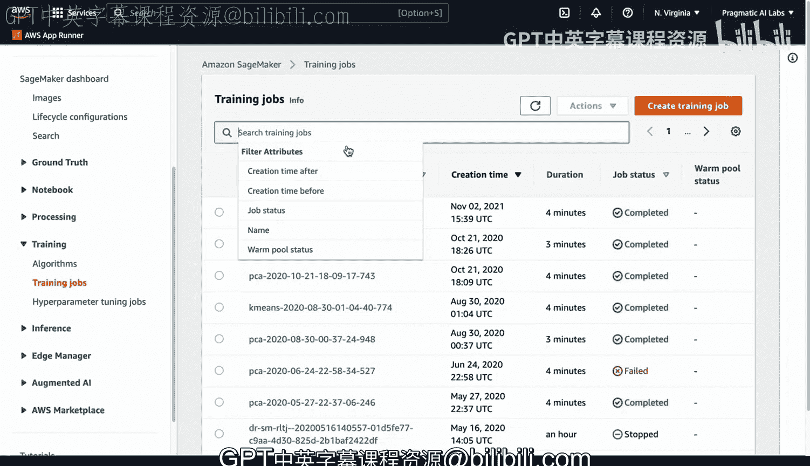

# 机器学习运维：112：使用实验跟踪比较模型

在本节课中，我们将学习如何利用实验跟踪功能来管理和比较不同的模型训练任务。我们将以Amazon SageMaker平台为例，展示如何通过其仪表板筛选、查询和分析历史训练任务。

---

## 实验跟踪的核心价值

上一节我们介绍了实验跟踪的基本概念，本节中我们来看看它在实际平台（如SageMaker）中的具体应用。实验跟踪的核心价值在于，它允许你系统化地记录、查询和比较大量训练任务的属性和结果。

## 在SageMaker中查看训练任务

以下是访问和筛选训练任务的基本步骤：

1.  **导航至训练任务面板**：在SageMaker控制台仪表板中，找到并点击“Training jobs”（训练任务）选项。
2.  **查看所有任务**：在此面板下，你可以浏览所有已完成的、正在运行的或失败的历史训练任务。
3.  **使用筛选功能**：这是实验跟踪的关键功能之一，允许你根据特定条件过滤任务。

## 如何筛选训练任务

利用筛选功能，你可以快速定位到感兴趣的任务。以下是几种常见的筛选方式：

*   **按状态筛选**：例如，你可以过滤出所有状态为“Completed”（已完成）的任务。这有助于你快速查看夜间批量任务的完成情况。
*   **按名称关键词筛选**：例如，你可以在任务名称中搜索“principal component analysis”（主成分分析），从而过滤出所有相关的任务。
*   **查看任务详情**：点击任意任务，可以深入查看其详细信息。

## 分析任务详情与指标

深入任务详情页面，你可以获取用于比较和分析模型的关键信息。以下是一些重要的可查看指标：

*   **任务运行时长**：了解模型训练消耗的时间。
*   **使用的训练镜像**：记录训练时所依赖的软件环境。
*   **实例类型**：明确训练任务是运行在CPU还是GPU实例上，这关系到计算成本与效率。

## 实验跟踪在团队协作中的作用

实验跟踪功能对于团队协作管理大规模训练任务至关重要。如果一个10人或100人的团队同时进行大量实验，此功能允许每位成员：

*   **快速查询历史**：从庞大的任务历史中迅速找到所需记录。
*   **深入挖掘细节**：根据各种属性（如算法、参数、数据集版本）进行筛选。
*   **有效管理流程**：系统化地比较不同实验的配置和结果，从而优化模型选择与迭代流程。

---

本节课中，我们一起学习了如何使用SageMaker的实验跟踪功能来比较和管理模型训练任务。我们了解了如何通过状态、名称等条件筛选任务，以及如何查看运行时长、硬件配置等关键指标。掌握这些技能，能帮助你在个人或团队环境中，更高效地追踪实验过程、比较模型性能并管理机器学习项目的生命周期。