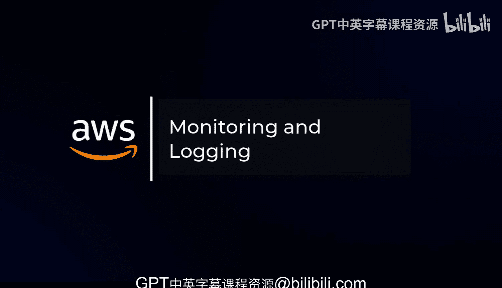
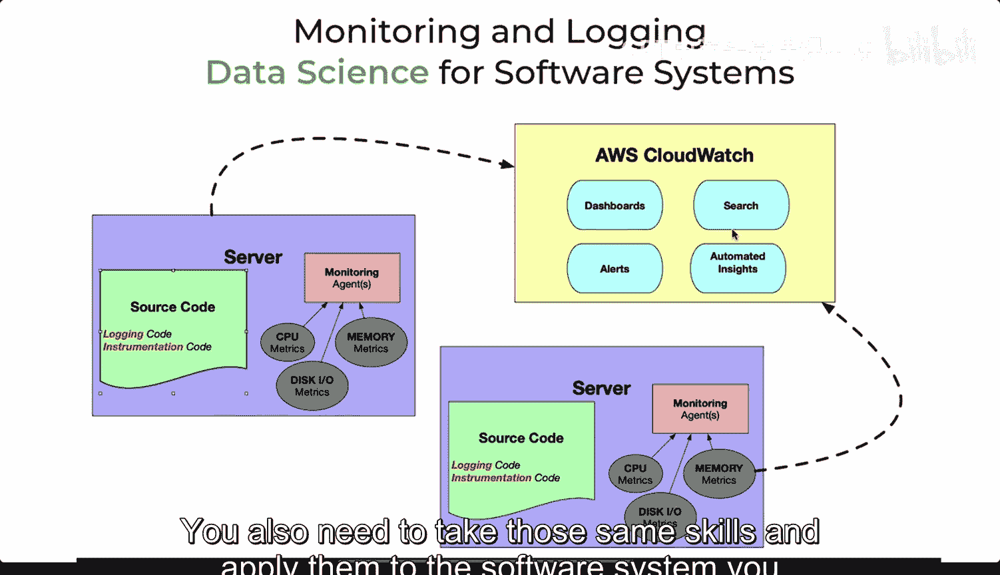
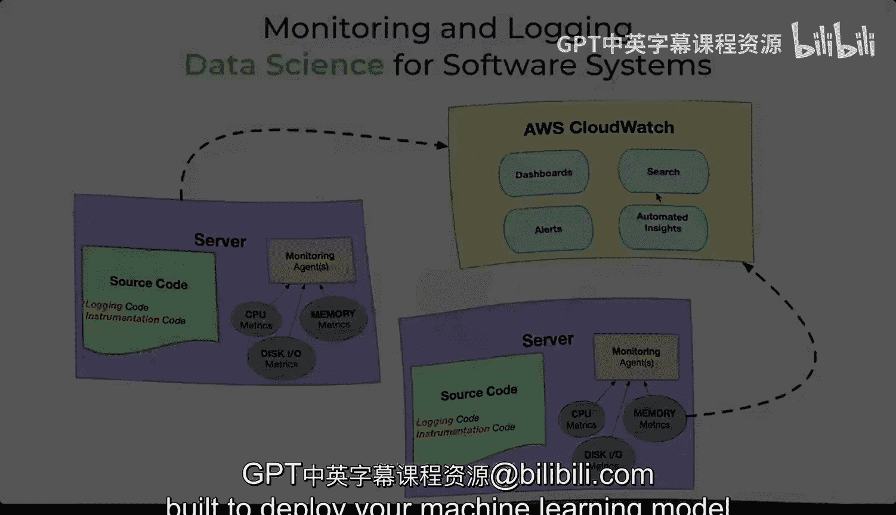

# 杜克大学｜机器学习运维｜DevOps⧸DataOps、Azure、MLFlow和抱脸｜MLOps ｜ Machine Learning Operations p113 36_04_03_监控与日志记录.zh_en -BV1yE421c7uA_p113-

Here we have monitoring and logging。 One of the ways to think about monitoring and logging is its data science for software systems。

 So even though you're doing machine learning operations， putting things into production。

You also need to look at the data science of the infrastructure you're using so in the case of a server。

 the source code itself that could be a source of information。

 the logging that you add inside the instrumentation you add to your code for example。

 how long does it take to do a particular prediction and then in terms of the monitoring agents there are some core things like CPUo memory that you would want to put into your agent now how do you view this well you could do this via AWS Cloudwach you could pull up a dashboard look at alerts search through a particular system and then get also automated insights that come from the AWS CloudWch system so that's really the best way to think about monitoring logging is data science for software systems you do need to have monitoring logging so that you know what's happening in your system and you get visibility data is a great discipline to have like being a data scientist you also need to take those same skills and apply them to the software system you built。

To deploy your machine learning model。

