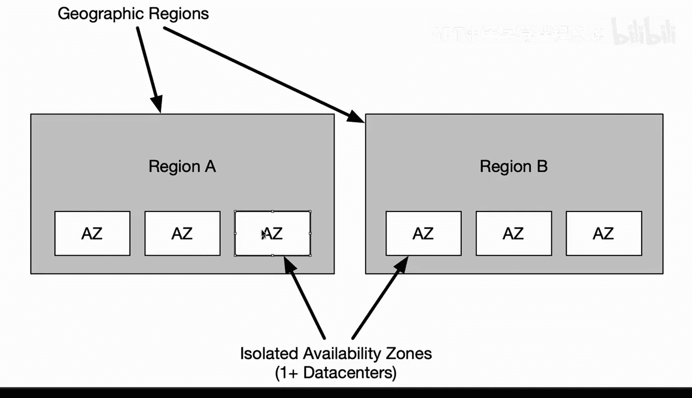

# 杜克大学｜机器学习运维｜DevOps⧸DataOps、Azure、MLFlow和抱脸｜MLOps ｜ Machine Learning Operations p114 37_04_05_多区域部署.zh_en -BV1yE421c7uA_p114-

Here we have a architectural diagram of AWS with geographic regions。 We have two regions。

 We have region A and region B。Inside of these regions， this could be， for example。

 a the East Coast of the United States。 this could be the European Union。

And inside of these geographic regions， though， we have availability zones。

 now availability zone are isolated physically from the other availability zones。

 and they are composed of more than one data center， typically there's two plus data centers。

 two or more data centers。That are enclosed inside of an availability zone。

 and this allows even inside of the availability zone。

 there to be some redundancy so the idea here is that if you wanted to build a geographically distributed application that was resistant to failures across the world。

 you could assign something to both regions and then also build multi-esezy architecture inside。

 so let's say a database could use all three of these availability zones。

 and now you've actually done really software development best practices to build a resilient application that even if there is an issue in a region or an issue in availability zone or an issue in a data center。

 your application is able to seamlessly handle those problems。

