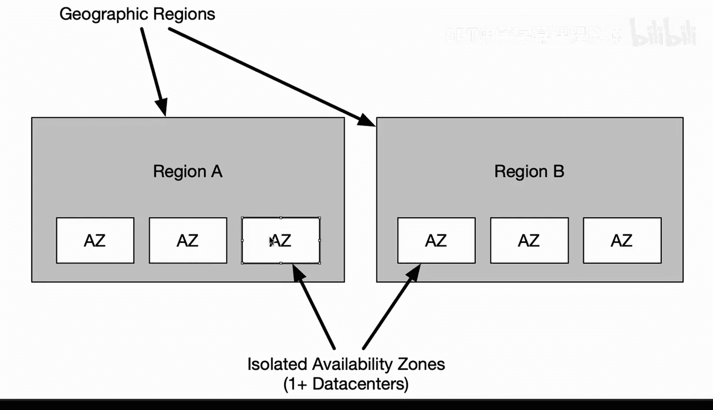

# 机器学习运维：114：多区域部署

在本节课中，我们将学习如何利用云服务提供商（如AWS）的地理区域和可用区概念，来构建一个能够抵御全球性故障的、高可用的分布式应用程序架构。

## 理解核心概念：区域与可用区

上一节我们介绍了构建弹性应用的重要性，本节中我们来看看实现这一目标的具体架构组件。云服务提供商通过**区域**和**可用区**来组织其全球基础设施。

*   **区域**：指云服务提供商在全球范围内划分的、地理上隔离的物理位置。例如，美国东海岸或欧盟都可以是一个独立的区域。每个区域包含多个**可用区**。
*   **可用区**：指在一个区域内，相互之间物理隔离、具备独立供电、冷却和网络设施的一个或多个数据中心集群。一个可用区通常由**两个或更多**数据中心组成。

这种设计的核心思想是：通过在不同地理区域和同一区域内的不同可用区部署资源，可以构建出能够抵御数据中心、可用区甚至整个区域级别故障的应用程序。

## 构建弹性架构的实践

理解了区域和可用区的概念后，我们来看看如何将它们应用于实际架构设计。以下是构建一个高可用、地理分布式应用程序的关键步骤：

1.  **跨区域部署**：将应用程序的关键组件（如前端、后端服务）部署在两个或更多不同的地理区域。这样，即使一个区域发生大规模故障，其他区域的实例仍可继续提供服务。
2.  **多可用区架构**：在每个区域内，将资源（如数据库、计算实例）分布在多个可用区中。例如，一个数据库集群可以同时使用区域内的所有三个可用区。
3.  **实现冗余与故障转移**：通过上述部署方式，确保任何一个数据中心、可用区或区域发生问题时，流量和负载都能自动、无缝地转移到健康的资源上，从而保证应用程序的持续可用性。

通过结合跨区域部署和多可用区架构，你实际上遵循了软件开发的最佳实践，构建了一个极具弹性的应用程序。这种架构能够从容应对数据中心故障、可用区中断甚至整个区域的服务问题。

本节课中我们一起学习了云架构中**区域**和**可用区**的核心概念，并探讨了如何利用它们来设计一个能够抵御全球性故障的、高可用的分布式应用程序。关键点在于通过在不同地理区域和同一区域内的不同物理隔离单元中部署冗余资源，来实现应用程序的弹性和持续可用性。