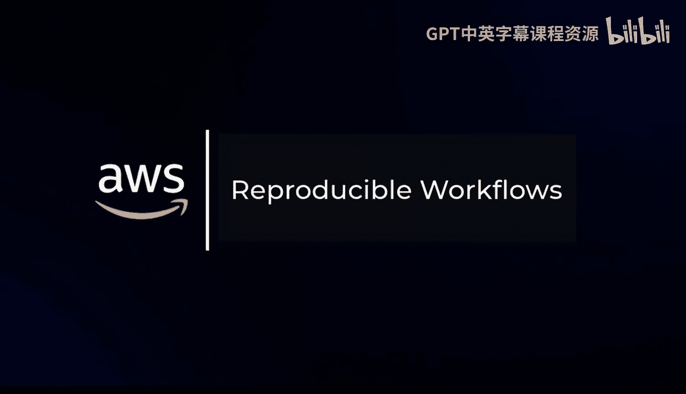
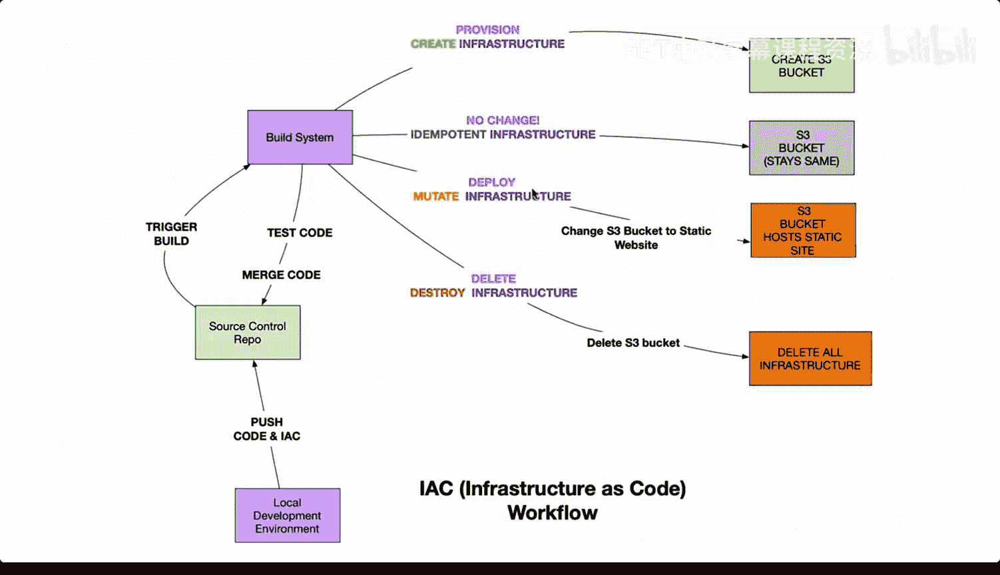
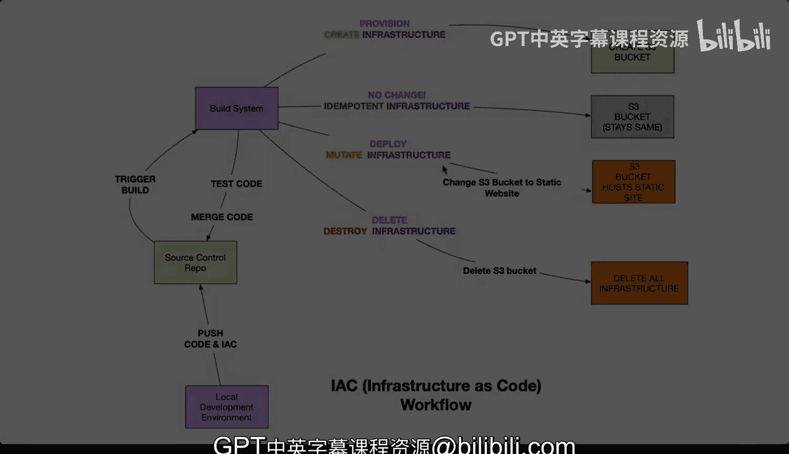

# 杜克大学｜机器学习运维｜DevOps⧸DataOps、Azure、MLFlow和抱脸｜MLOps ｜ Machine Learning Operations p115 38_04_06_可复现工作流.zh_en -BV1yE421c7uA_p115-

A reproducible workflow involves infrastructure as code。

 In addition to components like a build system and a source code repository。

 Here we have an infrastructure as code workflow where we take things from our either cloudbased development environment or local development environment like cloud 9 or Github codespaces and we do the test merge trigger build workflow。

 So this is testing our code， making sure that Linttin is working and making sure the deployment system works。

 And then in terms of the infrastructure as code， behind the scenes。

 it could be creating infrastructure like a S3 bucket， for example， it could also not make a change。

 So if nothing is changed when you do the next deploy。

 it'll just keep the state of the S3 bucket the same。 if you do need to make a change， for example。

 change in S3 bucket to a static website， you could actually deploy a mutated infrastructure change。

 and that if you needed to delete。Your， your change。

 you could delete and destroy your infrastructure， like， for example， getting rid of an S3 bucket。

 So really the idea behind infrastructure as code is that there isn't a human pushing buttons that make something happen。

 the code。

