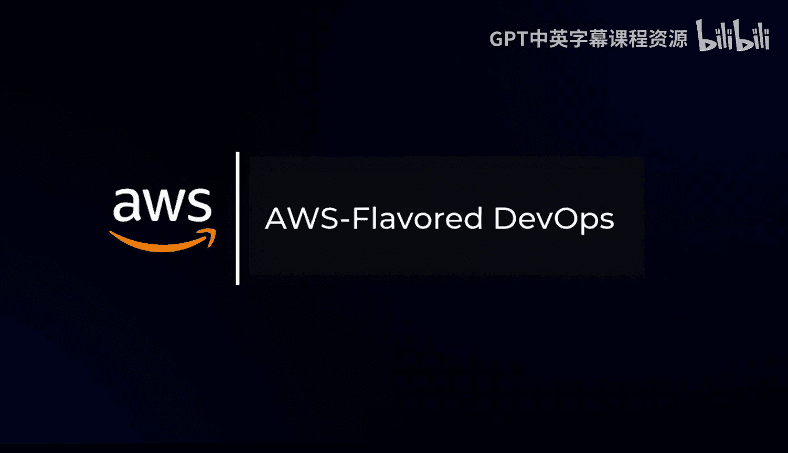
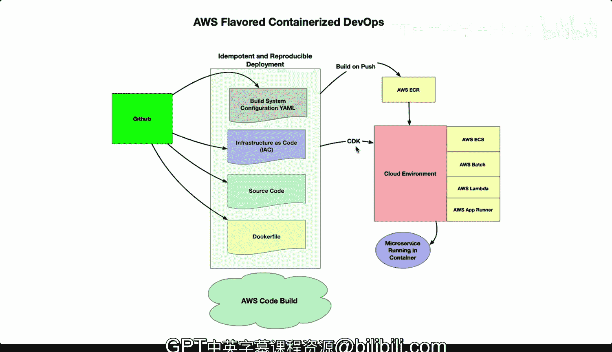

# 杜克大学｜机器学习运维｜DevOps⧸DataOps、Azure、MLFlow和抱脸｜MLOps ｜ Machine Learning Operations p116 39_04_07_AWS风格DevOps.zh_en -BV1yE421c7uA_p116-

Here we have AW S flavored containerized Devops。 And you can see here that there are some key components that are important to call out。

 First， you would put your code inside of a source control repo like， for example， Gitthub。

And then you have item potent and reproducible deployments。

 So the build system configuration file could be part of the deployment。

 The infrastructure itself could be part of the deployment。 Again， it could be some Amazon CDK code。

 you have your source code itself。 and then you have the Docker file。

 which defines what it goes into the container。 So every single component from the build system configuration to the infrastructure configuration to the containers configuration is inside of this one spot。

 you then go and trigger a build， in this case， AWs code build that build then pushes a container to Amazon's container registry and then the infrastructure as code itself or CDK would then put it into a service on Amazon。

 So AwS ES or AWs batch or AWs Lada or AWS apprunner。

 one of these services would then serve out a microservice running in a container。

 So the idea here is that you get。Complete visibility。

 and you have a noble infrastructure where every single component directly corresponds to a AWS service。

 this is AWS flavored， containerized Devops。

