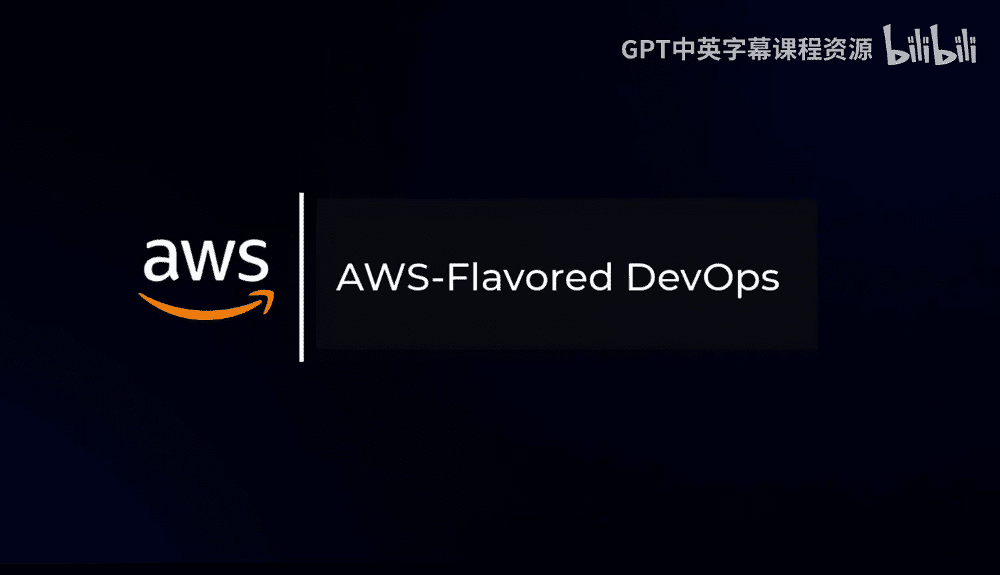
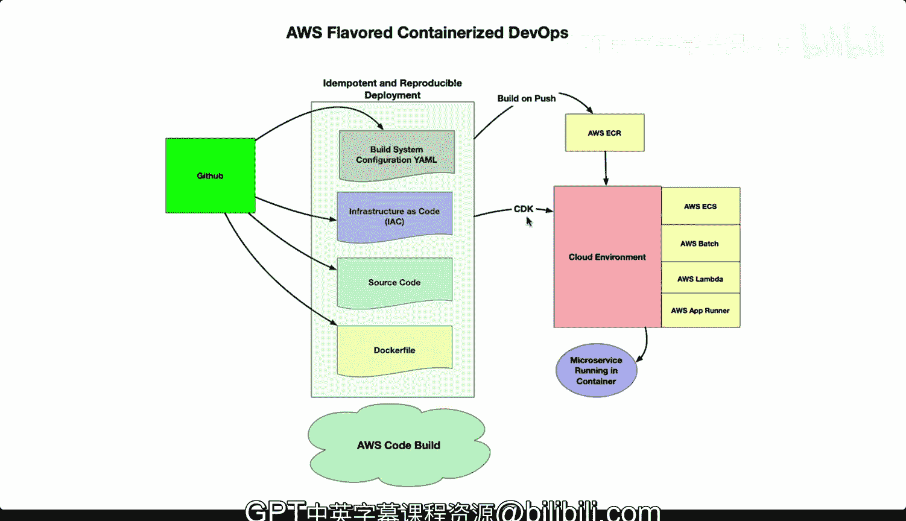

# MLOps 课程：第116讲：AWS风格的容器化DevOps 🚀

在本节课中，我们将学习一种基于AWS云服务的容器化DevOps实践。这种模式强调将所有组件，从代码到基础设施，都定义为代码并进行统一管理，从而实现高效、可复现的部署。

## 核心流程概述

上一节我们介绍了DevOps的基本理念，本节中我们来看看其在AWS云平台上的具体实现。整个过程围绕容器化和“基础设施即代码”展开，旨在实现完全的可视化和可追溯性。

以下是该流程的关键组成部分列表：

*   **源代码仓库**：将你的应用程序代码存放在如GitHub这样的源代码控制仓库中。
*   **声明式部署**：实现幂等且可复现的部署。这意味着无论执行多少次，部署结果都是一致的。
*   **构建系统配置**：构建系统的配置文件（例如，用于编译或打包的脚本）本身也是部署的一部分。
*   **基础设施即代码**：服务器、网络等基础设施也通过代码（例如，使用AWS CDK）来定义和配置。
*   **应用源代码**：你的核心业务逻辑代码。
*   **Dockerfile**：一个定义了如何构建容器镜像的文本文件，其中包含了运行应用所需的所有依赖和配置。

## 工作流程详解

正如我们所见，所有组件都集中管理。接下来，我们看看它们是如何协同工作的。

整个流程始于一次构建触发。具体步骤如下：

1.  **触发构建**：当代码仓库有更新（如推送新提交）时，会触发AWS CodeBuild服务开始执行构建任务。
2.  **构建与推送容器**：CodeBuild根据`Dockerfile`构建出一个Docker容器镜像，并将其推送到Amazon Elastic Container Registry (ECR) 进行存储。
3.  **部署基础设施与服务**：同时，基础设施即代码（如CDK代码）会被执行，在AWS上创建或更新所需的基础设施，并将上一步构建好的容器部署到某个计算服务中。
4.  **运行微服务**：容器最终会在AWS的某个托管服务上运行，例如：
    *   **Amazon ECS** (弹性容器服务)
    *   **AWS Batch** (批处理计算服务)
    *   **AWS Lambda** (无服务器计算服务)
    *   **AWS App Runner** (完全托管的容器应用服务)
    这些服务负责将容器作为一个微服务对外提供。

## 模式优势总结

本节课中我们一起学习了AWS风格的容器化DevOps模式。这种设计的核心思想在于获得**完全的可见性**和构建一个**可追溯的基础设施**。在此模式下，从构建配置、基础设施到容器环境的每一个组件，都直接对应一个具体的AWS服务，并通过代码进行管理，从而确保了部署过程的一致性和可靠性。