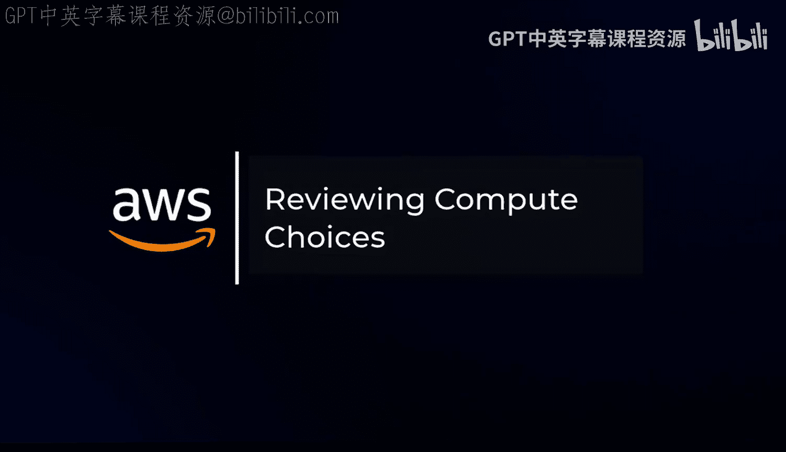
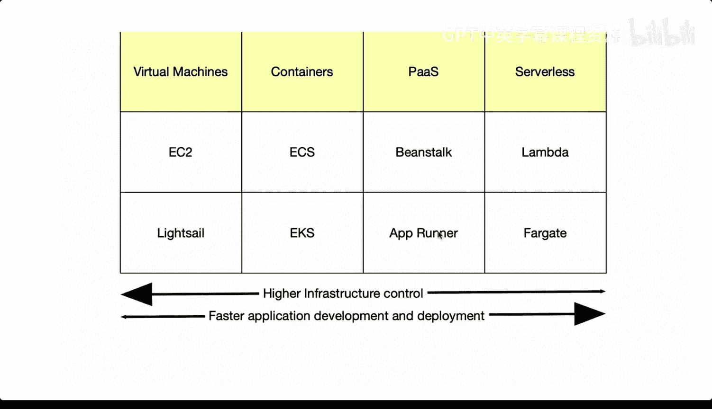

# 杜克大学｜机器学习运维｜DevOps⧸DataOps、Azure、MLFlow和抱脸｜MLOps ｜ Machine Learning Operations p117 40_04_02_回顾计算选项.zh_en -BV1yE421c7uA_p117-

Here we have a diagram that shows the difference between higher infrastructure control and faster application development。

And deployment on the left， we have virtual machines。

 And these could be easy to light sale type instances。

 And then as we get farther and farther towards serverless。

 we have containers and platform as a service， and then finally。

 with serverless like Lambda and Fargate， you don't do that much， you build your logic。

 and you put it into production。 a traditional platform as a service。

 You still do a little bit of work。 You may put a config file inside of application。

 but it does a lot of it for you。So really it's up to you as the developer if you're building a machine learning application。

 you may want to lean more towards using serverless options， if you're doing lowleve things yourself。

 you may want to lean more towards virtual machines and containers and it's up to you for each particular recipe that you're building to pick the right configuration that will solve the problem you're trying to solve。

