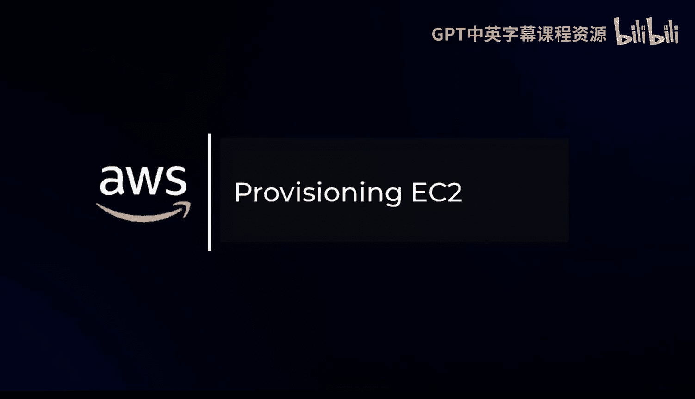
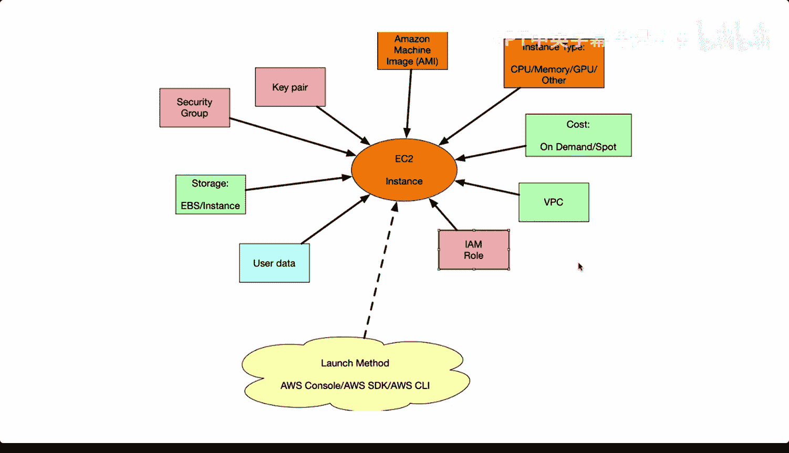

# 杜克大学｜机器学习运维｜DevOps⧸DataOps、Azure、MLFlow和抱脸｜MLOps ｜ Machine Learning Operations p118 41_04_03_配置EC2.zh_en -BV1yE421c7uA_p118-

Here we have an EC2 provisioning ecosystem where each of these subcomps is a step inside of how EC2 needs to work。

 First， you can launch EC2 from the console， you can launch it from the SDK。

 you can launch it from the CI， but there are some subcomps that are necessary to call out first user data。

 this could be where you would put special instructions。Storage。

 do you want to have EBS storage or instant storage？

The security groups or what are the firewall rules for your EC2 launch？

Is there an SSH key pair so that you can shell in from another location like， for example。

 AWS Cloud Shell？Did you build a custom AMI or Amazon machine image。

 Are you using an instance type like CPU， memory， GPU， and then in terms of cost on demand or spot。

 and then finally the virtual private cloud。Are you actually isolating things to a particular cloud and what is that particular virtual private cloud and then the role right what do you want this EC2 instance to do。

 do you want to be able to read from S3 or talk to DynamodDB so it's the encapsulation of all of these subcompons that makes the launch of an EC2 instance work。

