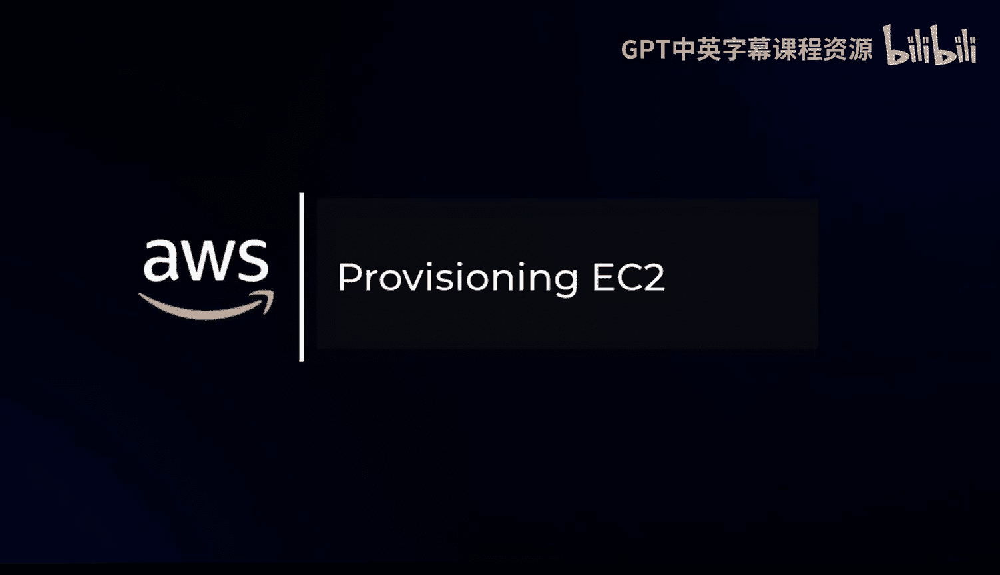
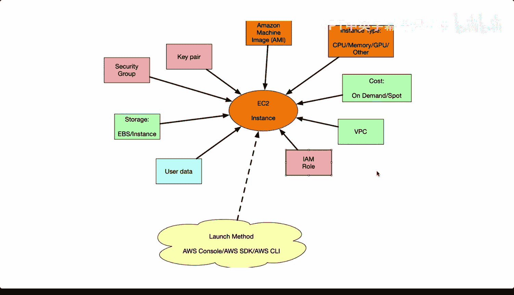

# 机器学习运维：04：配置EC2实例

在本节课中，我们将学习如何配置亚马逊AWS的EC2实例。EC2是弹性计算云的简称，它允许用户在云中启动和管理虚拟服务器。我们将详细拆解配置EC2实例所涉及的各个核心组件。

## 概述

配置一个EC2实例并非单一操作，而是一个涉及多个子组件的生态系统。每个子组件都扮演着关键角色，共同确保EC2实例能够按预期启动和运行。理解这些组件是成功部署和管理云基础设施的基础。

## EC2启动生态系统

上一节我们概述了EC2配置的整体概念，本节中我们来看看构成这个生态系统的具体子组件。下图展示了这些核心组件的关系：

以下是配置EC2实例时必须考虑的关键子组件：

1.  **启动方式**
    *   你可以通过AWS管理控制台启动EC2。
    *   你可以使用软件开发工具包（SDK）以编程方式启动EC2。
    *   你还可以从持续集成（CI）管道中启动EC2。

2.  **用户数据**
    *   这是你放置特殊指令的地方。例如，你可以在实例首次启动时运行脚本，用于安装软件包或配置环境。代码示例：`#!/bin/bash yum update -y`

3.  **存储**
    *   你需要选择存储类型：是使用持久化的EBS存储，还是临时的实例存储？

4.  **安全组**
    *   这定义了你的EC2实例的防火墙规则，控制着入站和出站的网络流量。

5.  **SSH密钥对**
    *   你需要一个密钥对，以便从其他位置（例如AWS Cloud Shell）安全地通过SSH连接到你的实例。

6.  **亚马逊机器镜像**
    *   你是使用预构建的AMI，还是基于特定配置创建了自定义的AMI？

7.  **实例类型**
    *   根据工作负载需求选择实例规格，例如侧重于CPU、内存或GPU。

8.  **成本模式**
    *   选择计费方式：是按需实例，还是为了降低成本使用竞价型实例？

9.  **虚拟私有云**
    *   你是否将资源隔离到特定的VPC中？这个VPC的网络配置是怎样的？

10. **IAM角色**
    *   你希望这个EC2实例拥有什么权限？例如，你是否需要它能够读取S3存储桶中的数据，或与DynamoDB数据库通信？角色封装了这些权限。

## 总结

本节课中我们一起学习了配置亚马逊EC2实例的完整生态系统。我们了解到，成功启动一个EC2实例是多个子组件协同工作的结果，包括启动方式、用户数据脚本、存储选项、安全组规则、SSH密钥、AMI镜像、实例类型、成本模型、VPC网络以及IAM角色。正是这些组件的封装与配合，使得EC2实例能够顺利启动并执行预定任务。掌握这些组件是进行有效机器学习运维的基础。