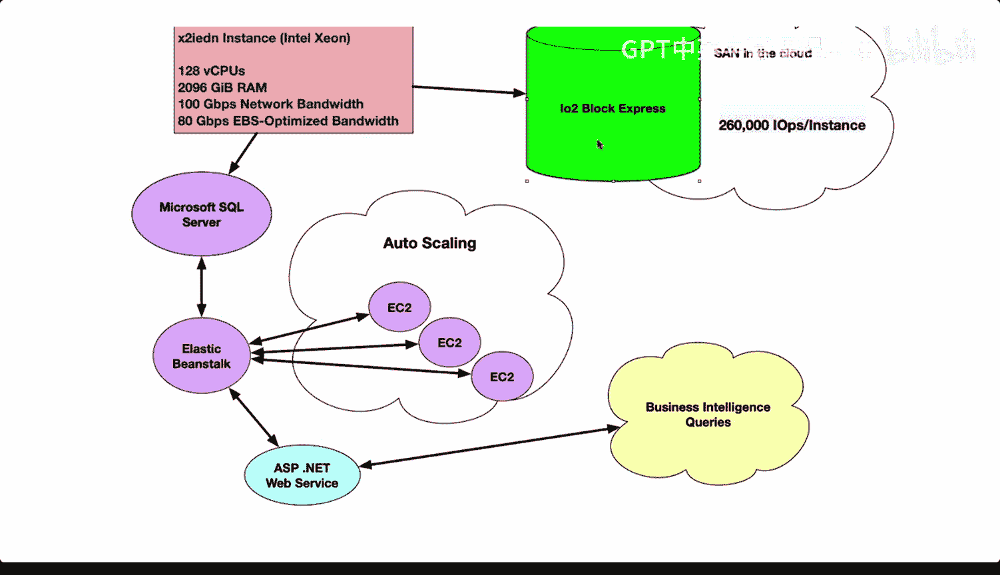

# 杜克大学｜机器学习运维｜DevOps⧸DataOps、Azure、MLFlow和抱脸｜MLOps ｜ Machine Learning Operations p119 42_04_04_配置EBS.zh_en -BV1yE421c7uA_p119-

Here we have a s in the cloud type architecture that really goes through and shows all the different knobs that you can turn when you're building on top of the AWS platform。

You have a sand in the cloud here where you can provision the block storage。

 you also could have auto scaling setup where you have EC2 instances that scale up and down via the elastic bean sock。

And then that service could do business intelligence queries or it could do machine learning queries。

 whatever it is that you're trying to solve at the time。

 But the key idea here is that this is elastic， the auto scaling and the instances spin up and down according to the health metrics from the load balancer and then also the block storage itself can be provisioned to have extremely high bandwidth。

 So it's up to you as the architect， that's building a machine learning system to decide which parts should be preprovision and which parts should be elastic and also what are the capabilities you'd like your application to have。

 For example， if you did need to have extremely high bandwidth storage for doing machine learning training where you had a cluster of machines all talking to the same mount point。

 this could be one configuration that could help with that problem。

