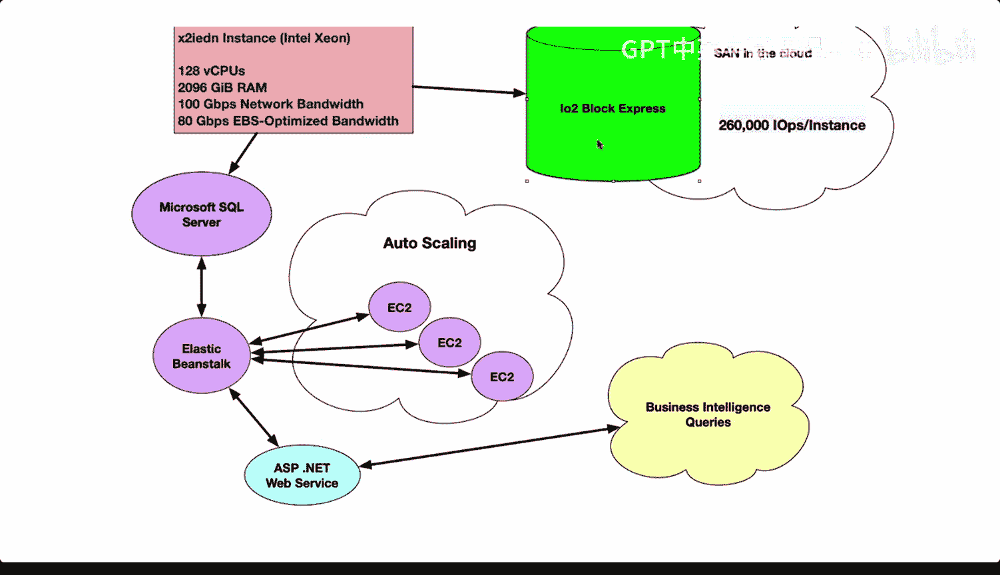

# 机器学习运维：04：配置EBS

在本节课中，我们将学习如何在AWS云平台上配置弹性块存储，并理解其在构建弹性机器学习系统架构中的作用。

## 概述

上一节我们介绍了AWS的基础服务，本节中我们来看看如何利用弹性块存储来构建高性能、可扩展的机器学习基础设施。我们将重点分析一个典型的云架构图，并解释其中各个可配置组件的作用。

## 架构图解析

下图展示了一个基于AWS平台的云架构，它清晰地列出了在构建系统时可以调整的各种配置选项。

## 核心组件与配置

以下是该架构中涉及的关键服务及其功能：

*   **弹性块存储**：在云环境中，你可以按需配置块存储设备。其核心优势在于存储性能可以根据需求进行弹性伸缩。
*   **自动伸缩组**：你可以设置自动伸缩，使EC2实例能够通过Elastic Beanstalk服务根据负载情况自动增加或减少。其工作流程可以概括为：
    > **负载均衡器监控健康指标 -> 触发自动伸缩策略 -> EC2实例数量动态调整**
*   **应用服务层**：这些弹性伸缩的实例可以运行业务智能查询或机器学习查询等任务，具体取决于你当前需要解决的问题。

## 架构设计的关键理念

此架构的核心思想是**弹性**。自动伸缩组中的实例会根据负载均衡器提供的健康指标动态启停。同时，块存储本身也可以被配置为提供极高的带宽。

作为构建机器学习系统的架构师，需要由你来决定哪些部分应该预先配置，哪些部分应该保持弹性，以及你希望应用程序具备哪些能力。

例如，如果你需要进行机器学习训练，并且需要一个由多台机器集群共同访问的、具有极高带宽的共享存储挂载点，那么上图展示的配置可能就是解决该问题的一个可行方案。

## 总结

本节课中我们一起学习了AWS EBS的配置及其在弹性架构中的角色。我们分析了如何结合自动伸缩、负载均衡和可配置的高性能存储来构建一个能够适应不同工作负载（特别是机器学习训练）的云上系统。理解这些组件的协同工作方式，是设计高效、可靠机器学习运维平台的基础。