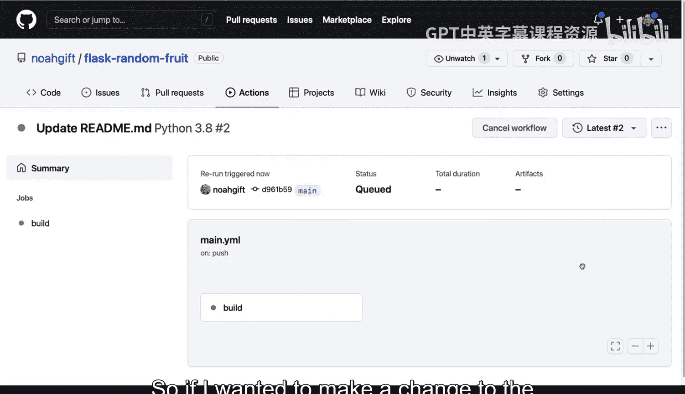
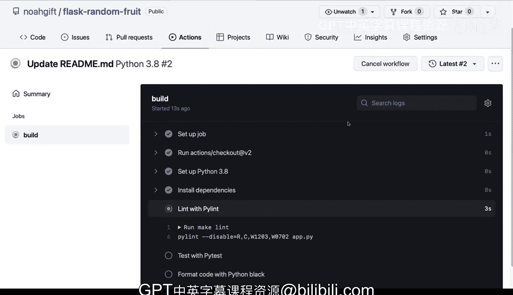

# 杜克大学｜机器学习运维｜DevOps⧸DataOps、Azure、MLFlow和抱脸｜MLOps ｜ Machine Learning Operations p12 19_01_06_Flask示例.zh_en -BV1yE421c7uA_p12-

Let's take a look at how to build a random fruit inside of a flask application。

How would we do this Well， there's a couple things to consider The first part is building a structure for your project In this case I have an application。

 a requirements file， a test app， a make file and also a build systems configuration file So these are all the assets that are used to a project inside of a continuous integration environment but also in our environment we're going to use just a little bit more code to build a microservice。

 So let's go ahead and get started。 The first thing I'm going to do is I'm going to move over to an environment where I have this code running。

And I can walk you through this structure。 The core components are first， this application。

 Not this is a small amount of code， and it generates a random fruit。

 So it takes this choice right here of one of these fruits and returns it。

 and then I build out a route in this route right here is just the home page of a web application and it returns back this random fruit from this function up here。

 and then notice I have a template where I do a little bit of HTML and I pass in the value from this random fruit function into this template。

 let's go ahead and take a look at the template。 Here we go。 it is a HTML template。

 And the only thing that's different。 If you're familiar with HTML is I have this template right here that's able to render out the value。

 Finally， if I go down to the make file， you can see I have an installation。 I have a lint。

 I have a test。 I have a format and I have it all。 So let's go ahead and test the local continuous integration。

 I'll type in make all。😊，And you can see here it goes through and it tests my insulation。

 it then next goes after the lint and it makes sure that my coat is lintting。

 and then I also go through and I do a test that tests all of the project。

 And notice this test app here is a very simple test that just says is either the apple or the cherry or the orange should appear in the output of this random fruit function。

 So really， that's it。 that's the basic structure for my application。

I'm going to go ahead and run it by typing Python app。Once I do this。

 notice that in this particular development environment， which is GitHub codespaces。

 it allows me to open a browser and preview this application， so I'll go ahead and use this。

There we go。 We see this web application generates random fruit。 That's the random fruit。

 And notice it says refresh the page for more random fruit。 I'm going to go ahead and refresh。😊。

And if I keep refreshing， it'll keep generating different random values now because it's random。

not every refresh will return the same value。 It will only return whatever value that particular function returns at the time。

 But in a nutshell， this is a great workflow for building out small based microservices and notice all the requests here pop in。

 So what if we want to go ahead and look at how the test system works because again， remember here。

 we have these test values inside of this application Well， what we can do。

I if I go to this template， I can take a look at this build system file and it's going to do the same things that I did earlier。

 make install， make Li， make tests and make format。 And if I go through here。

 I can go to Gitthub actions and I could actually select one of these things and I can say rerun all jobs and it'll go through here and it'll run the job。

 Now normally it would trigger on the build So if I wanted to make a change to the file it'll automatically test my project。

 really， this is the great thing about having continuous integration for your microservice is it sets you up for success。

 really gets everything running in a way that will make it easy for you to do continuous integration。

😊。

