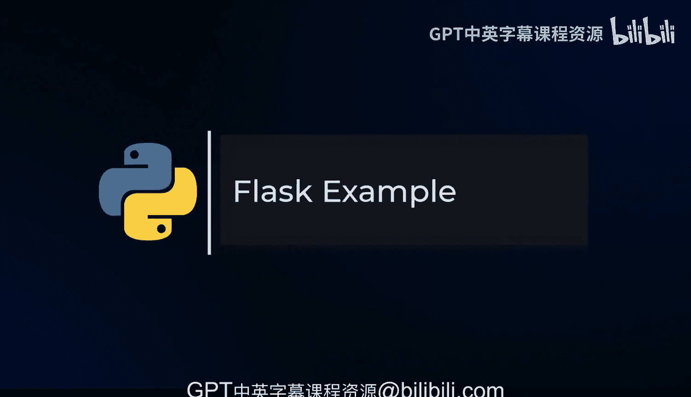
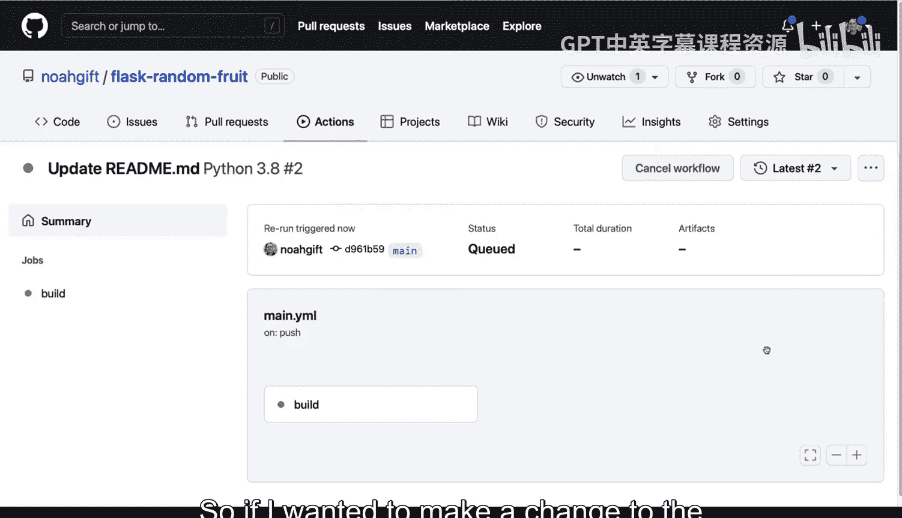
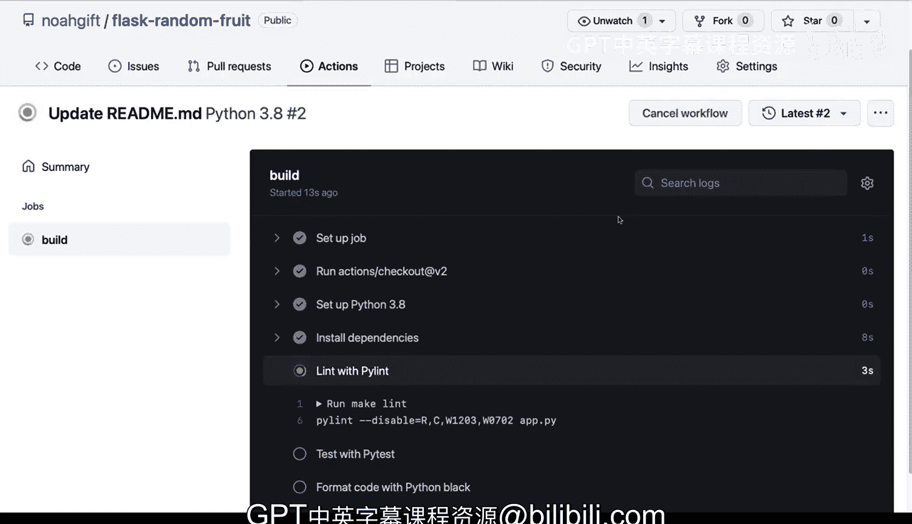

# 杜克大学｜机器学习运维｜MLOps：P12：Flask应用示例 🍇



在本节课中，我们将学习如何使用Flask框架构建一个简单的微服务应用。这个应用的核心功能是随机生成一种水果名称，并通过网页展示。我们将从项目结构开始，逐步讲解代码实现、本地测试，并最终了解如何将其集成到持续集成（CI）环境中。

---

## 项目结构 📁

首先，我们需要为项目建立一个清晰的结构。一个良好的结构有助于代码管理和自动化流程。以下是本项目包含的核心文件：

*   **`app.py`**: 这是应用的主文件，包含了Flask应用的核心逻辑。
*   **`requirements.txt`**: 列出了项目运行所依赖的Python包。
*   **`test_app.py`**: 包含了用于测试应用功能的单元测试。
*   **`Makefile`**: 一个自动化脚本，用于执行安装、代码检查、测试和格式化等任务。
*   **`build system configuration file`**: 用于配置持续集成/持续部署（CI/CD）环境的文件，例如GitHub Actions的配置文件。

这些文件共同构成了一个既适合本地开发，也适合在持续集成环境中运行的项目基础。

---

## 核心代码解析 🧑‍💻

上一节我们介绍了项目的整体结构，本节中我们来看看核心代码是如何实现的。让我们从`app.py`文件开始。

### 应用逻辑 (`app.py`)

`app.py`文件包含了Flask应用的所有后端逻辑。其核心功能是定义一个函数来随机选择一种水果，并设置一个Web路由来展示这个结果。

```python
import random
from flask import Flask, render_template

app = Flask(__name__)

def random_fruit():
    """
    这个函数从预定义的列表中随机返回一种水果。
    """
    fruits = ['Apple', 'Cherry', 'Orange']
    return random.choice(fruits)

@app.route("/")
def home():
    """
    这是应用的主页路由。
    它调用random_fruit函数，并将结果传递给HTML模板进行渲染。
    """
    fruit = random_fruit()
    return render_template("index.html", fruit=fruit)
```

代码解析：
1.  `random_fruit()`函数从一个包含`['Apple', 'Cherry', 'Orange']`的列表中随机选取一项。
2.  `@app.route(“/”)`装饰器将`home()`函数绑定到应用的根URL（即主页）。
3.  `render_template`函数用于渲染一个名为`index.html`的模板，并将随机生成的水果变量`fruit`传递给它。

### 前端模板 (`index.html`)

为了在网页上显示结果，我们需要一个HTML模板。这个模板位于`templates/index.html`。

```html
<!DOCTYPE html>
<html>
<head>
    <title>Random Fruit Generator</title>
</head>
<body>
    <h1>Random Fruit: {{ fruit }}</h1>
    <p>Refresh the page for more random fruit.</p>
</body>
</html>
```

模板解析：
*   这是一个标准的HTML文件。
*   关键部分在于`{{ fruit }}`，这是Jinja2模板语法。Flask会用从`home()`函数传递过来的`fruit`变量的实际值（如“Apple”）替换这个占位符。

---

## 本地开发与测试 🔧

我们已经构建了应用的核心部分，接下来需要确保它能正确运行并且代码质量过关。这可以通过本地自动化工具链来完成。

### 使用Makefile自动化任务

`Makefile`定义了一系列命令，可以简化开发流程。以下是其内容：

```makefile
install:
    pip install --upgrade pip &&\
        pip install -r requirements.txt

lint:
    pylint --disable=R,C app.py test_app.py

test:
    python -m pytest -vv test_app.py

format:
    black *.py

all: install lint test format
```

这个文件定义了四个任务：
*   `make install`: 安装项目依赖。
*   `make lint`: 使用pylint进行代码风格和错误检查。
*   `make test`: 运行`test_app.py`中的单元测试。
*   `make format`: 使用black工具自动格式化Python代码。
*   `make all`: 按顺序执行以上所有任务。

### 运行本地CI流程

在终端中，只需运行一个命令即可执行完整的本地持续集成流程：

```bash
make all
```

执行后，你会看到终端依次进行依赖安装、代码检查、运行测试和代码格式化。这能确保你的代码在提交前是干净且功能正常的。

### 单元测试 (`test_app.py`)

测试是保障代码质量的关键。`test_app.py`文件包含了对`random_fruit`函数的简单测试。

```python
import app

def test_random_fruit():
    """
    测试random_fruit函数返回的值是否在预期的水果列表中。
    """
    fruit = app.random_fruit()
    assert fruit in ['Apple', 'Cherry', 'Orange']
```

这个测试会调用`random_fruit()`函数，并断言其返回值是`‘Apple’`、`‘Cherry’`或`‘Orange’`中的一个。`make test`命令会运行这个测试。

### 启动应用

完成检查和测试后，就可以运行应用了：

```bash
python app.py
```

应用启动后，你可以在浏览器中访问它（在GitHub Codespaces等开发环境中，通常会提供预览功能）。每次刷新页面，都会看到随机显示的不同水果名称。

---

## 集成到持续集成（CI）环境 🚀

前面的步骤都是在本地完成的。为了在团队协作或自动化部署中保持代码质量，我们需要将这套流程集成到CI环境中，例如GitHub Actions。

### CI配置文件

项目中的构建系统配置文件（如`.github/workflows/python-app.yml`）定义了在代码推送或拉取请求时自动执行的任务。其内容通常与`Makefile`中的`all`目标一致：

```yaml
name: Python Application CI

on: [push, pull_request]

jobs:
  build:
    runs-on: ubuntu-latest
    steps:
    - uses: actions/checkout@v2
    - name: Run Make All
      run: make all
```

这个配置告诉GitHub Actions：每当有代码推送（push）或拉取请求（pull_request）时，在一个Ubuntu系统上执行`make all`命令。

### CI流程的优势

一旦配置好，CI流程将自动运行：
1.  当你向代码仓库推送更改时，GitHub Actions会自动启动一个任务。
2.  该任务会拉取你的代码，并依次执行`make install`、`make lint`、`make test`和`make format`。
3.  你可以通过GitHub的界面查看任务运行结果。如果任何一步失败（例如测试未通过），你会立即收到通知。

这种自动化测试确保了代码库的稳定性和一致性，是实施MLOps和DevOps实践的重要基础。

---

## 总结 📝



本节课中，我们一起学习了一个完整的Flask微服务示例。我们从搭建项目结构开始，编写了生成随机水果的后端逻辑和前端模板。接着，我们利用`Makefile`实现了本地开发任务的自动化，包括依赖管理、代码检查、测试和格式化。最后，我们探讨了如何将这套本地流程通过配置文件集成到GitHub Actions中，实现自动化的持续集成。



这个示例虽然简单，但它清晰地展示了一个可测试、可维护且适合自动化部署的微服务应具备的基本要素和开发工作流。掌握这些是构建更复杂机器学习运维（MLOps）管道的第一步。