# 杜克大学｜机器学习运维｜DevOps⧸DataOps、Azure、MLFlow和抱脸｜MLOps ｜ Machine Learning Operations p120 43_04_05_AWS AI与ML服务.zh_en -BV1yE421c7uA_p120-

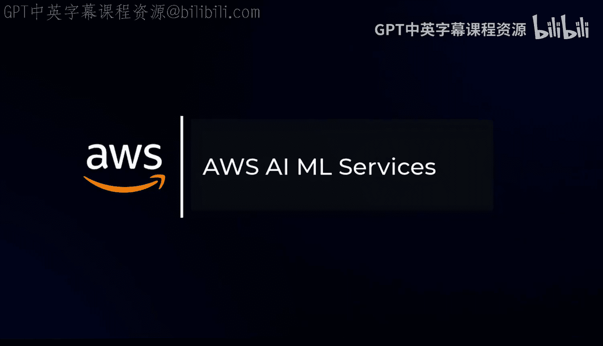

Let's take a look at the AWS machine learning services here。

 If you go over to services and scroll down to machine learning。

 this is a great way to get an idea of some of the different things you could do on the AWS platform and there are some very high level services that are worth getting into first is AWS comprehend。

 if I want to go to AWS comprehend and use this for doing natural language processing， for example。

 one of the ways you could do this is by doing a builtin analysis and you could put in here this is a great day。

😊。

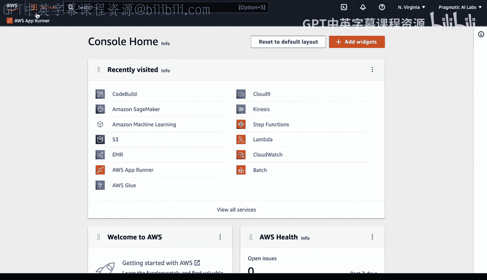

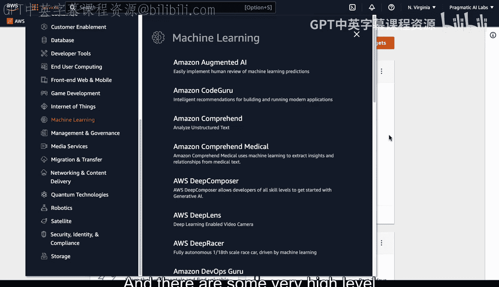

Analyze it and then notice that， in fact， it's able to look at key phrases， detect the language。

Find if there is any personally identifiable information and then detect the confidence of the sentiment。

 in this case， it's a very strongly positive message。

 So this is a great service to use and you can call it very simply from a console as well。

 So if I wanted to open up， for example， cloud shell environment。

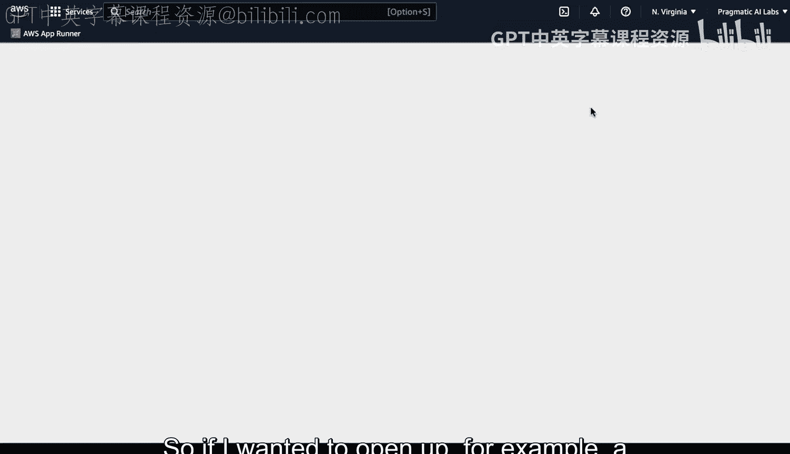

Open up a shell and start playing around with the SDK。 That's also a great way to do that。

 I can leave that running and then keep going here。

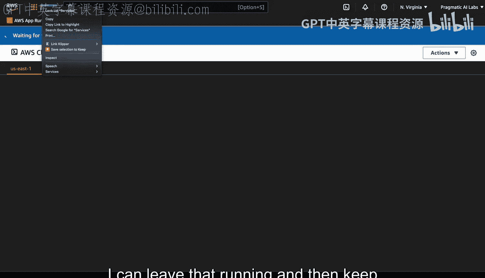

And open up another tab。So if I go back to the machine learning services here。

 another one to play around with that shows some of the high levelvel services that you can do is recognition。

 so if I want to go here and try out how to use this to detect labels， for example。

 we see label detection， facial analysis， text and images。

 all these I can just do by dropping things inside of this console so what I could do because I could grab a cat picture from my desktop and if I drop this into this location。

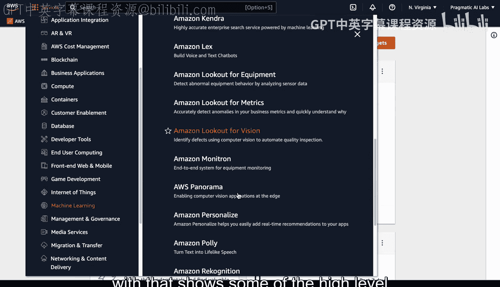

It's able to successfully identify this as a cat and then give me some other labels as well again。

 if I want to do a request here， I could call into this service and then use the Python interpreter for example。

 to build a solution and again， if I went back to Cloudhell launched it。

 went through here and ran the SDK I could also make API calls here Now how would you do this， Well。

 one of the ways to do this is to look at Bodo 3。

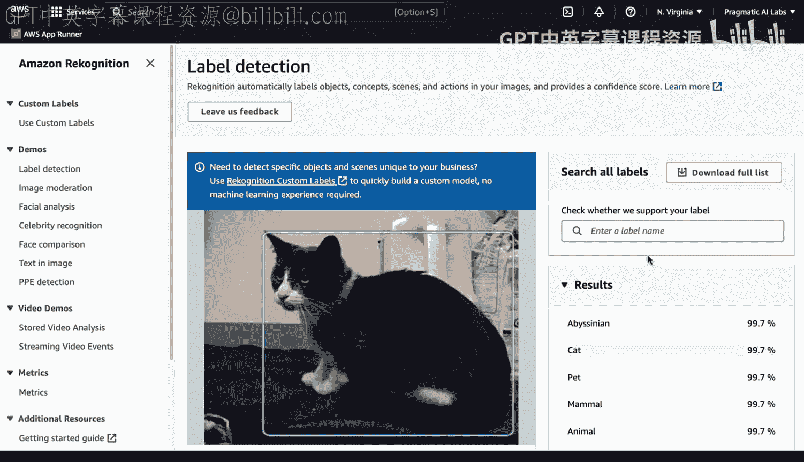

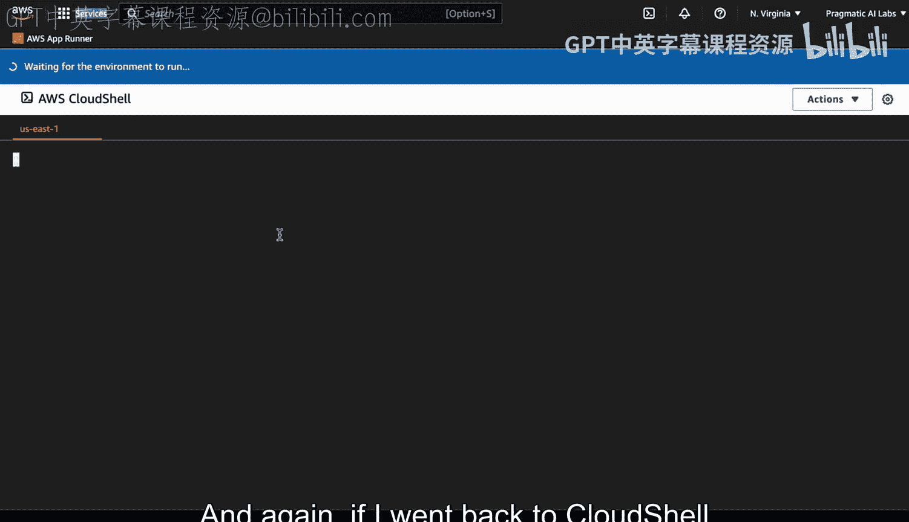

And you can look at the particular service that you're trying to find so in this case。

 if I wanted to look at comprehend， for example， you can see that it's a fairly straightforward way to use the service it's just one line of code to make a client and then if I wanted to go into the sentiment analysis I could go down here and say sentiments there we go tech sentiment and it's a pretty straightforward process to detect sentiment here we go just like that so in fact we can actually get back to this shell here and type in I Python。

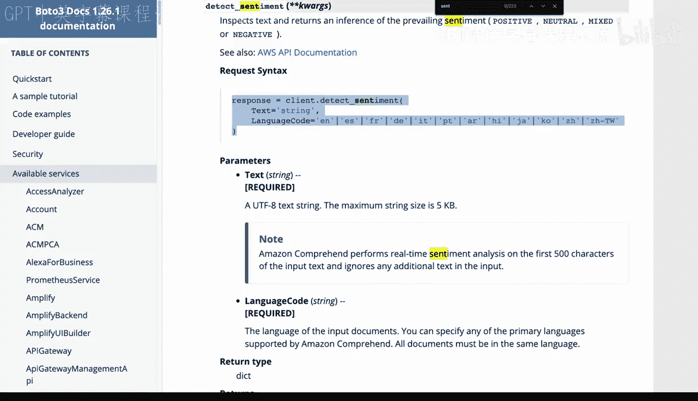

And see if Bodo 3 is loaded import port Bodo 3。Go through here。 comprehend。And then we can say text。

No， it is a great day。

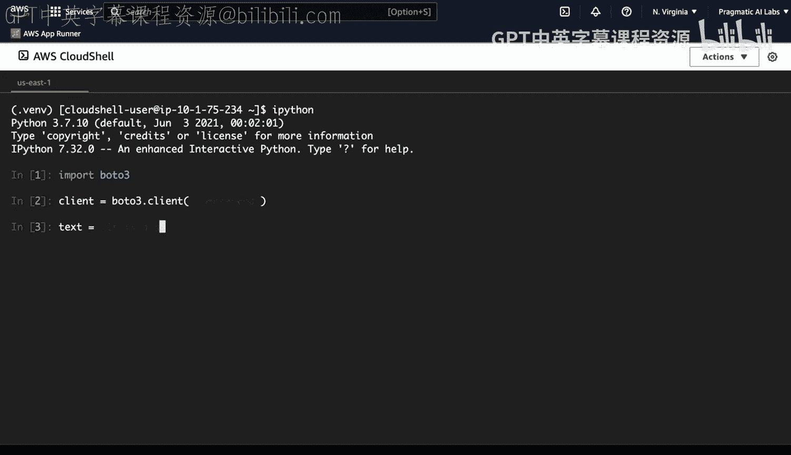

And then if we want to go ahead and do a sentiment analysis command。We can do sentiments。Alysis。

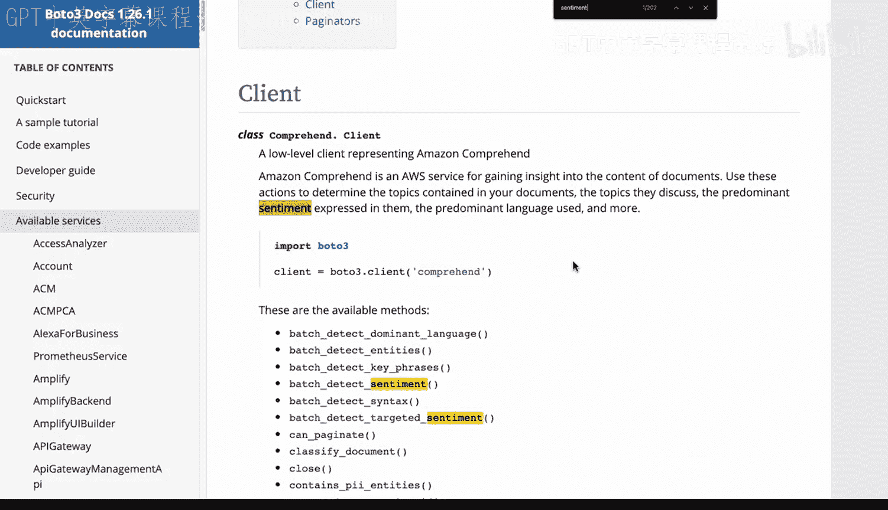

And we can do this part of it。Here we go。And then the text。 So we'll say text is equal to text。

And then， finally。What we can do is do language code is English。Perfect language code is English。

And then we can look at the response。There we go， we have a positive sentiment as well。

 so really doing things from the console， also doing them from the Cloud shell environment is a great way to use EWS machine learning services。

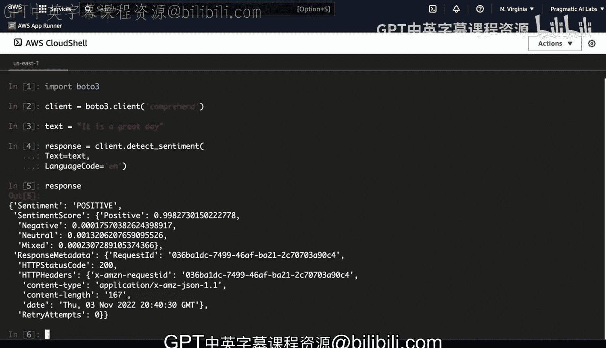