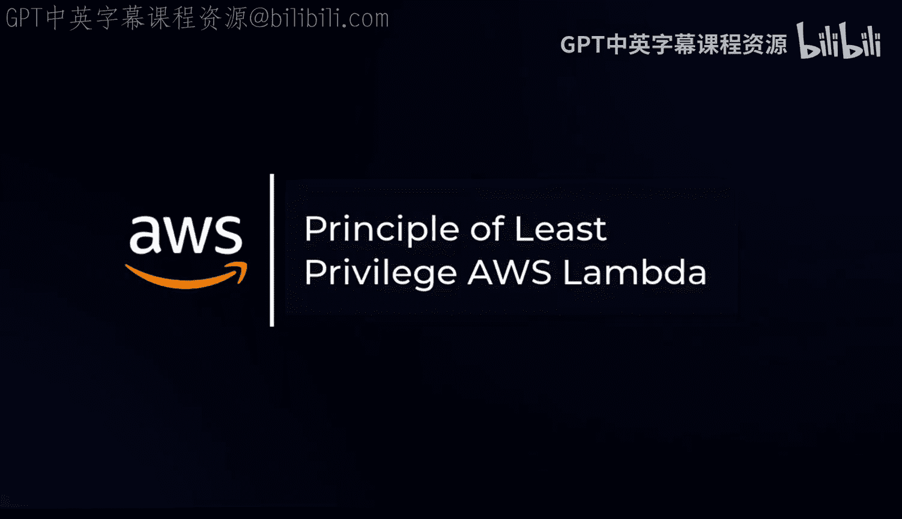
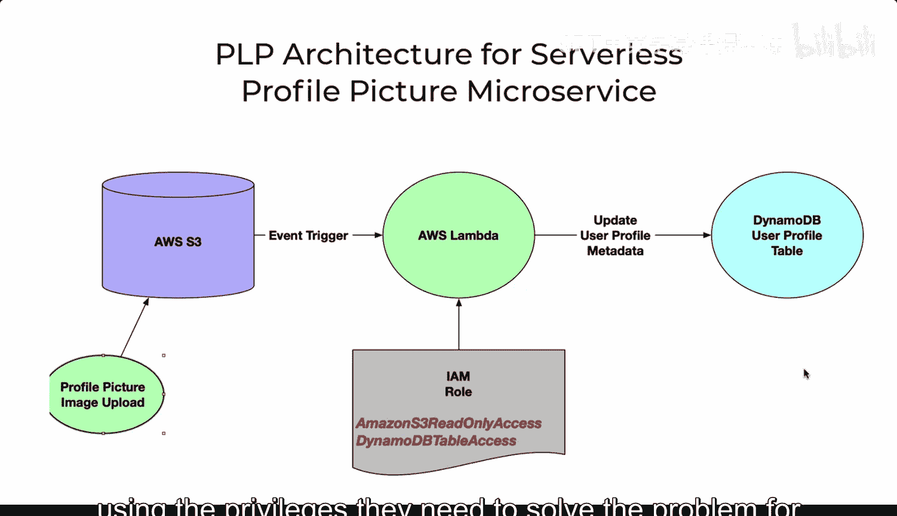

# 杜克大学｜机器学习运维｜DevOps⧸DataOps、Azure、MLFlow和抱脸｜MLOps ｜ Machine Learning Operations p121 44_04_02_最小权限原则与AWS Lambda.zh_en -BV1yE421c7uA_p121-

Here we have the principle of least privilege architecture for serverless。

 And in this particular microservice， you can see that。

The Lambda microservice is given only access to S3 to read and also access to dynamo Db table and what this does is it allows us to restrict exactly what this microservice does so it only is able to do the things that are required for it to function。

 it isn't given extra responsibilities and this makes it much more secure。

 so in this particular scenario a picture is uploaded， put into S3 it triggers this Lada function。

 this Lada function would then go through and update the user profile。

 This could be part of a machine learning system that then later goes in and decides to apply some kind of pretrained model to these images that are loaded inside of S3 and then does some kind of inpa or or identifies labels for this but the idea is that all parts of the system as they're being developed are only using the privileges they need to solve the problem for their。

Particular microservice。