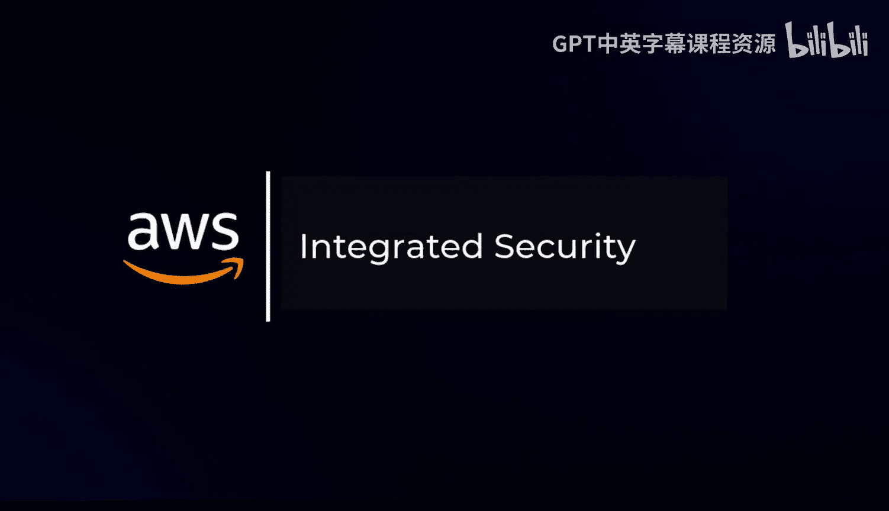
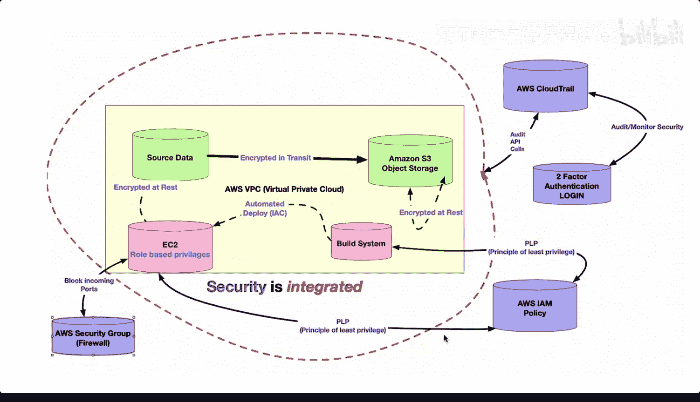

# 杜克大学｜机器学习运维｜DevOps⧸DataOps、Azure、MLFlow和抱脸｜MLOps ｜ Machine Learning Operations p122 45_04_03_集成安全性.zh_en -BV1yE421c7uA_p122-

Here we see an integrated security diagram for AWS that shows the power of how a properly constructed network has many different layers of security。

 First up， we have AWS security Firewall is able to block incoming ports。

 So we can see here from E C2 as well， we have roll based privileges。

 So this is going to limit the attack vector。 Finally， we're encrypting the data。

 when we're using it at rest。 And then when it's in transit if it's going from， for example。

 EBS storage to S3 storage， it's encrypted in to end。 Finally。

 the entire thing is inside of a virtual private cloud。

And because we're using automated deployment or infrastructure as code。

 we don't have to worry about making manual mistakes。And finally。

 we can see that monitoring systems are able to integrate with this。Integrated security system。

 and so we see that AWS Cloud Trail， we can look at the API calls and really introspect every single action that's occurring in the network when we're logging into our console account。

 we can enable tofactor authentication and then we're able to audit and monitor whose actually logging into the account and then with AWS IEM policy。

 we're able to implement the least privileges so the build system is only able to use exactly the privileges it needs to do a deployment likewise the service itself it's only able to use the exact privileges it needs because it's got role-based privileges。

So this integrated security concept is one of the key fundamentals to designing a secure network。

