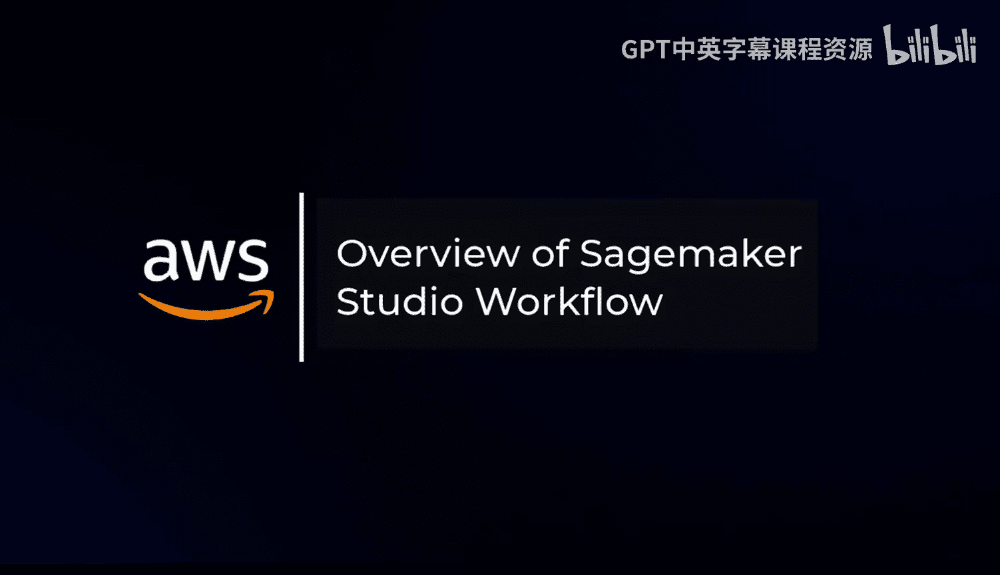
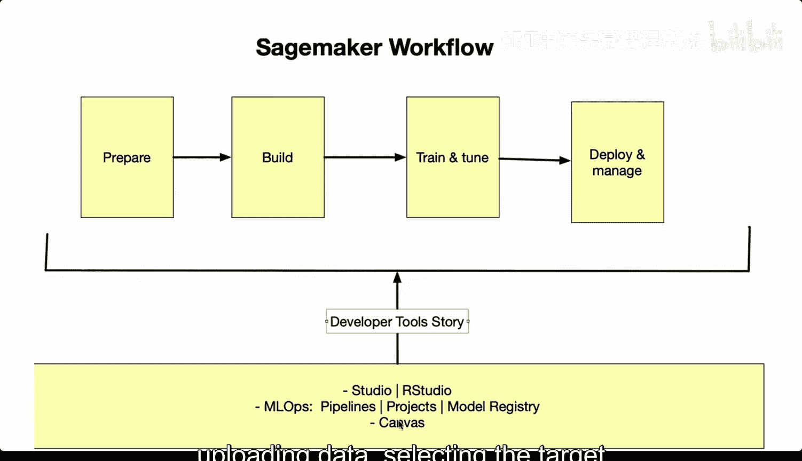
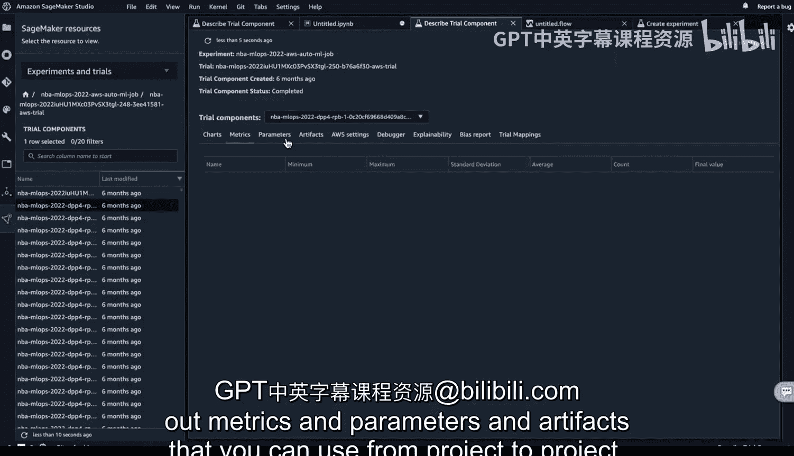

# 杜克大学｜机器学习运维｜DevOps⧸DataOps、Azure、MLFlow和抱脸｜MLOps ｜ Machine Learning Operations p123 46_04_04_SageMaker Studio工作流概述.zh_en -BV1yE421c7uA_p123-

Here is a sagemakerr workflow on AWS。You first start with preparing your data。

 then building the data， then using training and tuning to make sure that your model is correct。

And then deploying and then managing that model in production， for example。

 working with particular versions of your model， doing AB testing and then also doing predictions against that particular model and knowing when you should do a retraining job so is there a data drift tissue。

This is all the developer tool story。One other thing to mention is that there are a whole suite of tools that break down into different categories in terms of ML appss。

 There are pipelines， projects and model registry in terms of studio。

 there's not only the regular sageMaker studio， but also our studio integration。

 and then we have Canvas， which is a highle business intelligence type nocode lowcode tool that allows you to build machine learning problems by just uploading data selecting the target column and then doing a prediction。

 Here we have Amazon Sagemakerr studio， which is the developer friendly environment for building machine learning applications。

 a good place to start is the launcher， you can jumpstar models algorithm solutions。

 you can also build models automatically by creating an autopilot experiment。

 you can put in the name of your experiment， the location of your data， and then go from there。

Another thing you can do is import and explore data。 So if we go ahead and select this item。

One of the nice things that this does is it allows you to begin your data visualization by really first starting with whatever it is you have in your environment and pointing and clicking and building out solutions。

 Another thing you can do if you go to this launch menu here is to look at different tasks and components。

 so building a data flow， new compilation job， a new project。

All of these show up and you can also get more into the weeds and also just fire up a notebook and start building a solution from scratch。

 whatever it is you needed to do when you when you start your project。

 So really sageMake studio as a whole suite of tools it has these launch menus that are a good place to start。

 but it also allows you to look at previous experiments and trials and so this experiment tracking is a great resource as well for you to actually build out metrics and parameters and artifacts that you can use from project to project。

