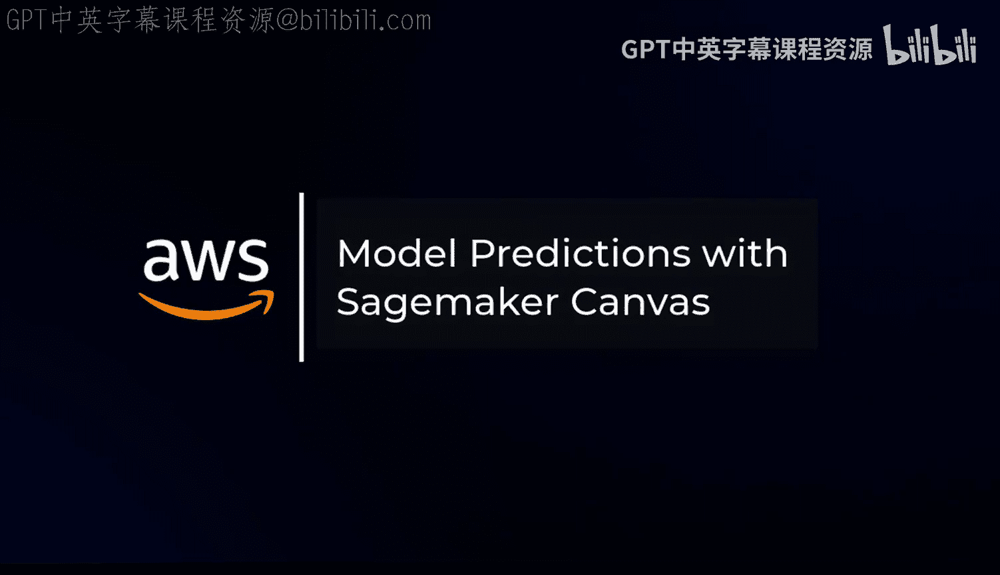
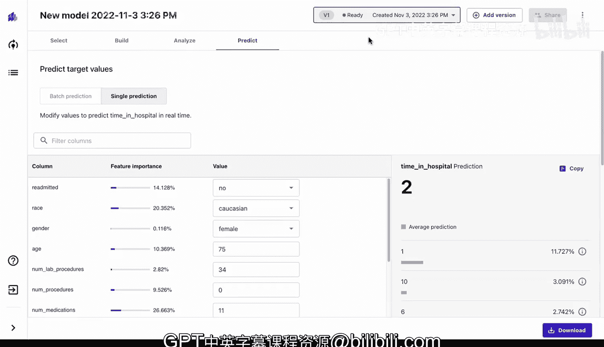

# 杜克大学｜机器学习运维｜DevOps⧸DataOps、Azure、MLFlow和抱脸｜MLOps ｜ Machine Learning Operations p124 47_04_05_使用SageMaker Canvas进行模型预测.zh_en -BV1yE421c7uA_p124-

Here we have S maker canvass， and I'm looking at a model。

That this model is able to correctly predict time in a hospital22% of the time。

 and so it may need a little bit of work here， but one of the things we can do is we can look at the impact of each of the columns So for example。

 the number of medications appears to be one of the strongest features that's driving this particular model also the number of lab procedures right。

 these are two of the highest features。 Now if I wanted to put this into production one of the ways to do this is to go to predict once we go to predict we have a couple options here。

 we could do a batch-based predictions so I could feed in a data and it could do a bunch of predictions on that data or I could go to single prediction and it would allow me to actually do predictions against this particular model right here。

Another thing that's pretty helpful about this process。

Is that by just tweaking things in real time here， you can see that it's able to actually allow me to make changes to this prediction system。

 Now， another thing that we can do。Here is we can also go to different versions of the model as well and allow us to build out and toggle between different versions。

 So， for example， if I wanted to try out a new feature that I just just create and retrain the model on。

 I can have multiple versions and then do a batch piece prediction and see where it goes。

 So using canvas is a great way to get some of the ideas at a high level around machine learning solved and you can also do this by building your own machine learning system with Sagemakerr or building your own system outside using a tool like cloud 9。

