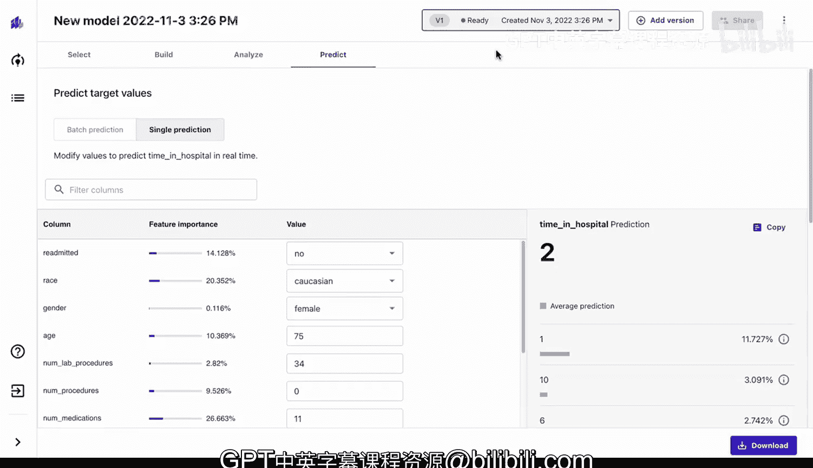

# 杜克大学｜机器学习运维｜MLOps：124：使用SageMaker Canvas进行模型预测 🎨

在本节课中，我们将学习如何使用亚马逊SageMaker Canvas平台进行模型预测。我们将了解如何评估模型性能、分析特征重要性，并探索进行批量预测与单样本预测的方法。

---

## 模型概览与性能评估

上一节我们介绍了模型训练的基础，本节中我们来看看如何评估和使用已训练好的模型。

我们正在查看SageMaker Canvas中的一个模型。该模型能够正确预测住院时间的准确率为22%。因此，这个模型可能还需要一些改进工作。

## 分析特征重要性

评估模型时，理解哪些因素对预测结果影响最大至关重要。以下是分析特征重要性的方法：

我们可以查看每一列（特征）对模型预测结果的影响。例如，“用药数量”似乎是驱动此特定模型的最强特征之一，“实验室检查程序数量”也是影响力最高的特征之一。

## 执行模型预测

在理解了模型表现和关键特征后，下一步就是利用模型进行实际预测。

如果我想将此模型投入生产，方法之一是点击“预测”。进入预测界面后，我们有几个选项。

以下是可用的预测模式：

*   **批量预测**：我可以输入一批数据，模型将对这些数据进行批量预测。
*   **单样本预测**：此模式允许我针对此特定模型进行单一样本的实时预测。

## 实时调整与预测

这个预测过程的一个非常实用的特点是，通过在此处实时调整输入值，我可以看到系统能够允许我对此预测系统进行更改并立即观察预测结果的变化。

## 管理多模型版本

在模型开发迭代过程中，经常需要测试不同版本。以下是管理模型版本的方法：

我们还可以在此处切换到模型的不同版本，允许我们构建并在不同版本之间切换。例如，如果我刚刚创建了一个新特征并基于此重新训练了模型，我可以拥有多个版本，然后进行批量预测来比较不同版本的表现。

---

## 总结

本节课中我们一起学习了如何使用SageMaker Canvas进行模型预测。我们首先查看了模型的整体性能（22%的准确率），然后通过特征重要性分析识别出关键驱动因素（如用药数量和实验室检查数量）。接着，我们探索了两种预测模式：批量预测和单样本预测，并体验了实时调整输入以观察预测变化的功能。最后，我们了解了如何管理多个模型版本以进行迭代测试。使用Canvas是快速验证机器学习想法的高效方式，当然你也可以选择使用SageMaker Studio或Cloud 9等工具构建自己的机器学习系统。