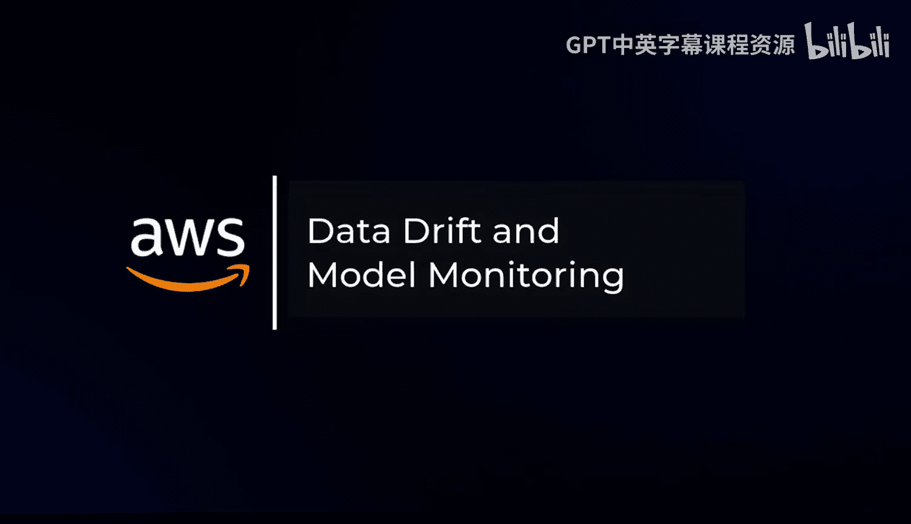
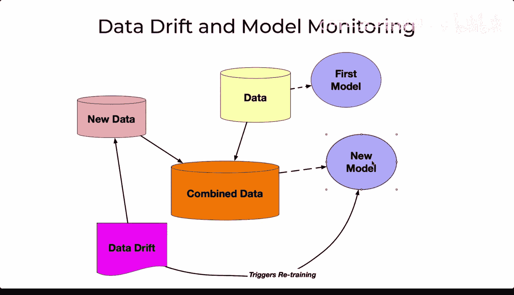

# 杜克大学｜机器学习运维｜DevOps⧸DataOps、Azure、MLFlow和抱脸｜MLOps ｜ Machine Learning Operations p125 48_04_06_数据漂移与模型监控.zh_en -BV1yE421c7uA_p125-

Here we have data drift and model monitoring in action。The best way to describe it is， first。

 you have data。The data is used to create a model。 This model could be in production somewhere。

 potentially predicting Covid-19， for example， maybe it's a vaccine that's been generated。

 which is the endpoint。 and then later as new data comes into play like new variant of the disease come in。

 you create a data drift alert。 and this alert says we need to actually train a new model。

 the new model is a combined set of data from the original data。

 and the new data that's actually occurred since the last model went into production。

Once this happens， a new model is registered， trained， deployed， put into production。

 and then in the future the same process will occur again， and then there'll be a third model。

 so really fairly straightforward process to think about data drift and model monitoring。

 but the idea is that is that as new data comes in。

 you create a new model and put that model into production。

