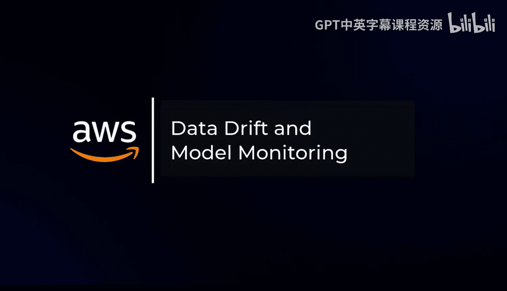
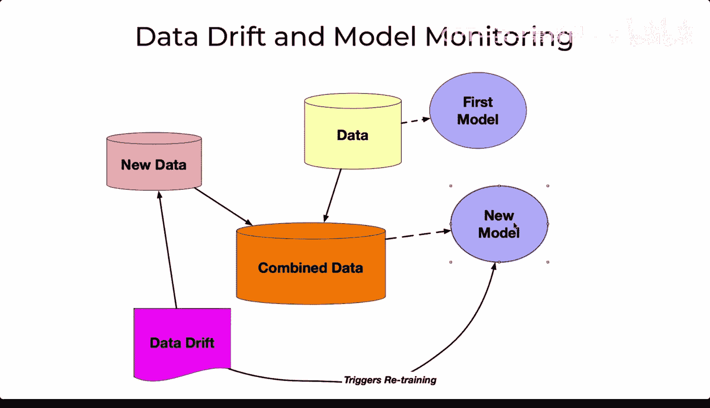

# 机器学习运维：125：数据漂移与模型监控 📊

在本节课中，我们将学习数据漂移与模型监控的核心概念和工作流程。这是一个确保机器学习模型在生产环境中持续有效的重要过程。

## 概述

数据漂移与模型监控是一个持续的过程，旨在检测模型性能因输入数据变化而下降的情况，并触发模型更新。接下来，我们将详细拆解这个过程。

## 工作流程详解

上一节我们概述了监控的重要性，本节中我们来看看数据漂移与模型监控的具体步骤。

整个过程始于数据。这些数据被用于创建一个初始的机器学习模型。

这个模型会被部署到生产环境的某个地方。例如，它可能正在预测新冠疫情的发展趋势，或者是一个已生成的疫苗模型，这构成了整个流程的终端应用。

随着时间的推移，当新的数据开始出现时，例如疾病的新变种出现，监控系统会检测到数据分布的变化。

此时，系统会创建一个**数据漂移警报**。这个警报表明，我们需要基于新的数据情况重新训练模型。

新模型的数据集由原始数据和自上一个模型部署以来出现的新数据共同组成。

以下是触发模型更新的关键步骤：
1.  检测到数据分布发生显著变化。
2.  系统自动或人工确认发出数据漂移警报。
3.  准备结合了历史数据与最新数据的新训练集。

一旦上述步骤完成，一个新的模型就会被注册、训练、部署，并最终投入生产使用。

在未来，当再次出现显著的数据漂移时，相同的过程会再次发生，从而产生第三个、第四个模型。

因此，思考数据漂移与模型监控的过程其实相当直观。其核心思想是：当新的数据输入时，你需要创建新模型并将其投入生产。

## 总结

本节课中我们一起学习了数据漂移与模型监控的完整流程。我们了解到，这是一个循环往复的机制，通过持续监控数据变化、及时发出警报并重新训练模型，来确保机器学习应用能够适应现实世界的变化，保持预测的准确性和可靠性。