# 机器学习运维：第49章：使用AWS App Runner部署PyTorch FastAPI应用 🚀

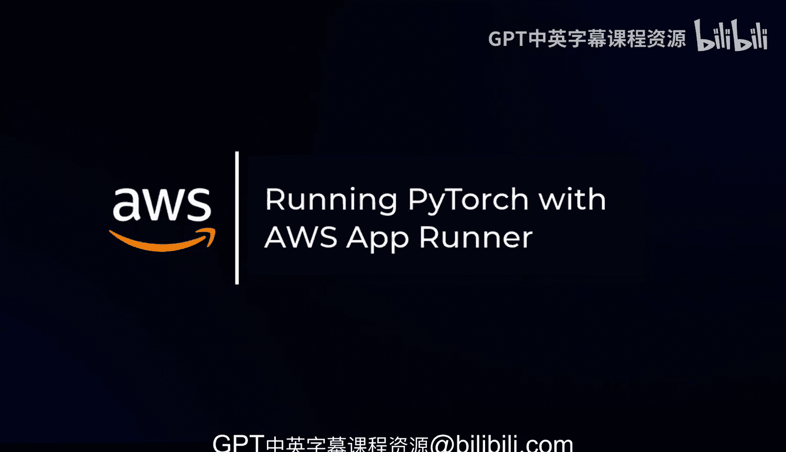

在本教程中，我们将学习如何将一个基于PyTorch和FastAPI构建的机器学习应用，通过AWS App Runner平台即服务（PaaS）部署到云端。整个过程涵盖本地开发、容器化构建、推送到AWS容器仓库（ECR），以及最终在App Runner上创建和运行服务。

---

## 概述 📋

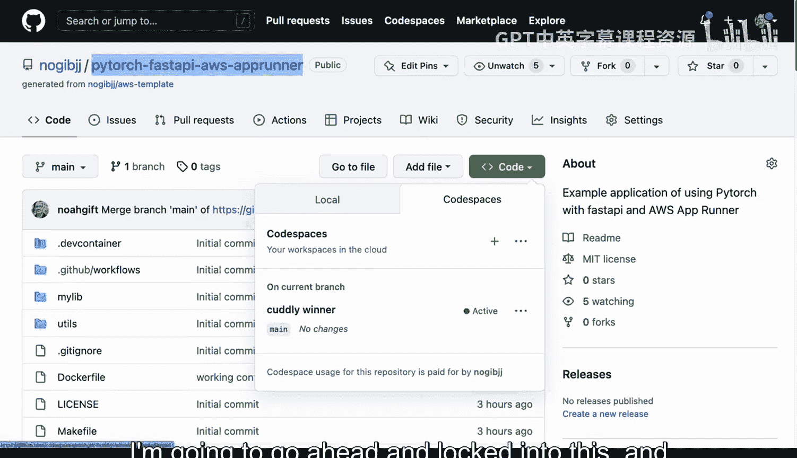

我们将从一个包含PyTorch模型和FastAPI框架的代码仓库开始。首先在本地或云端开发环境（如GitHub Codespaces）中运行并测试应用。接着，我们将应用容器化，并推送到AWS Elastic Container Registry（ECR）。最后，利用AWS App Runner服务，从ECR拉取容器镜像并部署为一个可公开访问的、安全的机器学习微服务。

---

## 1. 准备开发环境与代码 🛠️

我们从一个专为AWS App Runner部署设计的PyTorch FastAPI代码仓库开始。该应用也可以在GitHub Codespaces等云端开发环境中运行。

以下是项目`requirements.txt`文件的主要内容，它列出了运行所需的核心依赖：

```txt
fastapi
uvicorn
pillow
torch
torchvision
```

这些包确保了FastAPI Web框架、ASGI服务器、图像处理以及PyTorch深度学习库的可用性。项目也包含一个`Dockerfile`，为后续的容器化部署提供了基础。

---

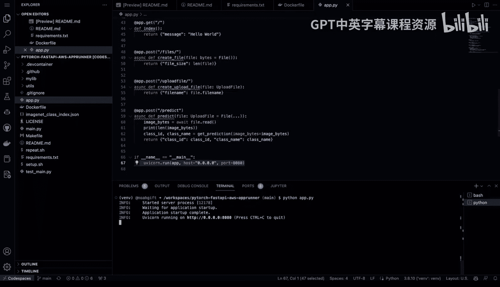

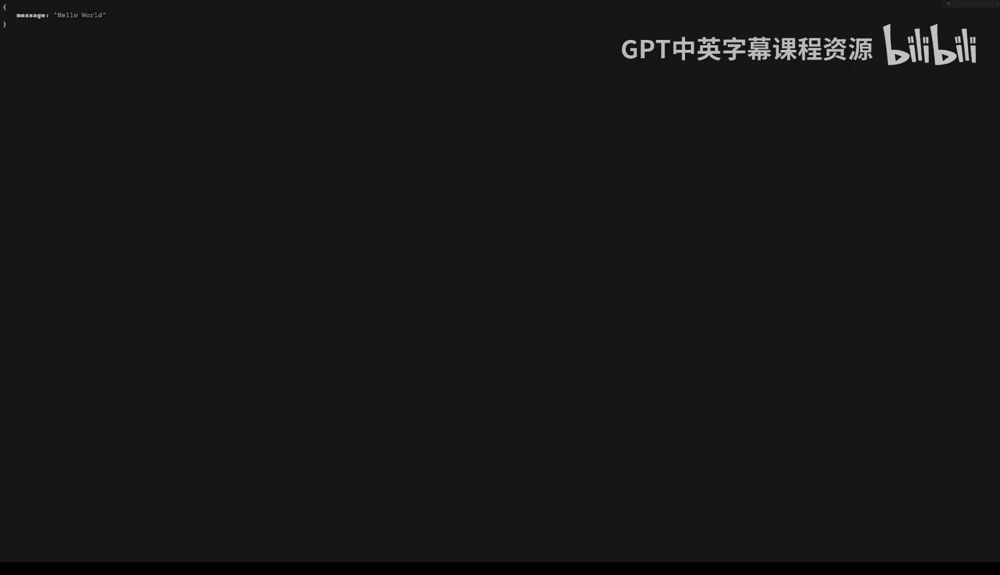

## 2. 理解应用代码结构 🧠

上一节我们介绍了项目依赖，本节我们来深入查看应用的核心代码逻辑。主应用文件（例如`app.py`）主要包含以下几个部分：

1.  **导入与初始化**：导入必要的库（FastAPI, PyTorch, PIL等），加载一个预训练的PyTorch模型，并初始化FastAPI应用实例。
2.  **图像处理与预测函数**：定义辅助函数，用于对上传的图像进行预处理（变换），并调用模型进行预测。
3.  **API路由定义**：
    *   `/`：一个简单的“Hello World”端点，用于调试和服务健康检查。
    *   `/predict`：核心预测端点。它接收上传的图像文件，调用预测函数，并返回分类结果（例如，判断是否为“猫”）。

代码的核心预测逻辑可以简化为以下流程：

```python
# 伪代码示意核心流程
@app.post("/predict")
async def predict(file: UploadFile):
    image = read_image(file)          # 读取上传文件
    tensor = transform_image(image)   # 预处理图像
    prediction = model(tensor)        # 模型预测
    label = decode_prediction(prediction) # 解析预测结果
    return {"prediction": label}
```

---

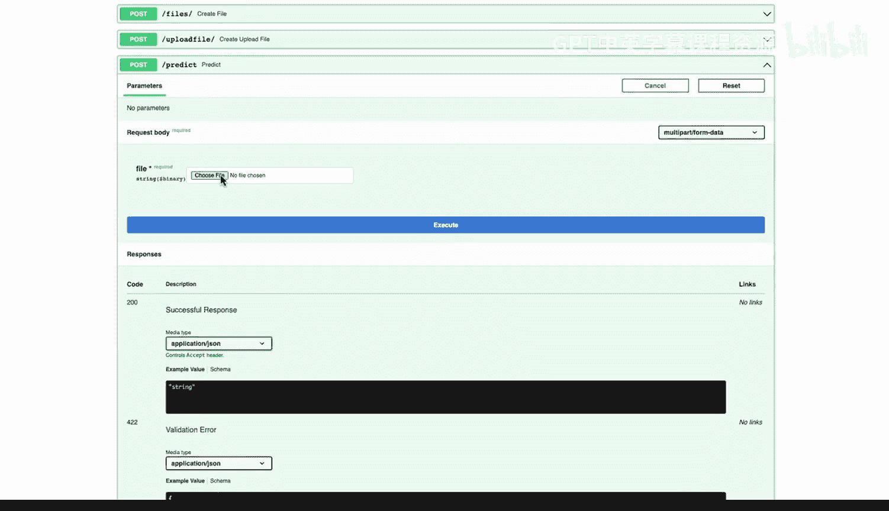

## 3. 本地运行与测试 ✅

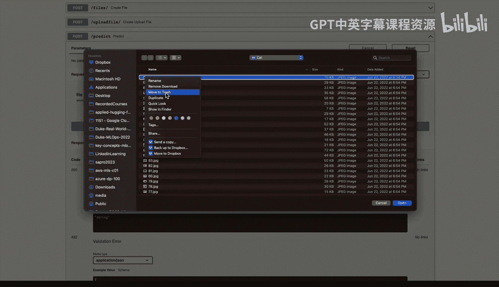

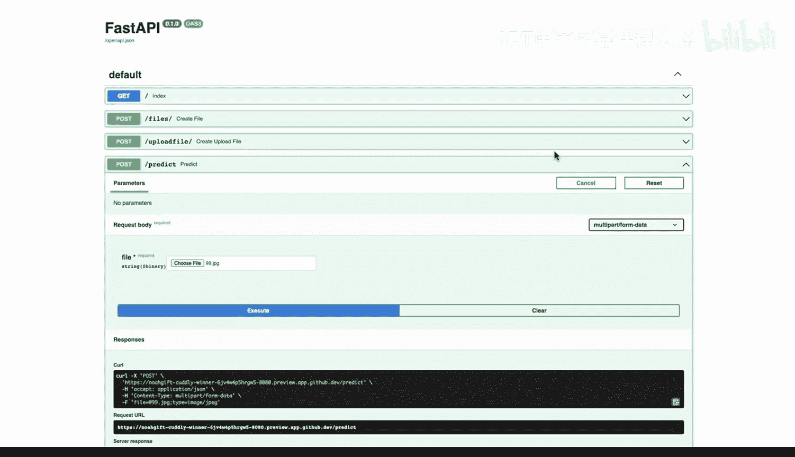

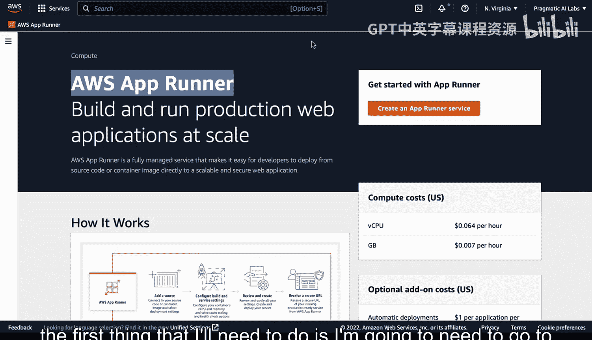

在部署到云端之前，在本地环境中运行和测试应用至关重要。

在项目根目录下，使用以下命令启动开发服务器：

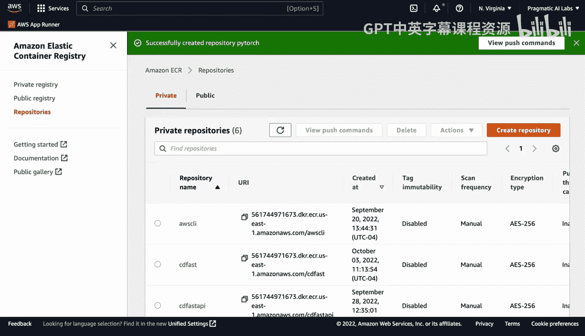

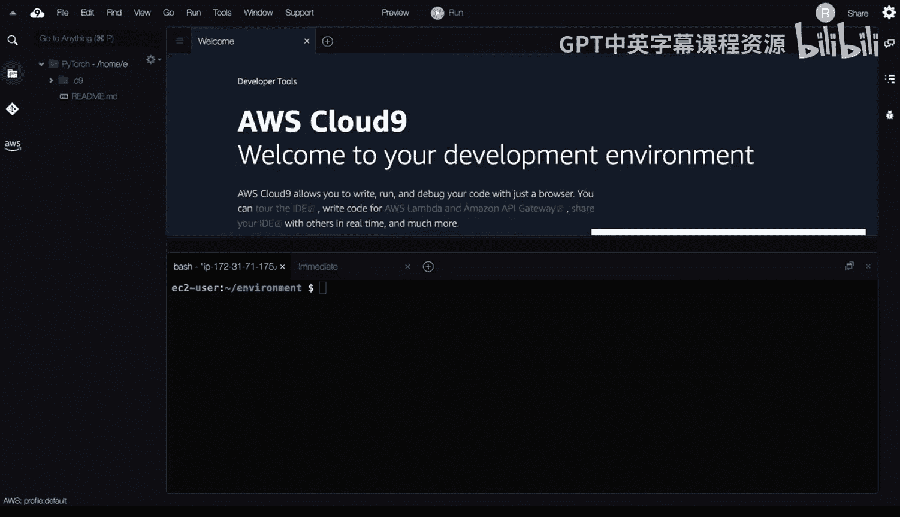

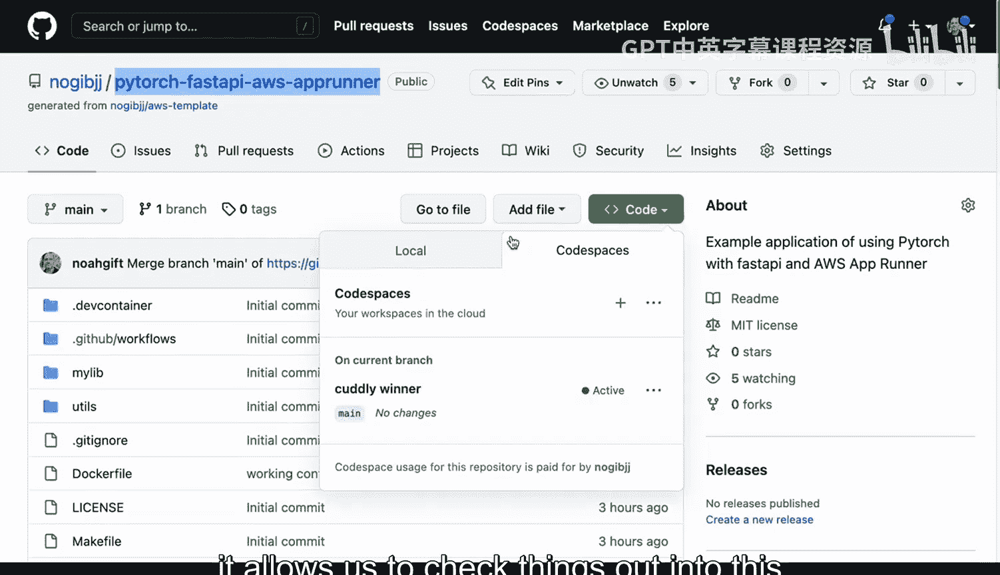

```bash
python app.py
# 或使用 uvicorn: uvicorn app:app --reload
```

服务启动后，在浏览器中访问 `http://localhost:8000/docs`，即可打开自动生成的Swagger API文档界面。

以下是测试步骤：
1.  在Swagger UI中，找到 `/predict` 端点并点击“Try it out”。
2.  选择一张本地图片（例如一张猫的图片）进行上传。
3.  点击“Execute”执行请求。
4.  观察返回的JSON响应，确认应用成功地对图片进行了分类（例如，返回 `"Egyptian cat"`）。

本地测试成功，验证了应用逻辑的正确性。

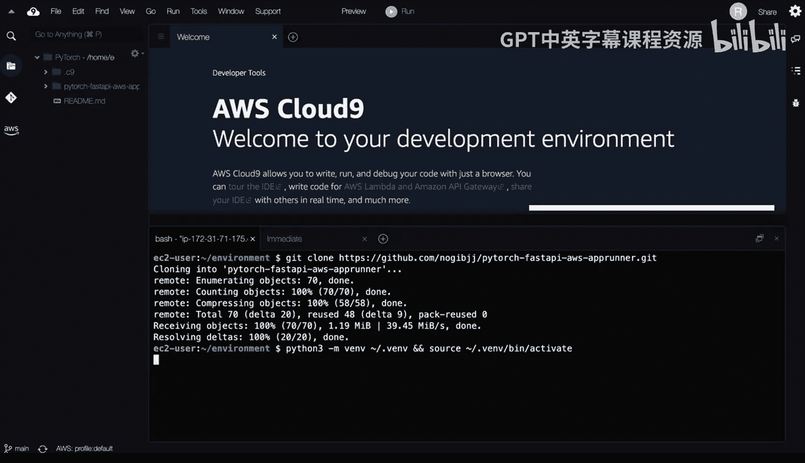

---

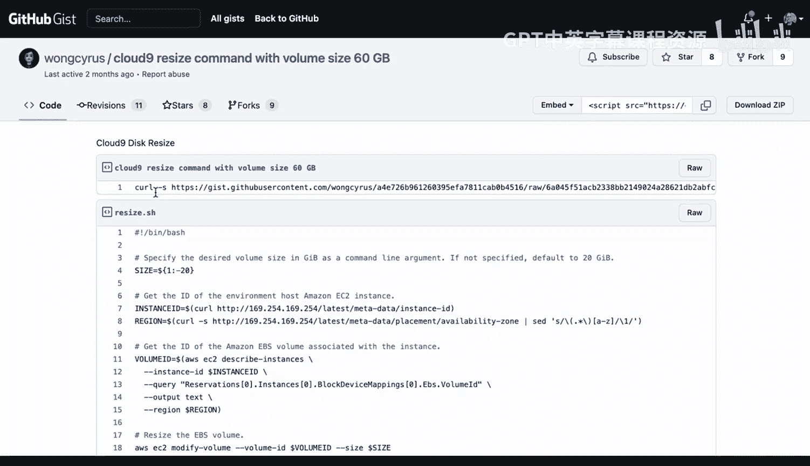

## 4. 容器化与推送到AWS ECR 🐳

上一节我们确保了应用在本地运行正常，本节我们将应用打包成Docker容器，并推送到AWS Elastic Container Registry（ECR），为App Runner部署做好准备。

**步骤概览：**

1.  **创建ECR仓库**：在AWS控制台为你的容器镜像创建一个新的私有仓库（例如命名为 `pytorch-fastapi`）。
2.  **准备构建环境**：使用AWS Cloud9（一个基于云的IDE）或任何已配置AWS CLI的环境。克隆代码仓库并安装依赖。
3.  **构建Docker镜像**：在项目目录下，使用`Dockerfile`构建镜像。
    ```bash
    docker build -t pytorch-fastapi .
    ```
4.  **标记镜像**：将本地镜像标记为指向你的ECR仓库URI。
    ```bash
    docker tag pytorch-fastapi:latest <your-aws-account-id>.dkr.ecr.<region>.amazonaws.com/pytorch-fastapi:latest
    ```
5.  **推送镜像**：登录ECR，并将标记好的镜像推送到仓库。
    ```bash
    aws ecr get-login-password --region <region> | docker login --username AWS --password-stdin <your-aws-account-id>.dkr.ecr.<region>.amazonaws.com
    docker push <your-aws-account-id>.dkr.ecr.<region>.amazonaws.com/pytorch-fastapi:latest
    ```

完成推送后，你的容器镜像已安全地存储在AWS ECR中。

---

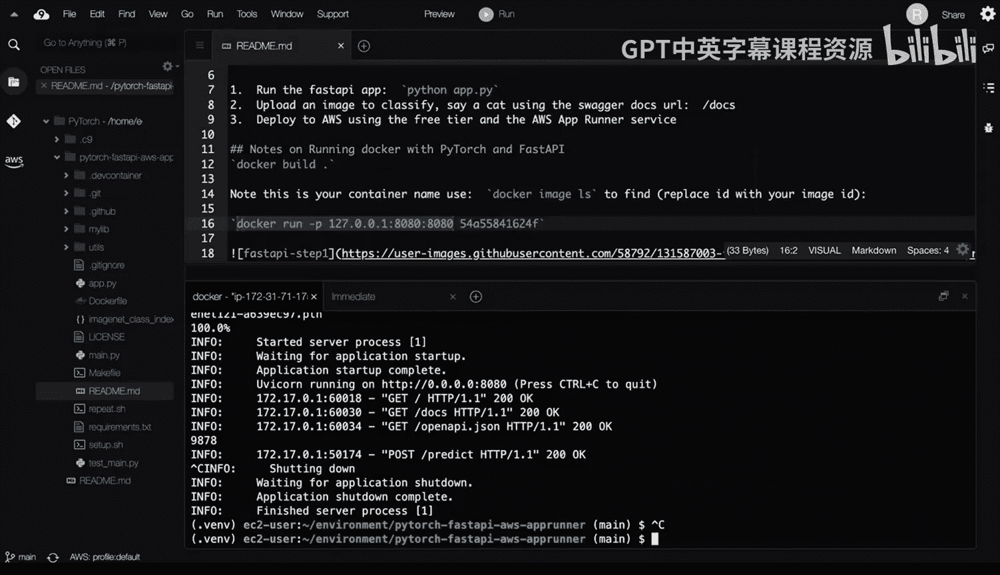

## 5. 使用AWS App Runner部署服务 ☁️

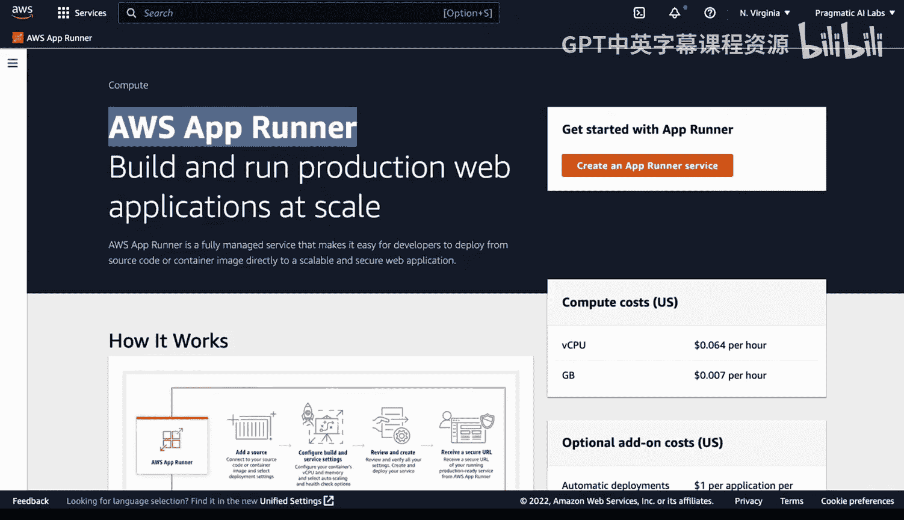

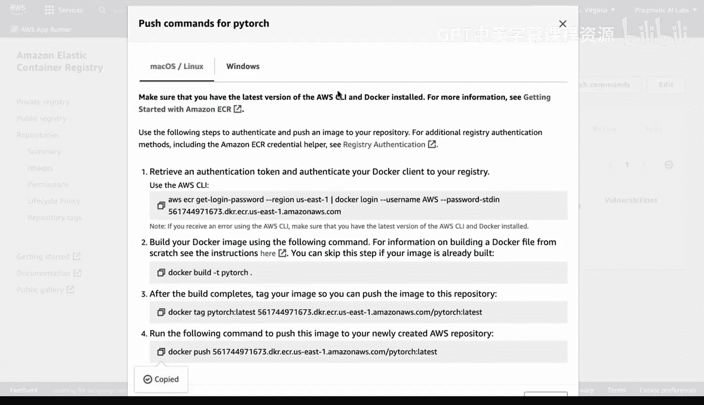

现在，容器镜像已准备就绪，我们可以使用AWS App Runner来部署和管理我们的微服务。

**部署流程：**

1.  在AWS控制台导航到App Runner服务，点击“创建服务”。
2.  **选择来源**：选择“容器注册表”，然后点击“浏览”找到并选择你在ECR中推送的镜像（`pytorch-fastapi:latest`）。
3.  **配置部署**：
    *   **部署触发器**：选择“自动”，这样每次向ECR推送新镜像时，服务会自动更新。
    *   **服务名称**：为你的服务命名，例如 `pytorch-container-service`。
    *   **计算配置**：根据应用需求（如PyTorch模型大小）选择合适的CPU和内存配置（例如，1 vCPU，2 GB内存）。
4.  **网络与安全**：App Runner会自动提供一个HTTPS端点，无需额外配置即可获得安全的加密连接。
5.  点击“创建并部署”。App Runner将开始从ECR拉取镜像并启动容器。

部署过程中，你可以在控制台查看实时日志。当状态变为“运行中”时，服务即部署成功。

---

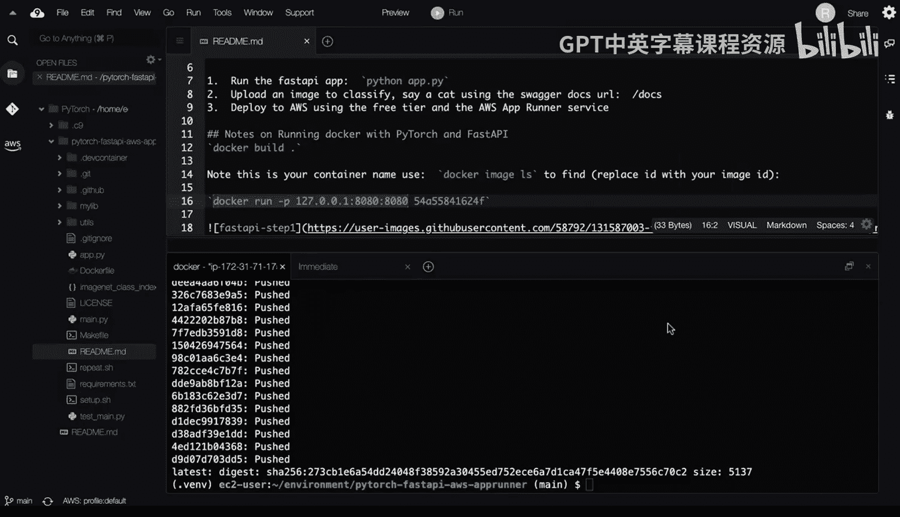

## 6. 测试生产环境服务 🌐

部署完成后，App Runner会提供一个唯一的服务URL（例如 `https://xxx.us-east-1.awsapprunner.com`）。

1.  在浏览器中访问该URL，应能看到根路径（`/`）返回的“Hello World”信息。
2.  访问 `{你的服务URL}/docs`，打开生产环境下的Swagger UI。
3.  如同本地测试一样，使用 `/predict` 端点上传图片进行预测。

如果成功返回预测结果，则表明一个完整的、生产级的机器学习微服务已在AWS云上成功运行。任何获得URL的用户都可以通过API调用使用这个图像分类服务。

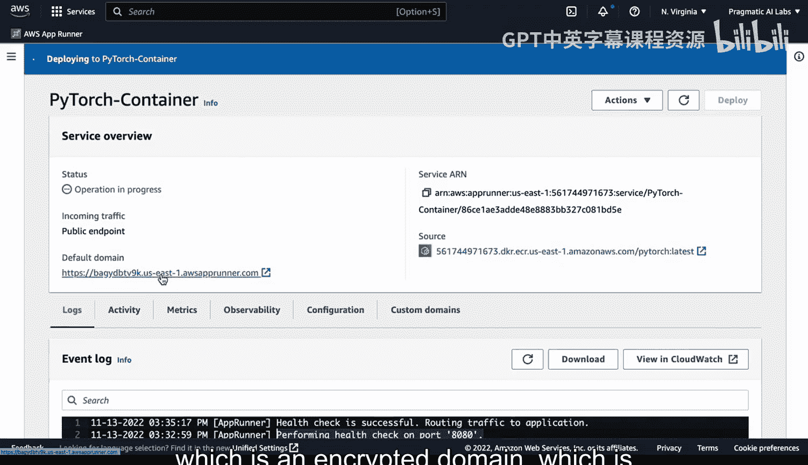

---

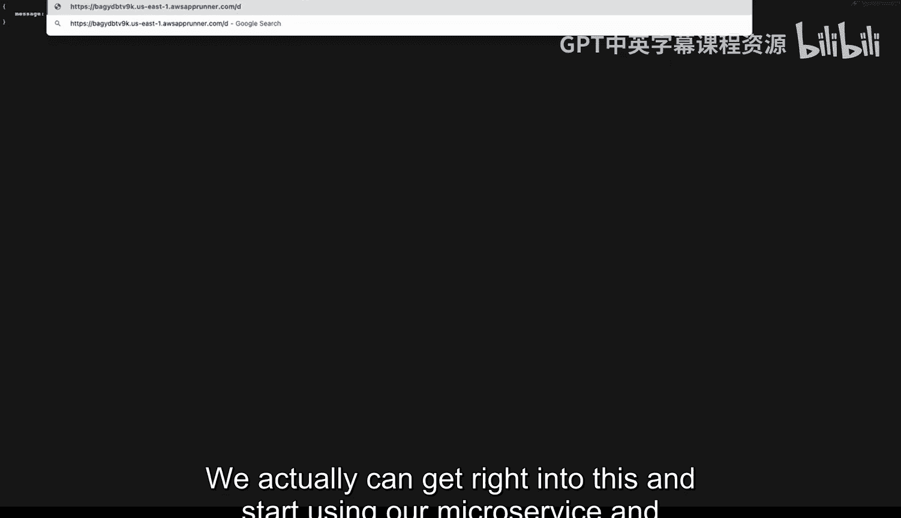

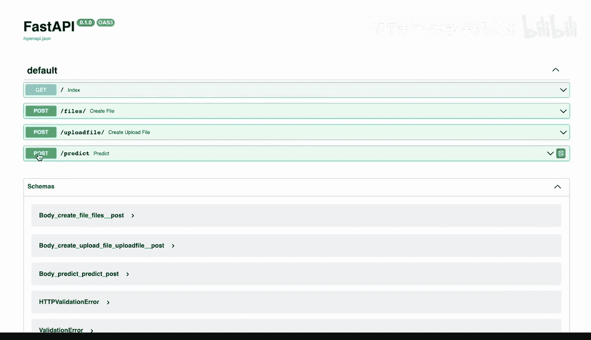

## 总结 🎯

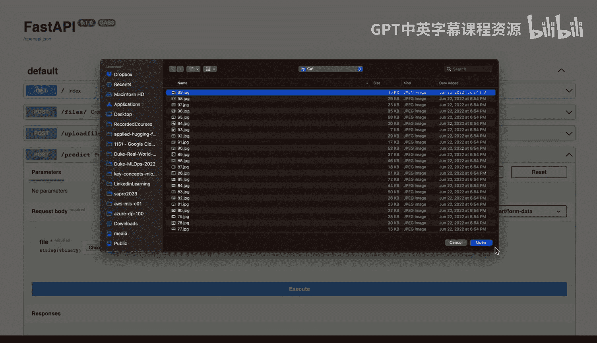

本节课中，我们一起完成了一个完整的MLOps实践流程：

1.  **开发与测试**：我们首先在本地运行并测试了一个基于PyTorch和FastAPI的机器学习应用。
2.  **容器化**：接着，我们将应用及其环境打包成Docker容器，确保环境的一致性。
3.  **存储镜像**：我们将构建好的容器镜像推送至AWS ECR进行集中管理。
4.  **一键部署**：最后，利用AWS App Runner这个PaaS服务，我们轻松地将容器镜像部署为一个可自动扩展、自带HTTPS的云端微服务。

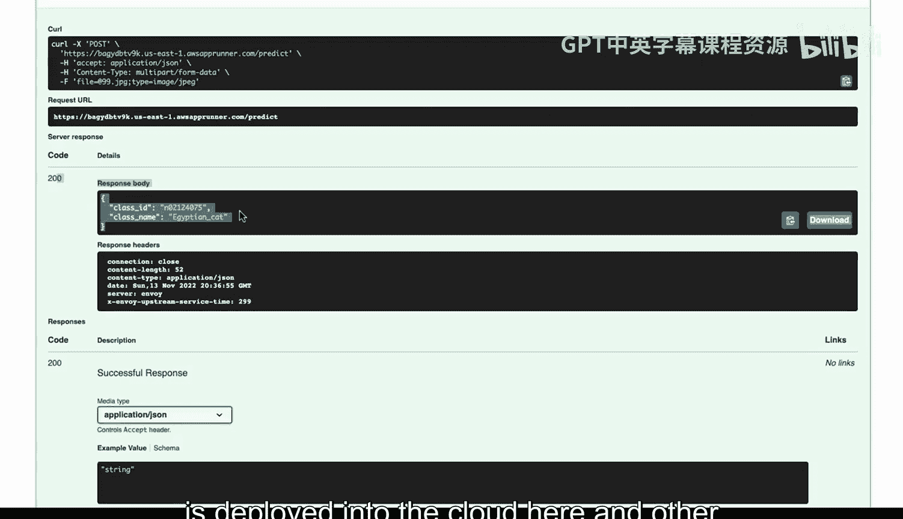

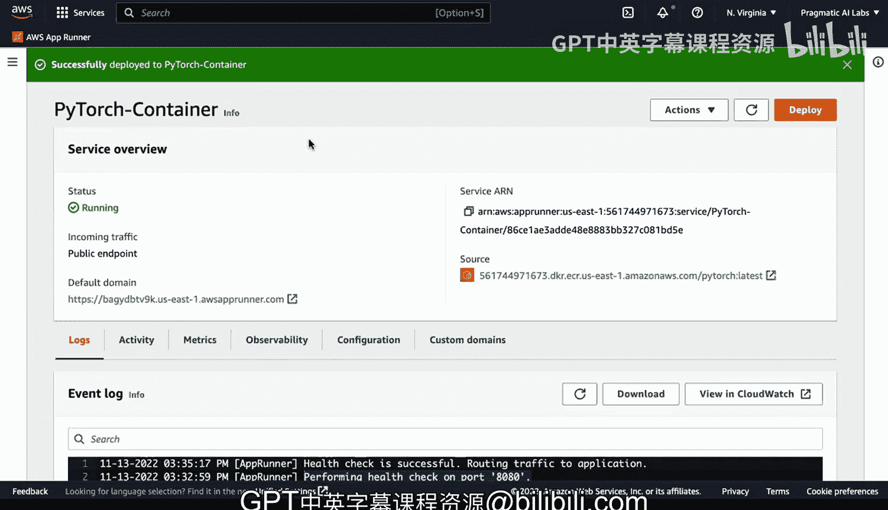

通过结合FastAPI的便捷性、PyTorch的机器学习能力以及AWS云服务（ECR, App Runner）的托管优势，我们可以快速构建和部署高性能、可维护的机器学习应用，这正是现代MLOps的核心实践。