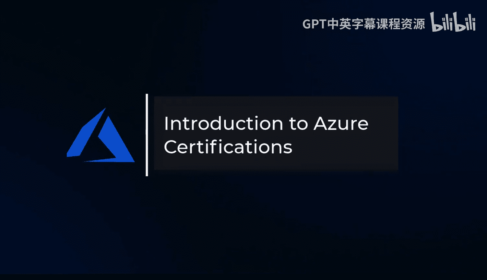

# 杜克大学｜机器学习运维｜DevOps⧸DataOps、Azure、MLFlow和抱脸｜MLOps ｜ Machine Learning Operations p127 50_05_02_Azure认证简介.zh_en -BV1yE421c7uA_p127-

Certifications can be an excellent way to expand your knowledge further in the case of Azure。

 which is Microsoft's cloud， there's a couple of useful certifications that you can take and you can take advantage of to try to learn a little bit more of some of the concepts that we've been covering。

 there are no specific certifications for MLOs， but say for example。

 the Azure AI fundamentals is a very comprehensive certification that covers multiple different aspects。

 not only of Azure itself but also about machine learning。

 you can take these concepts and apply them elsewhere you you'll learn more about some of machine learning techniques like regression and classification and although again these are not specific to machine learning operations or MLOs these are useful in your day today when you're。

regular operations because this knowledge is complementary to most of the activities that you might be doing as an MLOps engineer or someone involved in doing MLOs day in and day out Now I'll walk you through some of the things that you need to know for example。

 learning modules， learning paths and how Microsoft organizes all of that information so that you understand what it needs what needs to happen in order to go through the learning material。

 even if at the end you decide not to take the certification。

 you can actually peak and choose what are some of the elements that you're interested in or what are some of the portions where you need to expand your knowledge further in order to feel more comfortable doing machine learning and hopefully apply them as well to machine learning operations。

