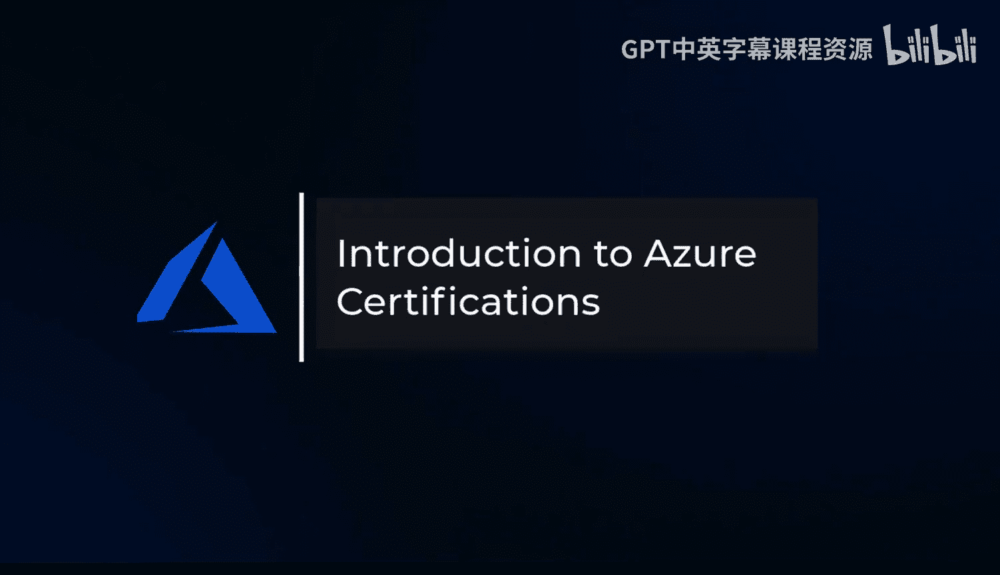

# 机器学习运维：127：Azure认证简介 🎓

在本节课中，我们将了解微软Azure平台提供的相关认证如何帮助你扩展知识，特别是在机器学习和云服务领域。虽然目前没有专门的MLOps认证，但一些基础认证涵盖了互补的核心概念。

上一节我们介绍了MLOps的生态系统，本节中我们来看看如何通过结构化学习路径来巩固相关知识。

## 认证的价值 📜

认证是深入学习Azure知识的绝佳途径。Azure是微软的云服务平台，提供了一些实用的认证。你可以利用这些认证，更深入地学习我们已涉及的部分概念。

目前没有专门的MLOps认证。但例如，**Azure AI基础**认证就是一个非常全面的认证，它涵盖了多个不同方面。这不仅包括Azure本身，也包括机器学习。

## 知识的应用与迁移 🔄

你可以将这些概念应用到其他领域。你将学到更多关于回归、分类等机器学习技术。尽管这些技术并非专门针对机器学习运维（MLOps），但它们在你日常的常规操作中非常有用。因为这些知识与你作为MLOps工程师或日常从事MLOps工作所进行的大多数活动是互补的。

接下来，我将引导你了解一些需要知道的信息，例如学习模块、学习路径，以及微软如何组织所有这些信息。目的是让你理解，为了完成学习材料，需要做些什么。

## 如何利用学习资源 🛠️

即使你最终决定不参加认证考试，实际上也可以浏览并选择你感兴趣的部分内容，或者选择那些你需要进一步扩展知识以更从容地进行机器学习的部分，并希望也能将它们应用到机器学习运维中。

以下是微软典型的学习资源组织方式：

*   **学习模块**：针对特定主题的简短、集中的课程单元。
*   **学习路径**：由多个学习模块组成的结构化课程系列，旨在帮助你掌握更广泛的技能。

## 总结 📝

本节课中我们一起学习了Azure认证作为扩展机器学习与云知识工具的价值。我们了解到，虽然没有直接的MLOps认证，但如Azure AI基础认证等提供了广泛且互补的知识体系。掌握这些结构化学习路径中的概念，能够有效增强你作为MLOps实践者的能力。