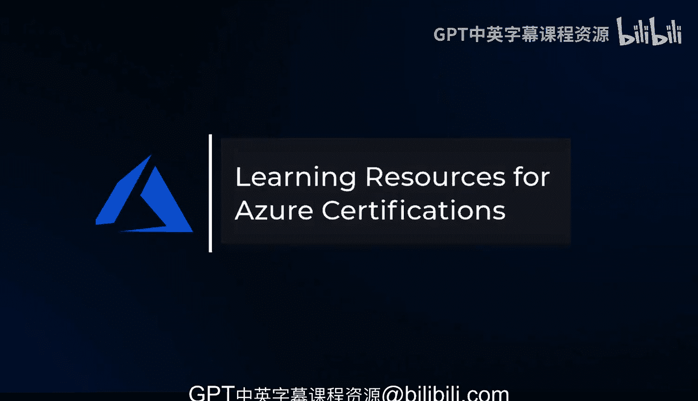
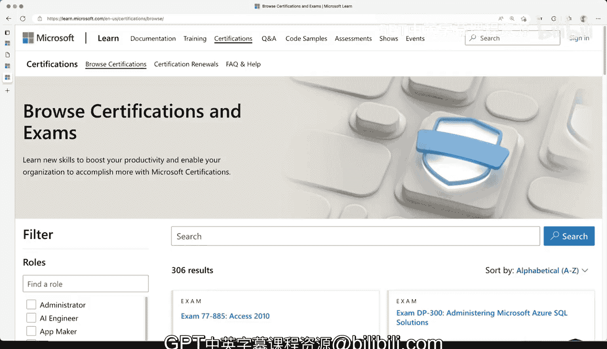

# 杜克大学｜机器学习运维｜DevOps⧸DataOps、Azure、MLFlow和抱脸｜MLOps ｜ Machine Learning Operations p128 51_05_03_Azure认证学习资源.zh_en -BV1yE421c7uA_p128-

Let me go through some of the options that you have when you want to take the Microsoft Azure certification。

 and I'm going to start here with Microsoft learn。 you can access these at learn Microsoftsoft。

 co and it is a ones stop shop like a single point of reference for anything that you want are in actually learning So you have all of the documentation for all of the APIs on on the Azure platform。

 you can even request some training but in this case we're going to concentrate in certifications。

 which is what we are going to be talking about。 So once you land on learn Microsoft co。

 you are going to go and search for something that you want and I'll tell you kind of like how you can get there but you can search for anything here say for example。

We can have the Azure fundamentals is a certification。

 you can see that it will pop up here and we can search for that and see what happens。

 So that is definitely one way to get that like and the research the search results will give you the ability to narrow down use some of the filters even narrow them for some of the products because again this is not only about certifications the first the first result。

 of course， is the Azure fundamentals and I'll talk about those in a second another way that you have to actually get into the certifications is by going directly through the certifications link here at the top So if I go back this doesn't change it stays right there so I'm going to click on it and go through some of the options that you have so you have you're able to browse through depending on your role if you're a data scientist。

 the developer。Devps engineer or if you are someone interested in doing some artificial intelligence。

 you can definitely do that。 Now there's nothing here that is specific to MLOs。 and that's fine。

 there's a couple of certifications that I recommend that you should go and take to expand your knowledge further。

 And again， these certifications are not only specific to Azure。

 but it will give you some general knowledge as well for other things that are important。

 So I'm going to scroll down here。 you definitely can go by roles。

 but you can scroll here by popular certifications。

 you can see here that the Azure fundamentala is are very popular and one that I've already visited。

 but you can definitely browse all of the certifications that are available。

 So that's where I'm going to follow。And here you can go and filter by all of the certifications。

 So the one that I want to start with is AI fundamentals。And if I search for AI fundamentals。

 you'll get two results。 One is the exam and the R1 is the certification。

 you want to concentrate for the learning on the certification itself。

 the exam is when you want to take the test I'm going click on the certification and you're going get to the details for the Microsoft certified Azure AI fundamentals So it gives you a bunch of details things that are useful for you to know on what are some of the skills you need to go through the skills measure。

 I'm gonna open a new tab with those and what that is is like a comprehensive list of all that you need in order to try to understand what is that you need to learn what are some of the questions What are some of the skills that you're gonna be asked about and you're gonna see here four describe for intelligence workloads and you're going get like a 2025% of questions on those Azure fundamental。

Pincipleles in machine learning on Azure 25 to 30 Azures of computer visions。

 computer vision workloads actually and NLP so you can see that there's a lot of interesting things that are related to MLOs but again not specific to MLOs but helpful to know regardless and you can see there's tremendous amount of useful information that will describe everything that you need to know So going back to the actual page of the certification。

 how do you get started， how do you even try to see what this knowledge is about and again you don't need to take the certification that the pass the exam I highly recommend you do because it's a perfect way of validating exactly what what you've just learned and what you've just went through and studied but there's a couple of options here that you have when trying to find out more so I'm gonna scroll down you have two options you have two ways to prepare you have self pace or instructor self pay。

of course， is going to be free and available to you a nocos ad learndamicrosof。

com and then we're going to do instructorlet as well So those two ways and I'll go through later what these options are they call them a collection but what collection is like a grouping of these learning paths and learn modules which again I'll explain later what these are but you can go through those go through the content and understand exactly what that is be at a selfpd learning and you can actually track your your progress and when I scroll all the way here there's a couple of other things that are interesting if you're a student you can get the certification for free so what does that mean well you will have to search for Azure and I'll have those links in the resources but what it means is that you can。

you can get the testing which depending on where you are it's around $100 or $150 for taking the exam。

 the test the examination and this can be done remotely as well in fact I've taken some of the certifications remotely and for students you have to you have to create a profile verify your student status and then this page will go through all of the steps that you need to youll be able to take that certification and for free essentially you will be able to get certified and in some cases you can even get college credits as well so that's an interesting option if you're a student you don't need to pay for it and all of those costs are covered another certification that I think that you should pay attention to is the Azure fundamentals now again you might be saying well I'm interested in MLLOs why would I want to go through the Azure fundamentals again even if you don't end up taking the certification I think this is incredibly valuable。

Because the Azure fundamentals doesn't only cover services out there are specific to Azure。

 it covers generic cloud computing concepts and knowledge that is useful to understand and get a good grasp on some of these things that services and actual descriptions on the cloud。

 so I want to show you a couple of the things that I'm going to scroll here all the way to the collection。

And you can see here that you're describing cloud concepts in here you're actually going into some of the Azure architecture and services。

 but even on the Azure architecture and services， you are going to get a solid understanding of compute services and management and costs and platform as a service versus software as a service and a little bit of security management and governance So all of those things are valuable and I highly recommend you in addition to the AI fundamentals you also take the Azure fundamentals or go through the content 40 Azure fundamentala certifications and again all of those certifications you can browse here depending on the type of workload that you are interested in these certificationifications from Microsoft are very good and the content is free so you can just go and browse through and pick and choosing and cater to the things that you want to expand your knowledge on。

