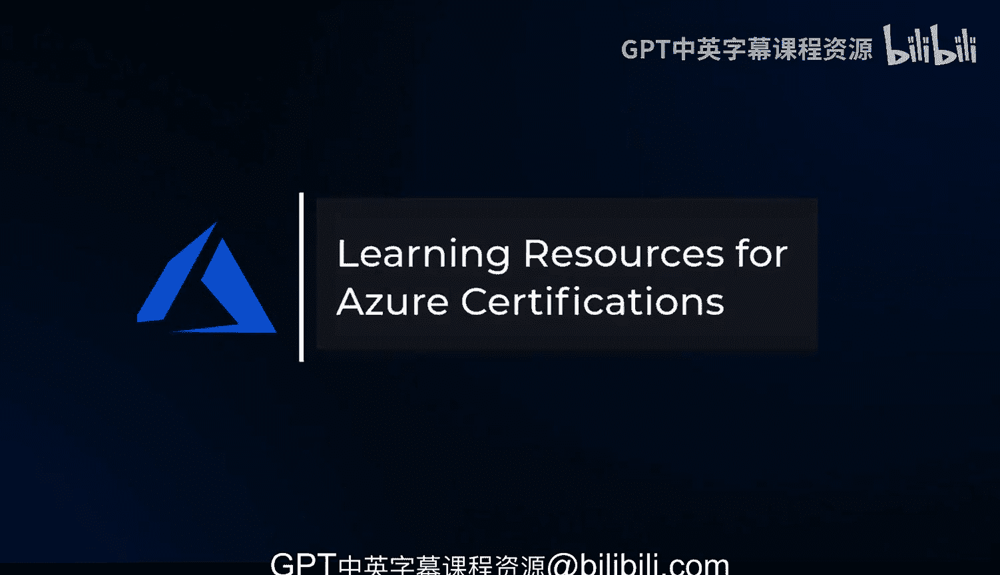
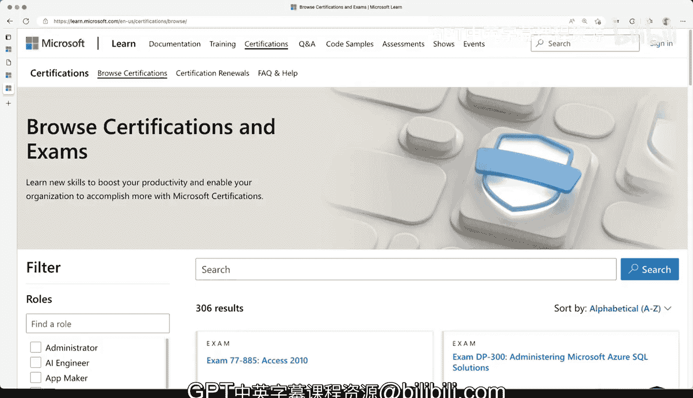

# 机器学习运维：128：Azure认证学习资源指南 🎯



在本节课中，我们将系统性地了解如何获取和准备微软Azure平台的认证。我们将重点介绍官方学习门户、核心认证路径，并提供获取免费学习与考试资源的实用方法。

## 微软官方学习门户：一站式起点

上一节我们介绍了课程背景，本节中我们来看看获取Azure认证的核心平台。微软官方学习门户 `learn.microsoft.com` 是获取所有Azure相关学习材料和认证信息的中心。

*   **功能全面**：该门户提供Azure平台上所有API的完整文档。
*   **集成培训**：除了文档，用户还可以申请相关培训资源。
*   **认证中心**：我们将重点关注其提供的认证考试准备路径。

## 浏览与筛选认证路径

了解平台后，我们来看看如何找到目标认证。在 `learn.microsoft.com` 上，主要有两种方式定位认证。

*   **直接搜索**：例如，搜索“Azure fundamentals”，搜索结果会直接显示相关认证，并可使用产品过滤器进行精确筛选。
*   **导航栏入口**：点击网站顶部的“Certifications”链接，可以进入专门的认证浏览页面。

## 按角色与热门度选择认证

进入认证页面后，您可以根据自身职业角色或热门程度来选择适合的认证。

*   **按角色浏览**：页面提供按角色（如数据科学家、开发人员、DevOps工程师）分类的认证选项。
*   **浏览热门认证**：页面也会展示如“Azure Fundamentals”等热门认证，方便用户快速选择。
*   **查看全部**：用户也可以选择浏览所有可用的认证列表。

## 以AI基础认证为例

为了具体说明，我们以“AI Fundamentals”认证为例。在搜索该认证后，通常会出现两个结果。

*   **认证详情页**：此页面包含认证的完整描述、所需技能大纲以及学习路径。
*   **考试页面**：此页面专门用于报名和参加认证考试。

以下是查看技能大纲的步骤：
```python
# 访问认证详情页 -> 点击“Skills measured” -> 查看详细考核领域与权重
```
例如，AI基础认证可能考核：描述AI工作负载（20-25%）、Azure机器学习基础（25-30%）、计算机视觉与自然语言处理等。

## 两种主要学习准备方式

确定目标认证后，接下来是准备阶段。官方为每个认证提供了两种主要的学习方式。

*   **自定进度学习**：免费提供，用户可在 `learn.microsoft.com` 上按自己的节奏学习。学习内容以“学习路径”和“模块”的形式组织，用户可以跟踪进度。
*   **讲师指导学习**：由讲师带领的培训课程，通常需要付费。

## 学生专属福利：免费认证机会

对于学生群体，微软提供了非常有价值的福利，可以免费参加认证考试。

*   **资格验证**：学生需要创建个人资料并验证其学生身份。
*   **费用减免**：通过验证后，价值约100至150美元的考试费用将被免除，学生可以远程参加考试。
*   **附加价值**：在某些情况下，获得认证还可能转换为大学学分。

## 扩展知识：Azure基础认证的价值

即使你的主要兴趣在MLOps，我也强烈建议你关注“Azure Fundamentals”认证。

*   **超越Azure**：该认证不仅涵盖Azure特定服务，更教授通用的云计算核心概念。
*   **知识体系**：内容包括云概念、Azure架构与服务、计算服务管理、成本管理、以及安全治理等。
*   **基础夯实**：这些知识对于理解任何云平台上的MLOps实践都至关重要。

## 总结与行动建议

本节课中我们一起学习了如何利用微软官方资源规划Azure认证路径。



我们介绍了从访问 `learn.microsoft.com` 门户，到浏览和筛选认证（如AI基础认证），再到利用免费的自学材料或学生福利进行准备的完整流程。最后，我们强调了即使专注于MLOps，学习“Azure Fundamentals”以构建扎实的云计算基础也同样重要。建议你根据自身角色和目标，浏览官方认证目录，选择适合的学习路径，系统地提升你的专业技能。