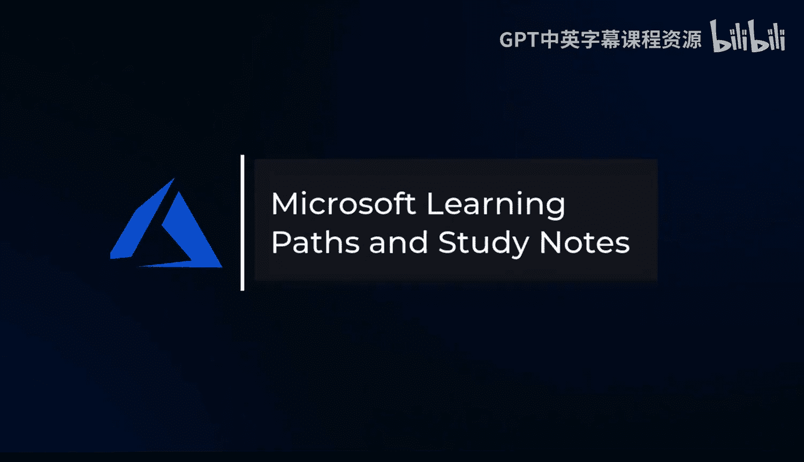
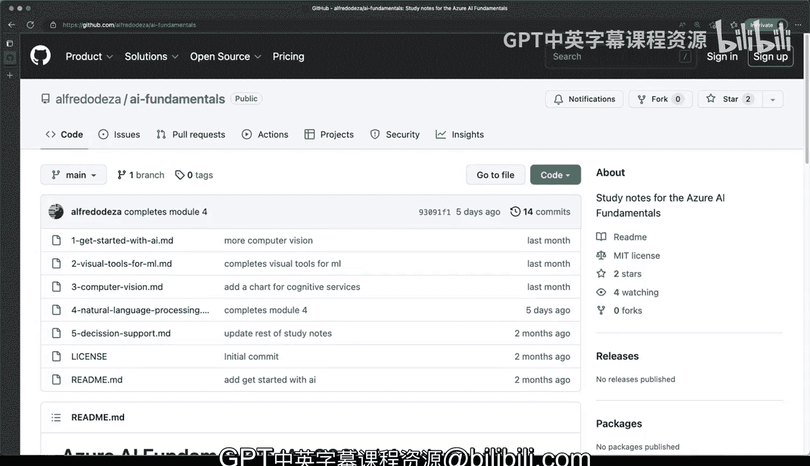

# 杜克大学｜机器学习运维｜DevOps⧸DataOps、Azure、MLFlow和抱脸｜MLOps ｜ Machine Learning Operations p129 52_05_04_微软学习路径与学习笔记.zh_en -BV1yE421c7uA_p129-

Now that we've gone through some of the details of how to get to certifications and some of the options that you have to take the test if you want to what I want to go through is talking about learning paths and learning modules So that is how Microsoft organizes its learning resources And if you want to go through it's worth getting a good overview of what that means and how this is organized so that you can take the advantage of how to organize yourself your study and how to get there。

 So I'm going to pick and choose one of these learning paths and a learning path is kind of like a grouping as well's just like a collection。

 a collection is a grouping of learning paths So it's hierarchy of learning content。

 So a collection is a grouping of learning paths， a learning path like this one is a collection of learning modules。

 So。Collction is the topmost parent， which then goes into a learning path。

 which then goes into learning module。 So let's go and see what a learning path is about。

 So I'm going to go and start here in this case， I'm in the AI fundamentals。The fundamentals。

 the basic introductory certification for Microsoft Azure AI。

 So I'm going to click here and you'll see that we're going to get into modules。

 So these are the modules in the learning path so each module allows you to have they're separated by units in this case there are 10 units each unit means a single page will'll see what that looks like。

 but all of these learning paths have like a specific learning objective that you want to go through So in this case get started with AI on Azure and remember I mentioned that some of these certifications are not only specific to Azure but also machine learning specifically and you can see that is true here when you get to some of these concepts like understanding machine learning anomaly detection these are not specific to Azure at all and actually it is useful to have a solid。

standing of some of these now， if you are very well burst in everything machine learning。 well。

 feel free to skip some of these， but I think it's worth going through that。

 another thing that I really like is that these are separated in chunks that are easily digestible like this one three minutes here actually all of them are three minutes well accept this one which is 10 minutes and you can get a knowledge check。

 if you are signed in， which I don't think I'm signed in at the moment。

 you can track your progress so you can pick up where you left and continue your learning progress。

 So again， a collection is a grouping of learning paths， a learning path。

 a grouping of learning modules and every single learning module will have a grouping of units So lets let's go through the get started of AI and Azure I'm long go into detail into what that looks like but I want to go and browse through and show you how exactly what exactly you will be seeing if you want to take the。

AI fundamental certification or any other certification that will also have the resources。

 the learning resources available for you in the form of learning paths and learning modules。

 So you have this one which is gets started with AI on Azure you start you get introduced you get a lot of content sometimes you get some videos and you start getting some concepts right out of the bat Now this is very consumable and very easily digestible information that is packed for you in a single page So you get one video and a few definitions right here。

 computer vision， what is anomaly detection and you start going through and making progress you can see now this is you need two of 10 and then you get our video some more concepts how machine learning works。

 some graphics so this is really really interesting and a solid way to expand your learning So one other thing that I want to show you is how to create a quick study guide and we'll take a look at that next。

So I wanted to show you here very quickly how did I created my study notes。

 I have an AI fundamentals， and I'll leave the link in the resources as well so you can take a look at what how is this organized and what I did is I went through the Azure AI fundamentals。

 I study for the Azure AI fundamentals and I created a study strategy I separated every single section。

 every single learning path into into these links here。

 but each one is composed of a single markdown file you don't need to do a markdown file you don't need to create a repository if you don't want to but I think this is a solid way of not only capturing the content and putting a back writing a back into your own words as you'll see here in the Getstar with AI learning path but also so that you can go back and easily study everything in a single page so you can see here I always start with capturing the learning path link and also the learning module and remember we went through the AI AI on Azure and some。

Des these are done in my own words using my own words and capturing things that I think are important for the certification。

 so it is definitely something that is worth going through because you're summarizing creating your study guide and this thing here。

 for example machine learning how does it work and I'm capturing details that are useful for the certification itself here are some of some of the components for Azure machine learning studio which is fine but all you know a solid way so that you can go back and hence your study methods for passing the actual certification so there you go that's all you need to know for learning past learning modules and capturing notes in a study guide that you can use in your own Github repo。

