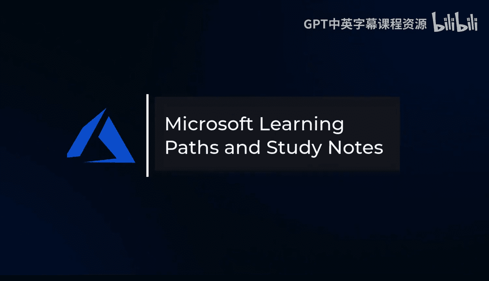
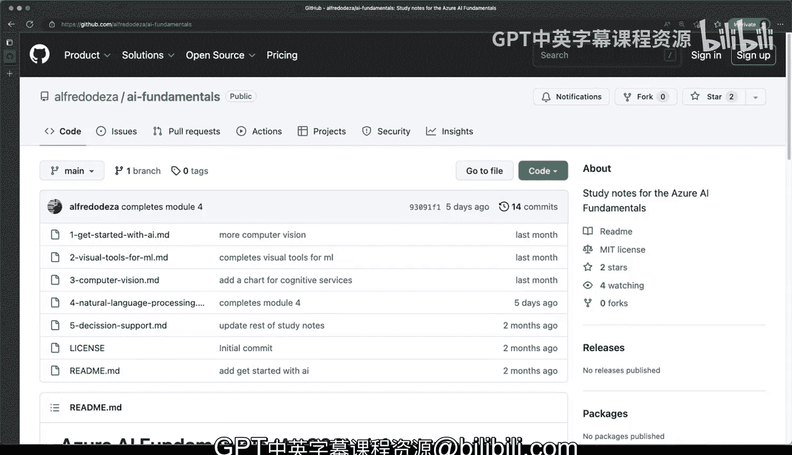

# 机器学习运维：01：微软认证学习路径与学习笔记指南

在本节课中，我们将学习如何利用微软官方提供的结构化学习资源来准备认证考试。我们将了解学习路径和学习模块的组织方式，并探讨如何创建个人学习笔记以高效备考。

---

## 学习资源的组织结构

上一节我们介绍了认证考试的基本信息，本节中我们来看看微软如何组织其学习材料。微软的学习内容采用层级结构，便于系统化学习。

以下是其核心层级关系：

*   **集合**：这是最高层级的分类，是**学习路径**的**分组**。
*   **学习路径**：这是**学习模块**的**集合**，通常围绕一个特定技能或认证目标组织。
*   **学习模块**：这是构成学习路径的**基本单元**，每个模块包含多个**单元**。
*   **单元**：这是学习模块中的**单个页面**，包含视频、文本、图表等具体学习内容。

这种层级结构帮助你规划学习进程，从宏观的集合入手，逐步深入到具体的学习模块和单元。

---

## 探索一个学习路径实例

为了让你更清楚地理解，我们以“AI-900: Microsoft Azure AI 基础”认证的学习路径为例进行探索。

当你点击进入“AI 基础”学习路径后，会看到一系列学习模块。每个模块都有明确的学习目标，例如“Azure 上的 AI 入门”。模块内容被分解为多个单元，每个单元代表一个独立页面。

以下是该学习路径的几个特点：

*   **内容普适性**：虽然认证冠以“Azure”之名，但许多概念（如机器学习、异常检测）是通用的，这有助于你建立扎实的AI基础认知。
*   **易于消化**：每个单元的学习时间通常很短（例如3分钟或10分钟），信息被精心组织，便于快速吸收。
*   **进度跟踪**：如果你登录账户，可以追踪学习进度，进行知识检查，并能随时从上次中断的地方继续学习。

现在，让我们进入“Azure 上的 AI 入门”模块。你会看到一个典型的单元页面，它可能包含一个介绍视频、一些核心定义（如计算机视觉、异常检测），以及解释关键概念的图文。通过点击“下一步”，你可以逐一完成所有单元，系统会清晰显示你的进度（例如“2 / 10”）。这种方式将复杂知识打包成易于消费的信息块，是扩展知识的有效途径。

---

## 创建个人学习笔记与学习指南

了解了如何浏览学习资源后，我们来看看如何将其转化为个人知识并高效复习。创建个人学习笔记是一个极佳的方法。

以下是我创建学习笔记的步骤与建议：

1.  **为每个学习路径创建独立文档**：例如，为“Azure AI 基础”认证的每个学习路径建立一个单独的Markdown文件。
2.  **记录原始链接**：在笔记开头，保存学习路径和学习模块的官方链接，便于快速回溯。
3.  **用自己的话总结**：不要复制粘贴。阅读每个单元后，用你自己的语言重新阐述核心概念、定义和关键点。这个过程能加深理解。
4.  **聚焦认证重点**：在总结时，有意识地筛选和记录那些对通过认证考试尤为重要的信息，例如特定服务的组件、工作流程或关键区别。
5.  **利用代码仓库管理**：将笔记保存在GitHub等代码仓库中是个好习惯。这不仅能进行版本管理，还能让你随时随地通过单个页面回顾所有学习内容。

通过这种方式，你不仅被动接收信息，更主动地构建了知识体系，并生成了专属于你的、高度浓缩的复习指南。

---

本节课中，我们一起学习了微软认证学习资源的层级结构（集合 > 学习路径 > 学习模块 > 单元），并通过实例了解了如何浏览这些内容。更重要的是，我们掌握了创建个人学习笔记的方法，这将帮助你有效组织学习、深化理解，并最终为成功通过认证考试打下坚实基础。