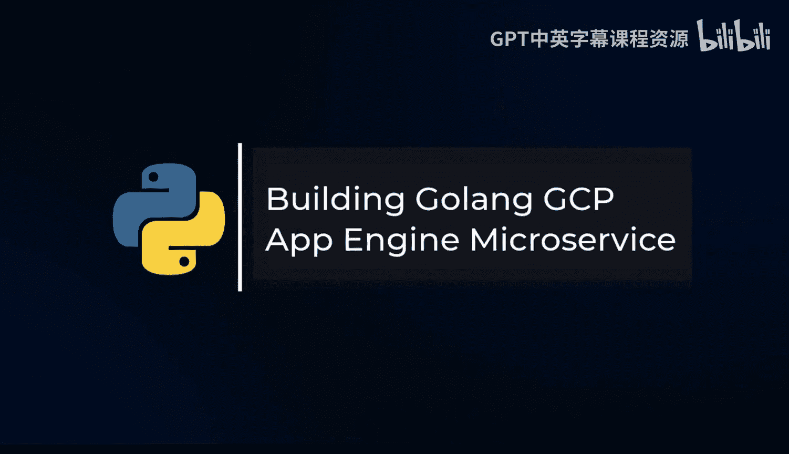
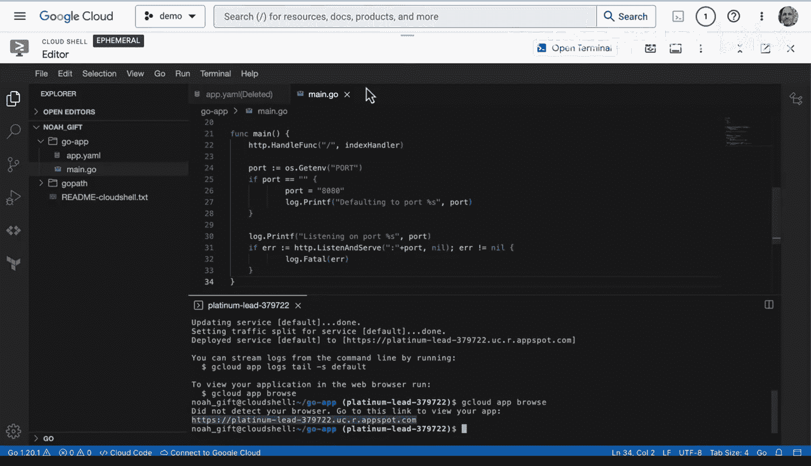
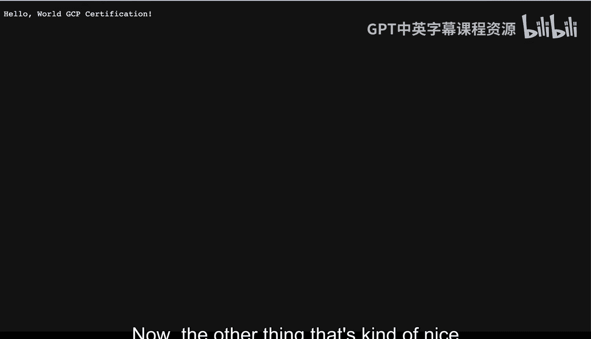
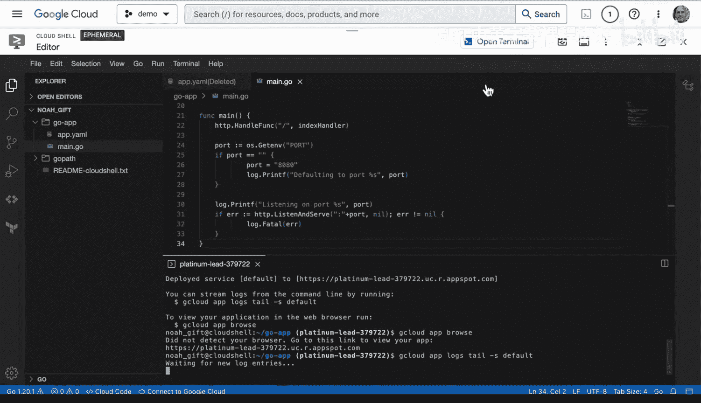
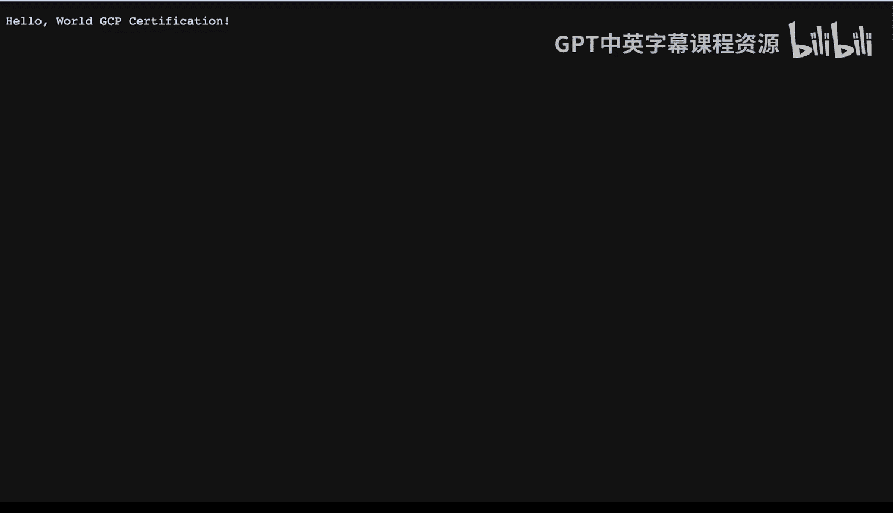
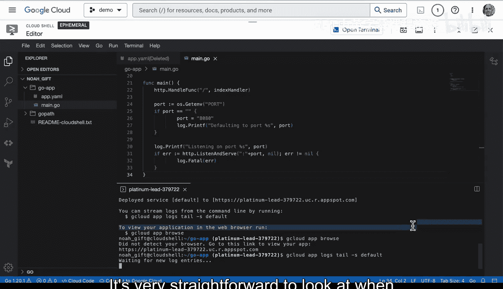
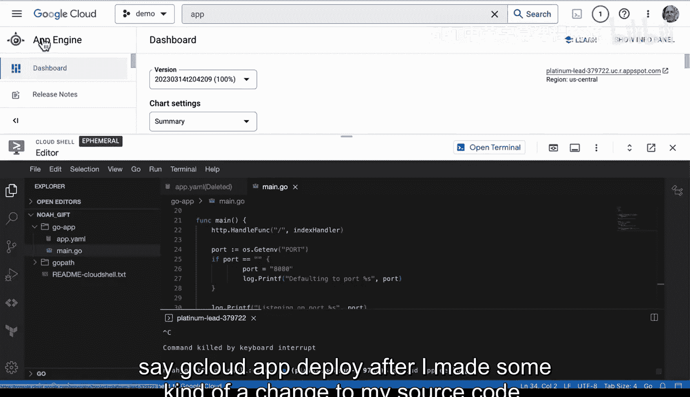
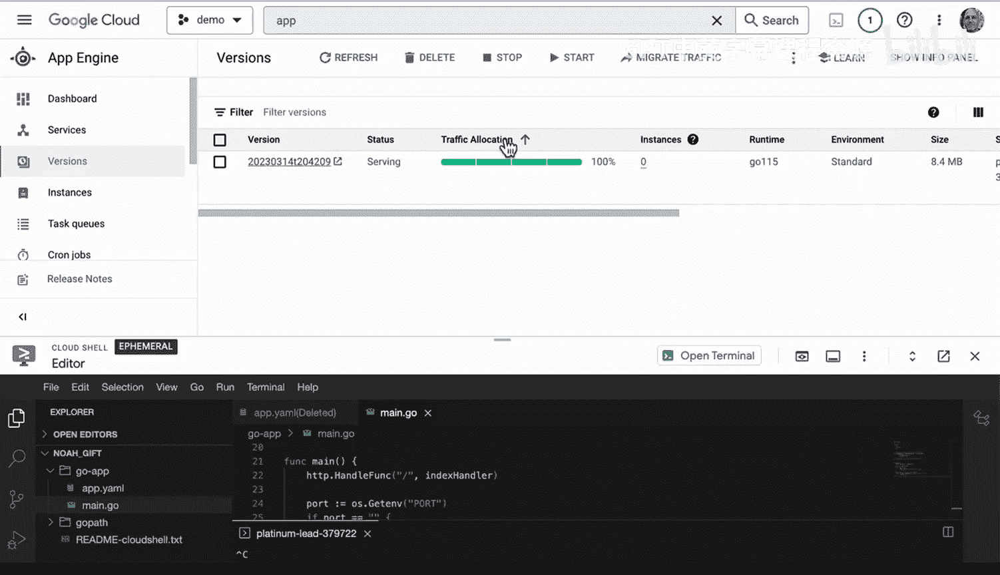
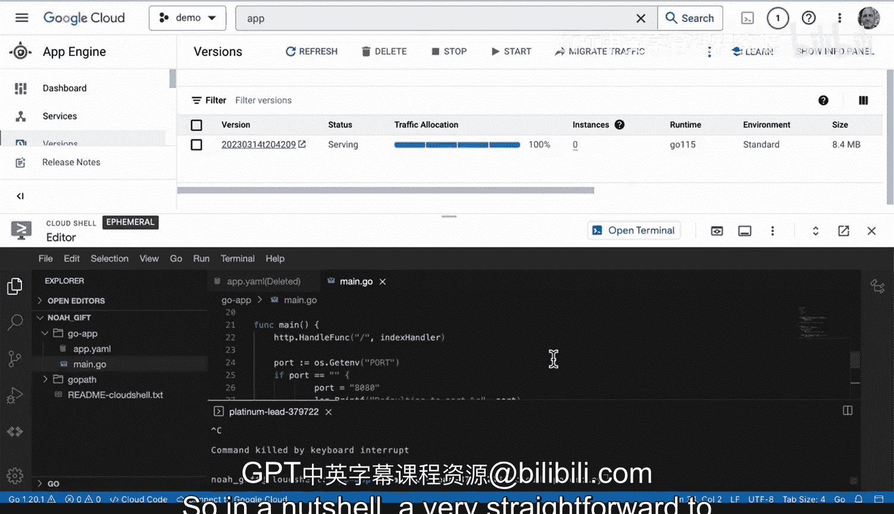

# 杜克大学｜机器学习运维｜DevOps⧸DataOps、Azure、MLFlow和抱脸｜MLOps ｜ Machine Learning Operations p13 20_01_07_构建Golang-GCP-App-Engine微服务.zh_en -BV1yE421c7uA_p13-

Here we're in the Google Cloud She environment And from here what we're gonna to do is build a app engine application。

 One of the things to be aware of is that you can actually find out more information about your app engine environment by typing in Gcloud app and you can type in help here it'll give you some options about different things that you'd want to do For example。

 do you want to deploy or look at versions etc。 you can look at all the different things that you can do here。

 So I've already created my environment here for app engine。

 So all I need to do now is create out a go structure And so that's what I'm going to do first here is go ahead and create this structure。

 We'll type in maketer。 we'll call this go app。Next up。

 I will look inside of this directory and see that it's empty and so I want to create an app dot Yaml So the app dot Yaml file。

 what it does is it is the configuration for the the app engine application All we need to do is put put in the runtime in this case we'll say a runtime and we'll call this go。

115 we could do a different runtime if we wanted to。

 but this is really a very straightforward initial configuration。

 the other thing that we would want to do inside of here after we're done with this go app is actually move this inside so we'll go ahead and move this inside the go app and we also want to create our structure and so inside of this structure let's go ahead and CDd into this directory here real quick to make it a little bit easier to work with and we can actually go ahead and create a main dot go file。

And in the main dot go file， one of the things that we can do is put in at the very beginning here a package dot Ma。

 so let's go ahead and do that。 We'll type in package main。We'll also put some imports in here。

 so we'll go ahead and type imports。And。Do format。Will also need log。We'll also need net。HDP。

And will also need OS， perfect。Now。😔，We also want to do our indexed handler here。

 and I'll just go ahead and just paste some easy code in here for that。

 The idea here is this will handle the hellello world。 We'll call this hollowello world。

GCP certification。Perfect， and also we'll want to register that handler next。

 so we'll put that right below。Perfect， okay， and that's it。

 That's a pretty straightforward process here in order to then go ahead and deploy this trivial microservice here。

 All we need to do is just type in G cloud app deploy。 So let's type in G cloud app deploy。

And let's see what happens。It's going to ask us if this is what we want。

 We're going to go ahead and say yes， we want to go ahead and do that。

 and it' it's able to just take that， move it directly into app Engine。 and in just a second。

 it'll be deployed。 All right， so we've got this set up here and it's been able to deploy。 Now。

 one of the easier ways to browse it would just be to type in this command。

 Let's go ahead and do this。G cloudud app browse。And it will give us the URL if we're not in a environment where it can launch it。

 so let's go ahead and do that next year。

We'll put in。There we go， Hello world GCP certifications。

 Now the other thing that's kind of nice if I'd load this a few times is I also could tail the logs。

 which is very useful。

When you're building out your application， so it's very straightforward here too。

 and let's go ahead and give it some things to look at over and over and over again here。

It's very straightforward to look at when you're building out applications。

All right， now we see that we're on the app engine window here。

 you can see all of those web requests here are shown inside because I'm doing the tail command again。

 which is the GCud app logs tail and if I wanted to redeploy or make changes pretty easy again。

 I would just go through and say GCud app deploy after I made some kind of change to my source code。

 I also could go to the console look at the dashboard， see different charts here。

 and look at the different things that are happening， billing status， loads status。

 request per minute server errors， a lot of really good information here if we're going to look at things and I also could go to the versions as well and see how much traffic is allocated to a particular set of versions。

 so a nutshell very straightforward to use app engine to build microservices。

