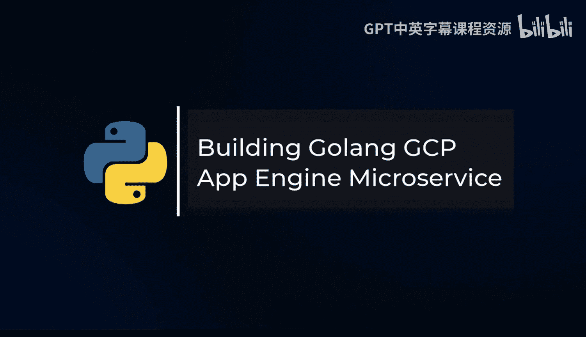
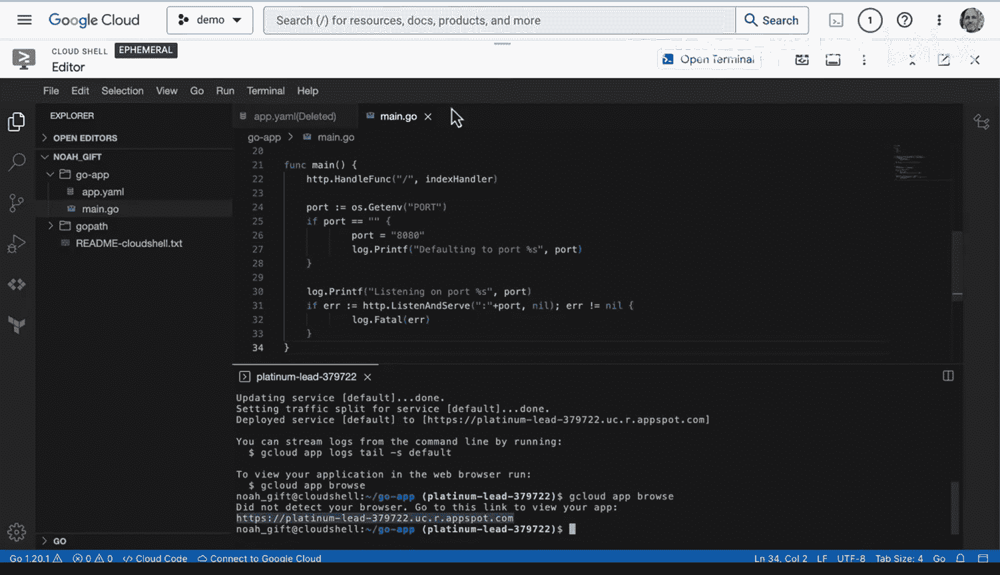
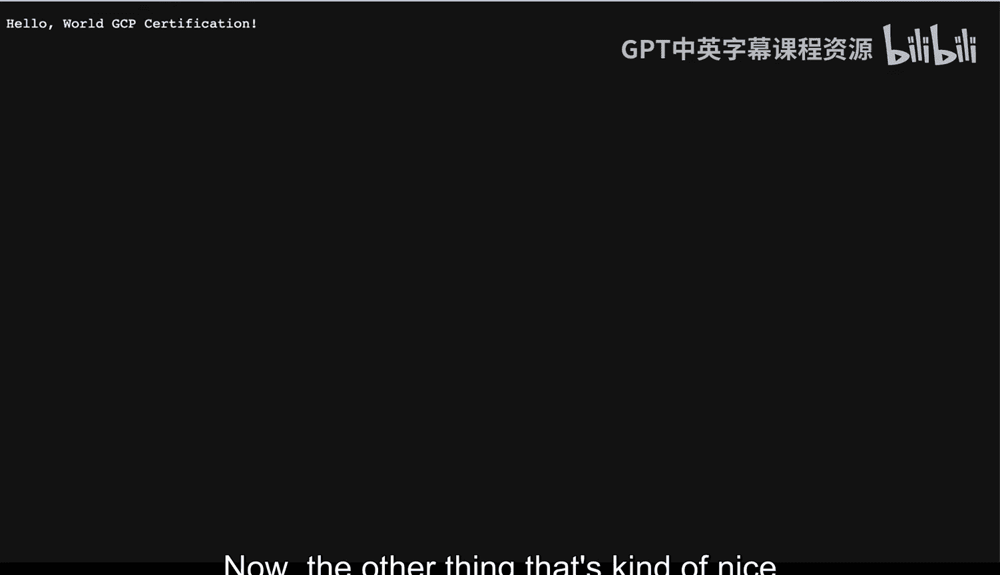
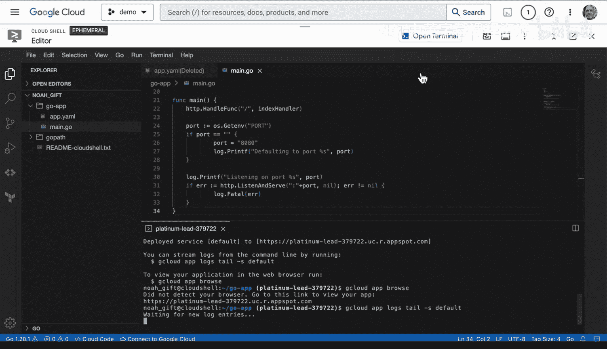
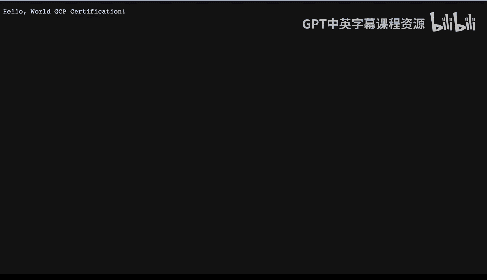
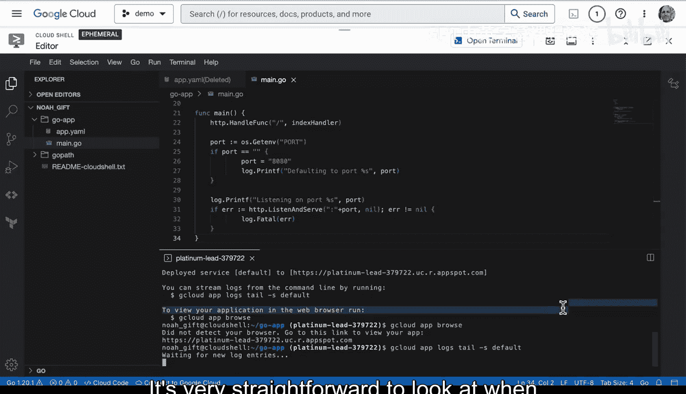
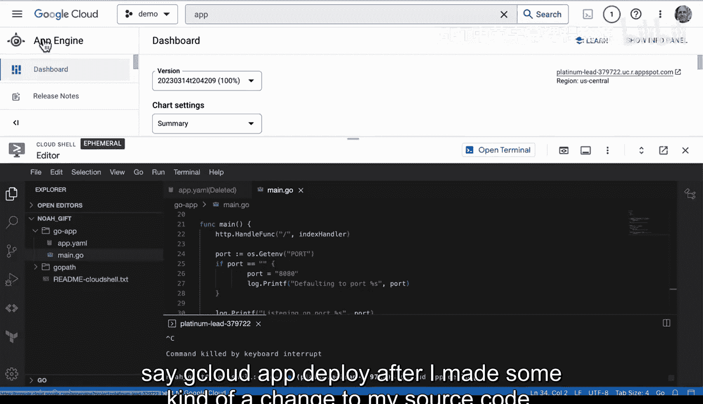
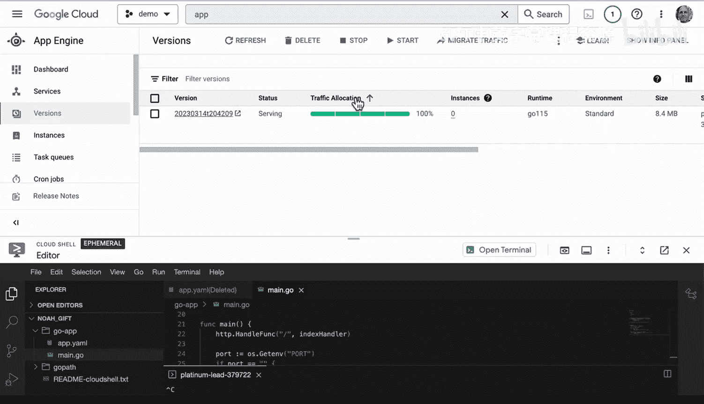
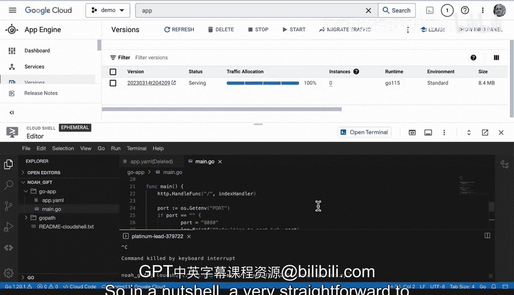

# 机器学习运维：13：构建Golang-GCP-App-Engine微服务 🚀

## 概述
在本节课中，我们将学习如何在Google Cloud Platform的App Engine环境中，构建并部署一个简单的Golang微服务。我们将从创建项目结构开始，编写代码，最终完成部署和日志查看。

---

## 在Google Cloud Shell环境中操作
我们当前位于Google Cloud Shell环境中。从这里开始，我们将构建一个App Engine应用程序。

需要了解的一点是，你可以通过输入 `gcloud app` 命令来获取关于App Engine环境的更多信息。输入 `help` 会显示你可以执行的不同操作选项，例如部署或查看版本等。你可以在这里查看所有可执行的操作。

我已经在此处为App Engine创建好了环境。

---

## 创建Go项目结构
接下来，我需要创建一个Go项目结构。首先，我将创建这个结构。

输入命令 `mkdir go-app`。

接下来，查看这个目录内部，确认它是空的。然后，我需要创建一个 `app.yaml` 文件。

`app.yaml` 文件是App Engine应用程序的配置文件。我们只需要在其中指定运行时环境。这里我们设置运行时为 `go115`。当然，你也可以选择其他运行时，但这只是一个非常简单的初始配置。

完成这个 `go-app` 目录的创建后，我们需要将 `app.yaml` 文件移入其中。同时，我们还需要创建项目结构。让我们快速进入这个目录以便操作。

输入命令 `cd go-app`。

---

## 创建主Go文件
现在，我们可以开始创建 `main.go` 文件。

在 `main.go` 文件的开头，我们需要声明包名。输入 `package main`。

我们还需要导入一些必要的包。输入 `import` 语句，并格式化代码。需要导入的包包括 `log`、`net/http` 和 `os`。

接下来，我们需要编写索引处理器。这里我会粘贴一段简单的代码。这段代码的功能是处理一个返回“Hello World GCP certification”的请求。

然后，我们需要注册这个处理器，将其放在代码的合适位置。

至此，一个简单的微服务代码就完成了。

---

## 部署微服务
为了部署这个简单的微服务，我们只需要输入命令 `gcloud app deploy`。

输入命令后，系统会询问是否确认部署。我们选择“是”继续。

部署过程会将我们的应用直接移动到App Engine中。稍等片刻，部署就会完成。

现在，应用已经部署成功。

---

## 浏览和查看应用
一个简单的浏览方法是输入命令 `gcloud app browse`。如果当前环境无法直接启动浏览器，该命令会提供应用的URL。

访问该URL，我们将看到“Hello world GCP certification”的响应。

另一个有用的功能是实时查看日志，这在开发应用时非常方便。我们可以通过命令 `gcloud app logs tail` 来跟踪日志。

反复访问应用URL，可以在日志中看到相应的网络请求记录。这对于调试和监控应用行为非常有帮助。

---

## 管理和监控应用
现在，我们进入了App Engine的管理界面。在这里，你可以看到所有的网络请求，因为我再次执行了 `gcloud app logs tail` 命令。

如果我想要重新部署或进行更改，过程同样简单。只需在对源代码进行任何修改后，再次运行 `gcloud app deploy` 命令即可。

我也可以进入控制台查看仪表板，观察不同的图表和信息，例如计费状态、负载状态、每分钟请求数、服务器错误等。这里提供了大量有用的信息。

此外，我还可以查看版本信息，了解流量是如何分配到不同版本上的。

总而言之，使用App Engine构建微服务是一个非常直接和简单的过程。

---

## 总结
本节课中，我们一起学习了如何在Google Cloud Platform的App Engine上构建和部署一个Golang微服务。我们从创建项目结构和配置文件开始，编写了处理HTTP请求的Go代码，然后使用 `gcloud` 命令行工具完成了部署。最后，我们还探讨了如何浏览应用、查看实时日志以及利用控制台进行应用监控和管理。整个过程展示了利用GCP托管服务快速搭建和运维微服务的便捷性。