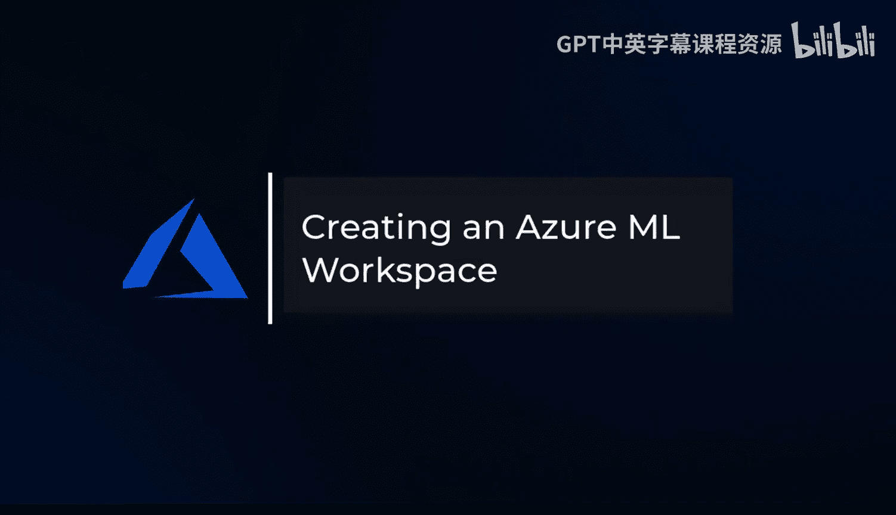
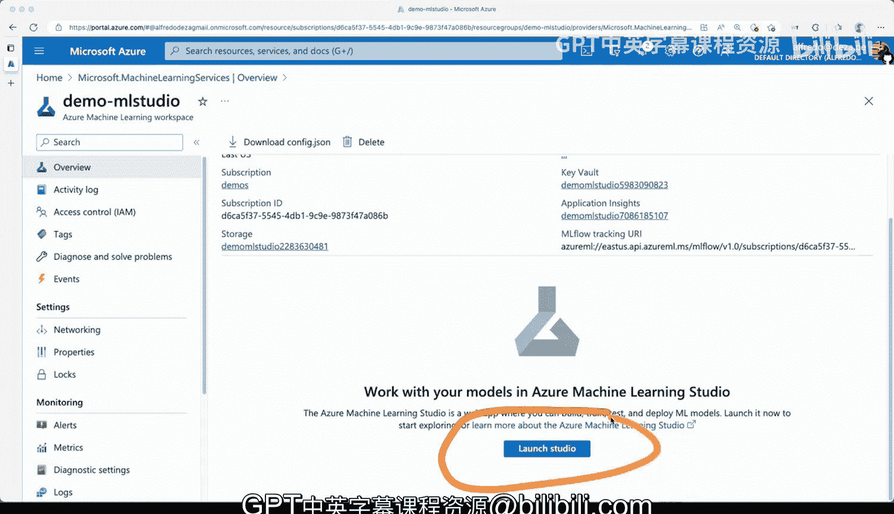

# 杜克大学｜机器学习运维｜DevOps⧸DataOps、Azure、MLFlow和抱脸｜MLOps ｜ Machine Learning Operations p130 53_05_05_创建Azure ML工作区.zh_en -BV1yE421c7uA_p130-

Getting started with Azure machine learning studio is a straightforward process。

 If you know what to be looking for in this case， I've opened the Azure portal now I've recently created an Azure machine learning workspace that's why you can see that demo automl over there but let's assume that you don't and you haven't before if you search for just M one of the first services that will show up is the Azure machine learning if you click that or actually you can click on the dropdown。

 you can create a new workspace and get started So I'm going click on Azure machine learning and I am going to create a new workspace In this case again。

 I already have one created from before but I'm going go through the steps what that looks like if I'm getting started from scratch So if you've never created anything or you don't have any workspace created from before this will be empty and you won't have anything listed here。

 So I'm gonna go。And click on create here on the dropdown and you can see that I'll have two options。

 One is a new workspace and the R one is a new registry。

 If you're just getting started and you want to try out azure machine learning and use the ash machine learning studio which is the web interface for interacting with machine learning then you will need to create a new workspace。

 Don't bother on creating a new registry， this is more of like a more advanced feature of F machine learning if you have multiple workspaces and you want to do other things there So okay so let's go and click on new workspace and let's see what that looks like。

 Alright so it has automatically selected my subscription。

 and this is kind of like the same web interface， the web form that you will have to fill out when you're creating services in Azure as you can see I have to select my subscription and then either select an existing resource group or create a new one。

 I always tend to create a new one especially when I'm doing demos or。

I'm trying things out because I prefix them with a word demo。

 So in this case I am going to create a new one。I'm going to say demo。

And I'm going to say M L studio。So once I do that， this will create a new resource group and if I click here you can see that it will select it will have the ability to select other ones existing like if I have other resource groups。

 I usually tend to create a new one if you're just trying it out this is a perfect way of actually creating these new resource group for your workspace so let's take a look at the details now let's select a workspace name I kind of tend to name the same my workspace names the same as the resource group so in this case I use demo ML Studio that's what I'm going to do here and I say ML studio and as I'm typing you can see that certain things are getting populated。

 the storage account keyboard and application insights this is all very useful and this is the automation this is the highly specific environment that you're want to work with because ash machine learning studio specific for machine learning tasks and this is the difference。

From just bringing up different brush machines around Azure in other types of environments because you're going to have to set up keyva。

 storage accounts， application insights， all those are done for you Now the one thing that is not done for you but it's actually very useful and I'm not going to go through it but still I'm going to go and mention it is the container registry now if you're going to be dealing with containers。

 which I highly suspect you're going do that if you're going be deploying some of these machine learning models to production then you're going to want to create a container registry and you can actually select one that is existing I don't have anyone that have privilege created but you can create a new one that will allow you to push container images to that container registry that is associated with this workspace and all of it will be more integrated and it will make your life easier I'm not going do that because we're not going to be creating any containers for these demos。

go ahead and say review and create it will do some validation。

 make sure that all of the things that I've added in the form are okay and once that completes。

 I'll be able to create this workspace and then we'll have to wait a second for it to complete All right so validation pass I'm going to click create and this is going to initialize the deployment made deployment deployment in progress so you'll see the status right here so what does that mean like what what's the deployment in progress well behind the scenes actually is creating all of the resources that we selected remember the keyboard and the storage accounts in this case I didn't create a container registry but if I was then Ashzure will be creating those right here so this will take a second and we'll come back once it's completed。

 Okay so this has completed and you saw that there was a notification there but essentially it tells us that we can now go to the resource I'm going to click here and go to resource and。

And and then see what that is。 Now we've created a workspace and now we have the resource page。

 Now this is not Azure Ma learning studio。 This is not the actual place where you' will be interacting with Azure machine learning this is kind of like a panel where you can set and do like overview activity log。

 set access controls， do more about like tags do a little a little bit about logs and networking。

 you're managing that， but it's not the actual place this might be confusing if you never used Azure Ma learning studio or if you're not aware how certain services work in Azure some services that have like a separate interface will have will have this landing page where you can do management but the actual interaction with the service itself happens elsewhere and where is it going to happen。

 Well， I'm going keep scrolling here and it's right here where you。

Our launching studio。