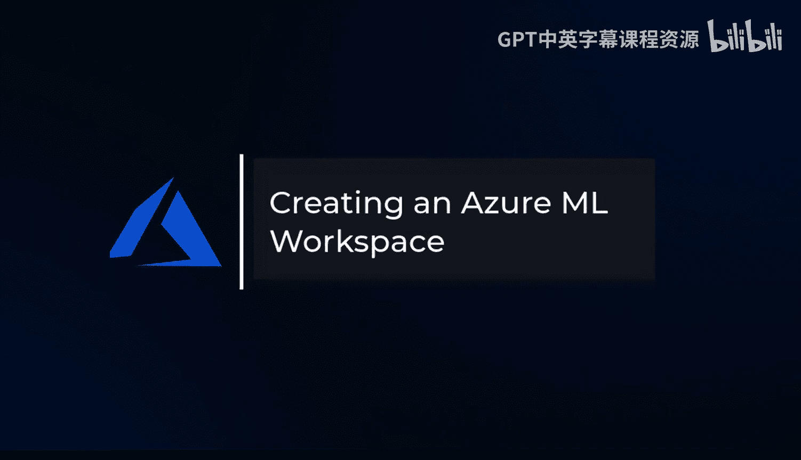
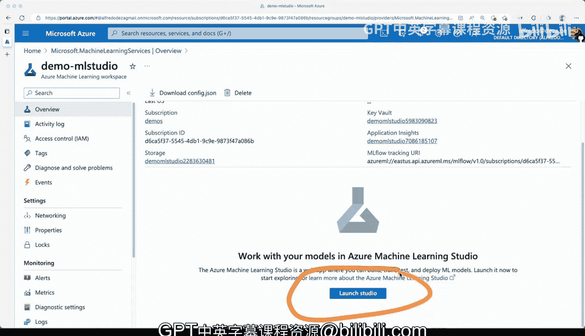

# 机器学习运维：1.1：创建Azure机器学习工作区 🚀

在本节中，我们将学习如何在Azure门户中创建一个机器学习工作区。这是使用Azure机器学习服务的第一步，它将为我们提供一个集中管理所有机器学习资产的环境。

## 概述

开始使用Azure机器学习工作室是一个直接的过程。如果你知道在哪里寻找，操作会很简单。现在我已经打开了Azure门户，并且之前创建过一个工作区，所以你能看到“demo automl”。但让我们假设你从未创建过，并且是第一次操作。

## 创建新工作区

如果你在门户中搜索“M”，首先显示的服务之一就是“Azure机器学习”。点击它，或者点击下拉菜单，你可以创建一个新的工作区并开始使用。

我将点击“Azure机器学习”，然后创建一个新的工作区。虽然我已经有一个了，但我会演示从头开始的步骤。如果你从未创建过任何内容，这里将是空的，不会有任何列表。

以下是创建新工作区的步骤：

1.  **点击“创建”**：在服务页面，点击“创建”按钮或下拉菜单中的选项。
2.  **选择工作区类型**：你会看到两个选项：“新建工作区”和“新建注册表”。如果你是初学者，想尝试Azure机器学习并使用其Web交互界面（机器学习工作室），你需要选择“新建工作区”。“新建注册表”是一个更高级的功能，适用于管理多个工作区的情况。因此，我们点击“新建工作区”。

## 配置工作区详情

现在，我们进入配置表单。界面会自动选择我的订阅。这是在Azure中创建服务时需要填写的标准Web表单。

以下是需要填写的核心信息：

*   **订阅**：选择你的Azure订阅。
*   **资源组**：选择一个现有的资源组或创建一个新的。我倾向于在演示或尝试新功能时创建新的资源组，并为其加上“demo”前缀。例如，我将创建一个名为 `demo-ML-studio` 的新资源组。
*   **工作区名称**：为你的工作区命名。我通常将其命名为与资源组相同的名称，例如 `ML-studio`。当你输入名称时，一些相关资源（如存储帐户、密钥保管库和应用洞察）的名称会自动填充。

这种自动化是Azure机器学习工作室环境高度专业化的体现，它专为机器学习任务设计。这与在Azure中自行搭建各种虚拟机和其他环境有本质区别，因为诸如密钥保管库、存储帐户和应用洞察等资源都会自动为你设置好。

## 高级选项：容器注册表

有一个选项不会自动完成，但非常有用，那就是容器注册表。如果你打算处理容器（我高度怀疑你会在将机器学习模型部署到生产环境时用到），你会希望创建一个容器注册表。你可以选择一个现有的，或者创建一个新的。关联的容器注册表允许你推送容器镜像，使所有工作更集成、更轻松。由于本次演示不涉及创建容器，我将跳过此步骤。

## 验证与部署

填写完表单后，点击“查看 + 创建”。系统会进行验证，确保表单中填写的内容无误。验证通过后，点击“创建”。

此时，部署将开始初始化，你会看到“部署正在进行中”的状态。这意味着Azure正在后台创建我们选择的所有资源，包括密钥保管库、存储帐户等。如果之前选择了创建容器注册表，它也会被创建。这个过程需要一些时间。

## 访问工作区

部署完成后，系统会提示我们可以“转到资源”。点击后，我们会进入该工作区的资源页面。

**重要提示**：这个资源页面**不是**Azure机器学习工作室。这不是你与Azure机器学习服务交互的实际场所。这是一个管理面板，你可以在这里查看概览、活动日志、设置访问控制、管理标签和网络等。这对于不熟悉Azure服务的人来说可能有些困惑。许多具有独立交互界面的Azure服务都有这样一个用于管理的着陆页，而实际的服务交互发生在别处。

那么，实际交互界面在哪里呢？继续向下滚动资源页面，你会找到它。

**启动工作室**按钮就在这里。点击这个按钮，你将进入真正的Azure机器学习工作室Web界面，开始你的机器学习项目之旅。

## 总结

本节课中，我们一起学习了创建Azure机器学习工作区的完整流程。我们从在门户中搜索服务开始，逐步完成了选择订阅、创建资源组、命名工作区、理解自动化资源配置（如存储帐户和密钥保管库），并了解了可选的高级功能（如容器注册表）。最后，我们区分了工作区的**管理资源页面**和用于实际机器学习操作的**Azure机器学习工作室**界面。成功创建工作区是构建、训练和部署机器学习模型的第一步。