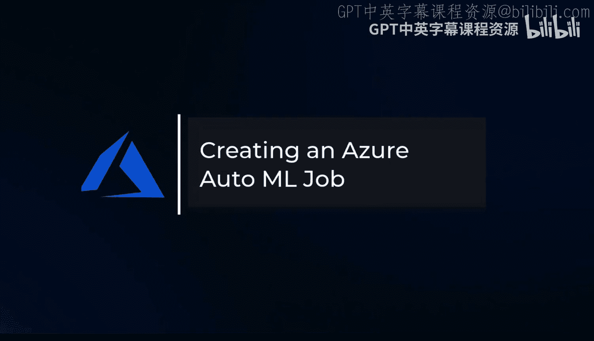
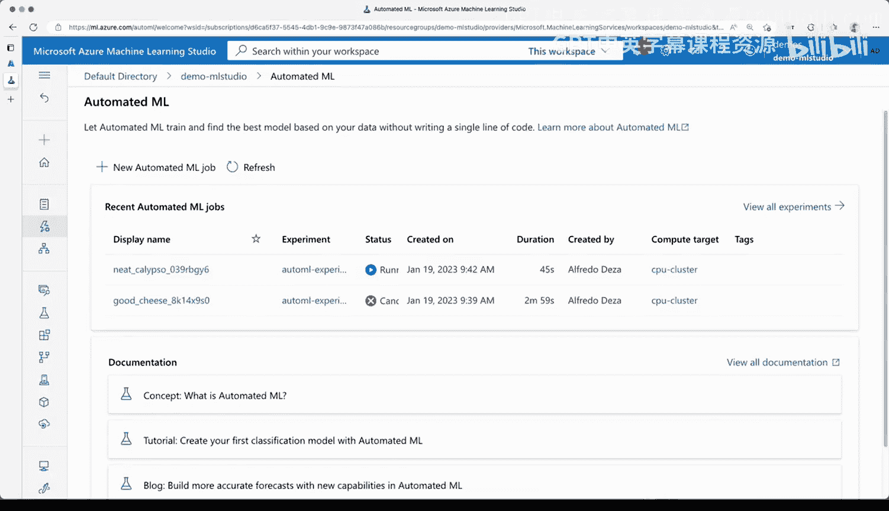

# 杜克大学｜机器学习运维｜DevOps⧸DataOps、Azure、MLFlow和抱脸｜MLOps ｜ Machine Learning Operations p131 54_05_06_创建Azure Auto ML作业.zh_en -BV1yE421c7uA_p131-

So I'm gonna click here and go to Azure Maachine Learn studio so you can see that it open a new tab over there。

 and now I'm greeted with this interface which it might be a little bit overwhelming if you've never used this before。

 but it allows you to very easily access most of the features that you may want to use when you're dealing with machine learning。

 So right off the bad you can see you have the ability to create anything that is new notebooks automated M。

 which is we're going to try out to and then the signer。

 which is a and drag and drop user interface where you can create an interface for building machine learning pipelines。

 We're not going do the signer today but we're gonna to focus on automated M。

 So how do you get started with Automl Well you have the ability to go through here on these panel on the left and go through the different options if you get。

As you're always able to come back to the screen by clicking on home， you have notebooks automated M。

 which is we going to see today designer， which I mentioned we're not gonna use today and various different pieces of data that you definitely can investigate further but you can get started with Automl like clicking on these little lining logo or go right here to automated M and start now or create new and get started there。

 So all those three options are valid you can choose any and I'll show you right here。

 you can start here with automated M job。 I'm gonna go and click on start now for automated M on this one right here and then go through the process of creating any new run So I don't have any previous automated ML jobs So that's why there's these empty notice here saying I don't have anything。

 So yes， I want to create a new one。And let's go through the steps needed in order to find out what that looks like。

 so I'm going to click on create new automated ML job and then I'm going to go through all of these steps so all the way from number one to number five。

 we're going to skip on number four because we are now going to be doing computer vision today。

 I am going to be using a tabular dataset If you have never worked with datasets before。

 or you're slightly confused as to what those are don't worry I'll explain what that looks like and how we can make it work。

So the first thing that we need to do is select a data asset。 Now， recently。

 Azure changed these before it didn't name them data assets。

 I tend to call them data sets because I'm gonna to be working with a comm separated value file。

 So I'm going to go ahead and add one。 I don't have any。

 That's why this list or this box here is empty。 So I'm going to go ahead and create one。

 This is a new not a new， but like a very useful feature where you can， if you don't have anything。

 you don't have to jump to another narrow page， you can do that right from here。

 So I'm going to click on create。And I'm going to name it。

 So I have a data set for wine ratings from all over the world。

 So I'm going to call these wine ratings and I'm going to say the description is wine ratings。

From actually， world wire raining ratings。 And then that's a good， good enough description。 Actually。

 we can add that from。From GiHub there we go and it's tabular that's fine I'm going to click create next and see what happens and then I have several different options and you can see from Azure open datas these are premade and ready to use some popular datasets that are available here we can even grab data from SQL databases from local files if I want to upload something Azure storage if I have already a blob of from Azure I can use that or I can use from web files in this case this is what I'm going to be using today when I want to show you because I feel like it is very incredibly useful to use web files so I'm going go and take you over to a different webp page a different window that I have open and that is these GiHub repository where a while ago I created these wine ratings that CSP you can see here。

There's a Jupyter notebook and I'm going to be creating be using these wine ratings that CSB file。

 So I'm going to click on that one it says that it is too big to display it。

 but it doesn't matter I'm gonna click and view the raw one and you can see there's lots of information here now why did I click click on viewing the raw because that is the exact URL that we will need。

 you can see here raw that Githubuser content do com and the reason why we need the raw one is because if if we go and use this one。

I need to have the exact URL to the actual file， not the version that has the website from GitHub。

 So again it is this is the URL that I want I'm going copy that go back to Azure Automl or Azure Azure machinechineingt where I'm creating the automl run and I'm going to say I'm going to click from web files this is actually a web file and then I'm gonna click create on next and then I'm going paste that web URL you can see that it is Githubus contenttent co I am not going skip data validation。

 I'm going to let Azure try to validate the data is correct。 and I'm gonna to click on next。

 Alright so it did some validation there and now there's a few settings and a brief preview of what that data set looks like right off the bad you can see there's some problems。

s there's a weird column one there with some numbers it looks like a。

Index column grapes seem like they're all messed up because there's null all over the place there are some other ones that are look okay。

 there's red wine let's see if there's anything else there there's a little bit of wine wine and their ratings numbers over there so there's a little bit of descriptions file format is telling me a little bit about the encoding the delimiter ask me if I want to skip some rows what what are heaters and yes。

 I do have some heatherers。And I am going to click on next so that you can see what else we can do with this。

And this is the schema and I really like this from Azure Machine learning Studio where we can start dropping things that are not interesting and we don't want to include when we're processing so definitely the column one seems not useful at all I'm going to remove that I am going to remove the name because I for the type of machine learning operation that we're going to do I don't care about the name。

The grape is awful of nules， so that is not okay。 So I'm going to remove that as well。 Now。

 the region seems important。The variety， red wine or white wine seems to be good。

 and the rating seems to be good。 And then the notes is there's a lot of。There's a lot of text。

 and I'm not gonna use that。 So these three， the region， the variety and the rating。

 those are the ones that I'm gonna be using。 So I'm gonna to click on next。 perfect。

 So now we have our our data。 We're ready to we're ready to go。

 we're still creating the dataset over here。 I'm going to click on create。

 It's going create the data iss going to get that in that you can see the right away。

 it doesn't show up here。 So what's the deal。 Well， this is why refresh。

 You need to like actually click here so that it shows up。 I click on refresh W ratings appears。

 I'm going select that。 I'm gonna click on next and continue through the creating the new automated Ml job。

 Alright， so I need to create a new experiment name。 So I'm gonna say。嗯。Auto Ml experiment。

 You feel free to name it something that is more meaningful to you。 In this case。

 we' just going to do a demo。 So auto Ml experiment sounds okay to me。 Now， the target column。

 What is that， Well， this is the what the model that is going to be。

Created is going to predict like what do we want to predict in this case。 Well。

 I want to give some options and I want to get a prediction on the rating if I pass in a region。

If I pass the variety and I want to get the ratings。

 So so we want to know what this is actually called the label and region and variety will be the feature。

 So ratings that's what I want the model to predict。 and then I'm gonna have to select a compute。

 What's the compute。 Well， let's click here in the dropdown menu and you can see here that I have either compute cluster or compute instance。

 but I don't have anything。 No compute cluster is found。 So what do I do there。 Well。

 I want to use a cluster， you could use a single instance。

 I want to use a cluster because I want to parallelize the operation。

 So what do I do here well similarly as the data， I'm gonna create a new。

 I have this ability to create new and then not get away from this configuring my automated MLl job I can come back。

 So I'm gonna click on new and this interface loads where I'm asked to create the cluster or like if if it was an instance it would be the same。

 I have to define what's。Location and this is a trick to use either dedicated versus low priority。

 low priority would allow you to do it for much cheaper。 So I'm gonna select low priority。

 youll see how some of these prices will change if I click low priority Well you'll see now that this is very。

 very very low that 01 per hour So that's 1 cent per hour for just the standard2 gigabys of Ram。

 but if I were to click on dedicated you will see that well that same machine doesn't show up。

 but you can see that the prices are significantly higher because low priority is something that it makes it available depending on depending on different various things like location and what type of brush machine type half it doesn't seem like there's anything that Azure can。

Wide me at this point in time。 So I'm going to click on dedicated and make sure that I just use some of some of these recommended options。

 So let's see if we can just use a little bit。 let's see we have 14 gigs of Ram。

 That looks like a good one。 I'm going to select this one。 It's 29 cents an hour。

 and I click on next。And then I want to have well one node sounds okay。

 it seems that I don't have the ability to run more nodes because it has6 cores and that's the maximum of quota and I'm going to say that this is a CPU。

Cluster， although it's going to be a single node， that's fine， depending on your quota。

 you might have the ability to run more nodes or less nodes depending on the number of core。

 Now you can enable other some a more advanced settings virtual network manage identity。

 enable SS say check I don't need SSA check this is all good。

 you will see that I don't really need to interact with as when I click on create and this is going to take a second to create these dedicated virtual machine just for automl。

Alright so it seems that that completed and now we have our experiment name。

 we have that target column， we have selected the compute type， which is a cluster。

 which is really just a single node cluster Now we need to select the Azure ML compute cluster I'm going to click here and you can see my CPU cluster is ready ready to go。

 So Im select that one and click on next。Alright so what type of machine learning model we're going to be working with Well we have several options here you can see it starts with classification。

 regression， time series， NLP and computer vision， but in this case Azure has detected correctly that we're going to pretty continuous numeric values we're going to do a regression。

 a regression task so because we're going to be predicting the ratings so that the wine ratings that that's a perfect job for regression we're going to click on next。

And then we're going to do what type of validation type auto sounds okay and no test data asset required。

 I'm not going to do any test data asset。 I'm going to skip that。

 click finish and this is going to create a new auto auto。Automl job。

 Now I want to show you one thing that you might run to if you did everything exactly like that like I did Now this by default。

 we'll try to find everything for a very long while。

 a very like will' try to do several different algorithms to try to find what the best models are and the models will start showing up here once this starts going on。

 If I go back to automated M， you can see that this is running， it's been running for 45 seconds。

 So now we'll wait to see when this completes and and go and browse results。

