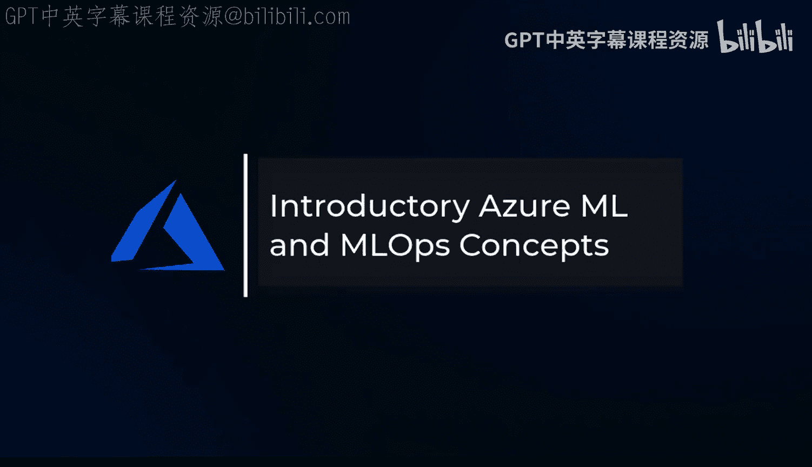

# 杜克大学｜机器学习运维｜DevOps⧸DataOps、Azure、MLFlow和抱脸｜MLOps ｜ Machine Learning Operations p132 55_05_02_基础Azure ML与MLOps概念.zh_en -BV1yE421c7uA_p132-

There are a few other components to Aure that are worth going into better detail。

 we'll go through a little bit of the open data sets and working as well with the SDK and you will see how all of these come together and are related to machine learning operations Azure machinech learning Studio has plenty of services available and it can be overwhelming to cover everything but I'll go through some of the most interesting things that are related to MLOs in the next few lessons。

