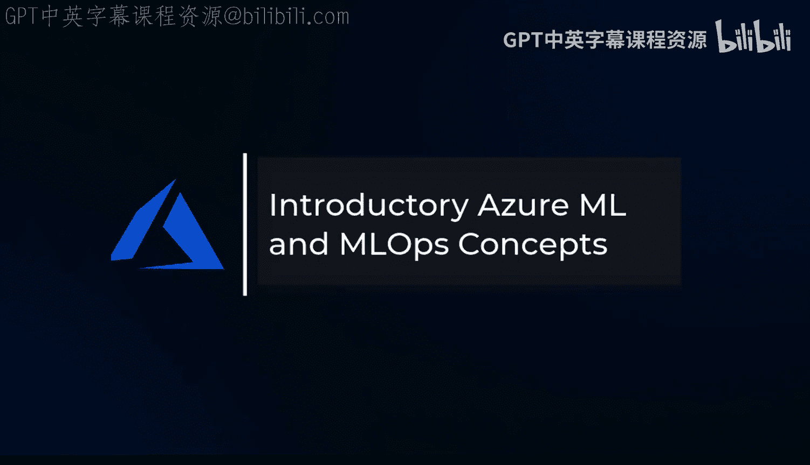

# 机器学习运维：55_05_02：基础Azure ML与MLOps概念 🧠

在本节课中，我们将学习Azure机器学习平台的核心组件及其与机器学习运维（MLOps）的关系。我们将了解Azure ML Studio提供的服务，并初步探索开放数据集和软件开发工具包（SDK）的使用。

---

Azure平台包含多个值得深入探讨的组件。

上一节我们介绍了Azure ML的概况，本节中我们将更详细地了解其核心服务。

Azure机器学习工作室提供了丰富的服务，虽然涵盖所有内容可能令人望而生畏，但在接下来的课程中，我们将重点介绍与MLOps最相关的一些核心功能。

我们将简要介绍开放数据集以及如何使用SDK进行工作。你将看到所有这些组件如何协同工作，并与Azure上的机器学习运维实践相关联。

以下是Azure ML中与MLOps相关的一些关键服务：

*   **计算资源**：用于模型训练和部署的托管计算环境，例如 `ComputeInstance` 或 `ComputeCluster`。
*   **数据存储与版本控制**：用于管理训练数据和跟踪数据集的变更。
*   **自动化机器学习（AutoML）**：自动进行模型选择和超参数调优的工具。
*   **模型注册表**：用于存储、版本控制和跟踪已训练模型的中央仓库。
*   **管道**：用于自动化端到端机器学习工作流的可重复步骤序列，例如 `Pipeline(steps=[data_prep_step, train_step])`。
*   **端点**：用于将模型部署为可通过HTTP请求访问的实时或批量推理服务。

---

本节课中，我们一起学习了Azure机器学习平台的基础概念及其与MLOps的关联。我们概述了关键组件，如计算资源、数据管理、自动化工具和模型部署服务，为后续深入实践这些工具奠定了基础。