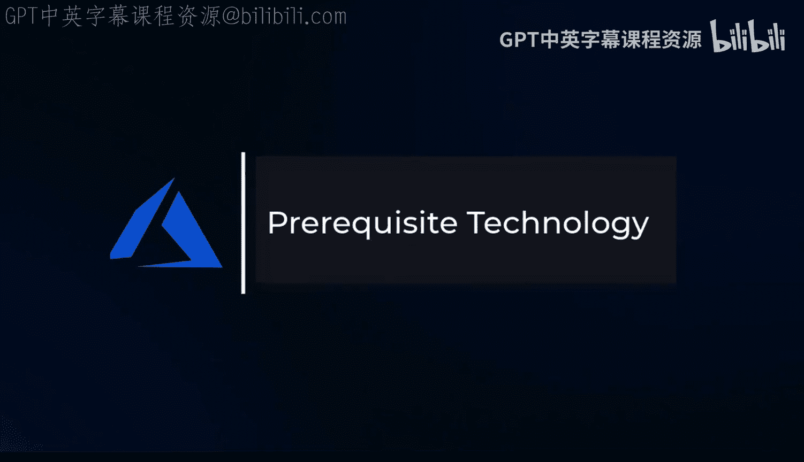
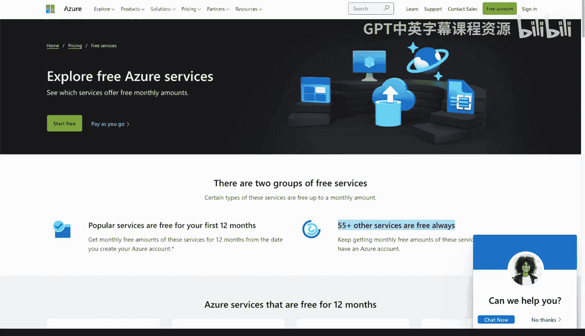
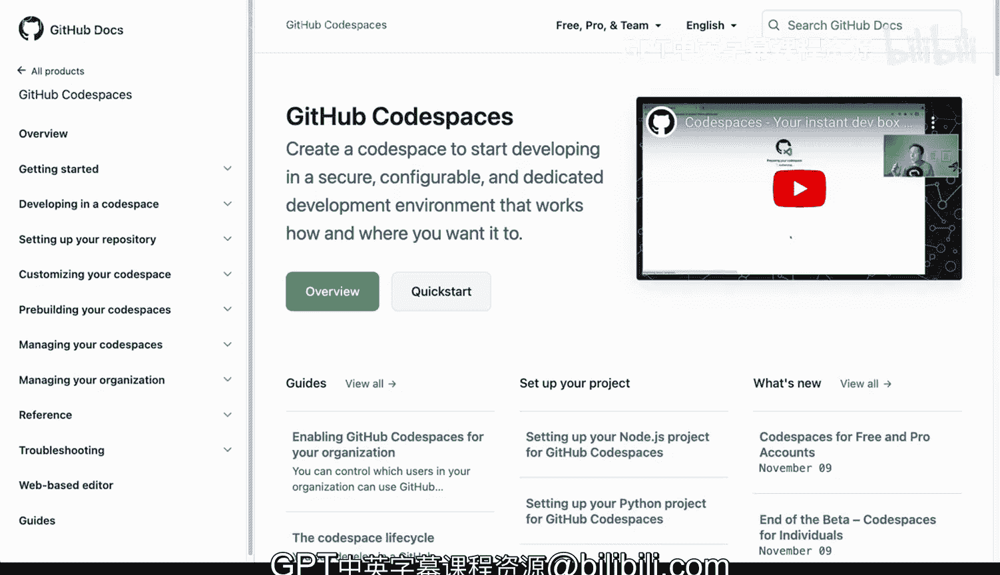

# 杜克大学｜机器学习运维｜DevOps⧸DataOps、Azure、MLFlow和抱脸｜MLOps ｜ Machine Learning Operations p133 56_05_03_先修技术.zh_en -BV1yE421c7uA_p133-

The prerequisite technologies are very simple to get started for studying for the Azure Asociate Data scientistient exam DP 100 to start with。

 we can dive into an Azure free tier account。 So when you get a free tier account。

 the key goal here is that if you look at the services available。

 You can get them available for free for 12 months。

 Most of the services are free that you would need to use。

And you can actually pay as you go after that， so that's probably a good place to start when you're studying for the exam。

Second， another powerful interface is the GitHub account and if you have a GitHub account and you use codespaces you can develop against the Azure API and this is really a powerful way to study for the exam we take a look at codespaces。

 you can create a codespace to start developing really in a cloud based environment and integrate it very deeply with Azure and this is a great place to keep your code samples。

